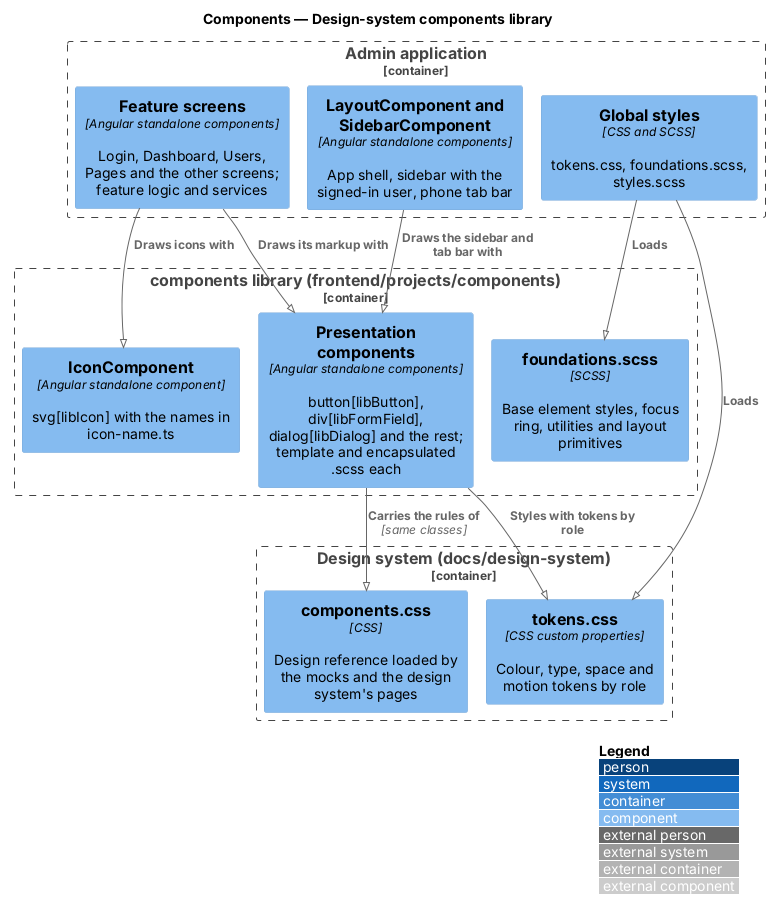
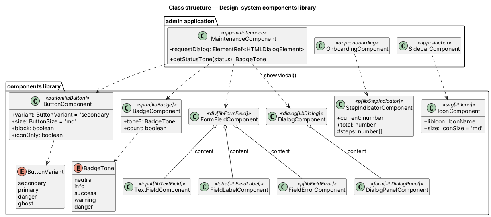

# Design-system components library

## Overview

The admin application draws every screen with the design system in
`docs/design-system`. Until now each admin template wrote the system's
markup by hand (`<button class="btn btn--primary">`, a `.field` with its
label, help and error, the `.dialog > .dialog__panel` structure) and the
admin loaded `docs/design-system/assets/components.css` globally
(ADR 0009). This design moves those presentation pieces into Angular
components in the `components` library, `frontend/projects/components`, and
has the admin's feature and layout templates use them. Nothing an admin sees
or does changes: the look in light and dark, the copy, the keyboard and
screen-reader behaviour, and the layout at every width and at 400% zoom stay
as they were. The decisions are recorded in ADR 0010.

Terms used in this design:

- **library component** — an Angular component in
  `frontend/projects/components/src/lib/<name>/` with its class, a `.html`
  template and a `.scss` file, exported from `public-api.ts`
- **host** — the element a component's attribute selector matches, for
  example the `<button>` in `<button libButton>`; it stays the native
  element
- **foundations** — the global rules that style plain elements and page
  layout rather than a component, in
  `frontend/projects/components/src/styles/foundations.scss`
- **design reference** — `docs/design-system/assets/components.css`, which
  the mocks and the design system's pages keep loading

## Description

### Library layout

Each folder under `frontend/projects/components/src/lib/` holds one design
system component and its parts, named after the design system page. Every
part has its own class in a kebab-case file with a separate template and
stylesheet, for example `button/button.component.ts`,
`button/button.component.html` and `button/button.component.scss`. Small
union types for inputs sit beside them (`button/button-variant.ts`). Every
folder has a vitest spec.

All components are standalone, use `ChangeDetectionStrategy.OnPush` and
signal inputs, and have no outputs: events come from the native host
(`(click)`, `(ngSubmit)`, `(close)`). A component's selector is an attribute
on the native element it draws, so the host keeps its role, keyboard
behaviour, form binding (`formControlName`, `ngModel`), `routerLink`,
`aria-*` and `data-testid`. The host carries the design system's class names
(`btn`, `field__label`), and inputs choose the modifiers. Boolean inputs
accept a bare attribute (`
`). Components hold no business
rules and do not use the `api` project.

### Components

Content is the host's own children, projected with `<ng-content />`
("default"). Pages are under `docs/design-system/components/` unless they
start with `foundations/`.

| Component | Selector | Inputs | Content | Design system page |
|-----------|----------|--------|---------|--------------------|
| `AlertActionsComponent` | `div[libAlertActions]` | none | default | `alert.html` |
| `AlertBodyComponent` | `div[libAlertBody]` | none | default | `alert.html` |
| `AlertTitleComponent` | `p[libAlertTitle]` | none | default | `alert.html` |
| `AlertComponent` | `div[libAlert]` | `tone` (required) | default | `alert.html` |
| `AvatarImageComponent` | `img[libAvatarImage]` | none | none | `avatar.html` |
| `AvatarComponent` | `span[libAvatar], img[libAvatar]` | `size` | default | `avatar.html` |
| `BadgeComponent` | `span[libBadge]` | `tone`, `count` | default | `badge.html` |
| `ButtonComponent` | `button[libButton], a[libButton], label[libButton]` | `variant`, `size`, `block`, `iconOnly` | default | `button.html` |
| `CardTitleComponent` | `h2[libCardTitle], h3[libCardTitle]` | none | default | `card.html` |
| `CardComponent` | `div[libCard], section[libCard], article[libCard], form[libCard], fieldset[libCard]` | `flush` | default | `card.html` |
| `CheckboxTextComponent` | `span[libCheckboxText]` | none | default | `checkbox.html` |
| `CheckboxComponent` | `label[libCheckbox]` | none | default | `checkbox.html` |
| `ChipComponent` | `button[libChip]` | none | default | `chip.html` |
| `DescriptionListComponent` | `dl[libDescriptionList]` | `horizontal` | default | `description-list.html` |
| `DialogBodyComponent` | `div[libDialogBody]` | none | default | `dialog.html` |
| `DialogFooterComponent` | `div[libDialogFooter]` | none | default | `dialog.html` |
| `DialogHeaderComponent` | `div[libDialogHeader]` | none | default | `dialog.html` |
| `DialogIconComponent` | `div[libDialogIcon]` | none | default | `dialog.html` |
| `DialogPanelComponent` | `div[libDialogPanel], form[libDialogPanel]` | none | default | `dialog.html` |
| `DialogTitleComponent` | `h2[libDialogTitle]` | none | default | `dialog.html` |
| `DialogComponent` | `dialog[libDialog]` | none | default | `dialog.html` |
| `DividerComponent` | `hr[libDivider]` | none | none | `divider.html` |
| `EmptyStateActionsComponent` | `div[libEmptyStateActions]` | none | default | `empty-state.html` |
| `EmptyStateIconComponent` | `div[libEmptyStateIcon], span[libEmptyStateIcon]` | none | default | `empty-state.html` |
| `EmptyStateTextComponent` | `p[libEmptyStateText]` | none | default | `empty-state.html` |
| `EmptyStateTitleComponent` | `h2[libEmptyStateTitle]` | none | default | `empty-state.html` |
| `EmptyStateComponent` | `div[libEmptyState]` | none | default | `empty-state.html` |
| `FieldErrorComponent` | `p[libFieldError]` | none | default | `form-field.html` |
| `FieldHelpComponent` | `p[libFieldHelp]` | none | default | `form-field.html` |
| `FieldLabelComponent` | `label[libFieldLabel], legend[libFieldLabel]` | none | default | `form-field.html` |
| `FormFieldComponent` | `div[libFormField]` | none | default | `form-field.html` |
| `IconComponent` | `svg[libIcon]` | `libIcon` (required), `size` | none | `foundations/iconography.html` |
| `InlineStatusComponent` | `p[libInlineStatus]` | none | default | `inline-message.html` |
| `ListBodyComponent` | `div[libListBody], span[libListBody]` | none | default | `list.html` |
| `ListItemComponent` | `li[libListItem], button[libListItem]` | none | default | `list.html` |
| `ListMetaComponent` | `div[libListMeta], span[libListMeta], p[libListMeta]` | none | default | `list.html` |
| `ListTitleComponent` | `div[libListTitle], span[libListTitle], p[libListTitle], h3[libListTitle], button[libListTitle]` | none | default | `list.html` |
| `ListComponent` | `ul[libList], ol[libList]` | none | default | `list.html` |
| `LogoMarkComponent` | `span[libLogoMark]` | none | none | `logo-mark.html` |
| `MetricCardIconComponent` | `span[libMetricCardIcon]` | `tone` | default | `metric-card.html` |
| `MetricCardComponent` | `div[libMetricCard]` | none | default | `metric-card.html` |
| `StatLabelComponent` | `span[libStatLabel]` | none | default | `metric-card.html` |
| `StatValueComponent` | `span[libStatValue]` | none | default | `metric-card.html` |
| `StatComponent` | `span[libStat]` | none | default | `metric-card.html` |
| `NavLinkComponent` | `a[libNavLink]` | none | default | `sidebar.html` |
| `PaginationLinkComponent` | `button[libPaginationLink]` | none | default | `pagination.html` |
| `PaginationListComponent` | `ul[libPaginationList]` | none | default | `pagination.html` |
| `PaginationComponent` | `nav[libPagination]` | none | default | `pagination.html` |
| `PhotoPickerActionsComponent` | `div[libPhotoPickerActions]` | none | default | `photo-picker.html` |
| `PhotoPickerBodyComponent` | `div[libPhotoPickerBody]` | none | default | `photo-picker.html` |
| `PhotoPickerComponent` | `div[libPhotoPicker]` | none | default | `photo-picker.html` |
| `PictureListAddComponent` | `div[libPictureListAdd]` | none | default | `picture-list.html` |
| `PictureListChoiceComponent` | `button[libPictureListChoice]` | none | default | `picture-list.html` |
| `PictureListGridComponent` | `ul[libPictureListGrid]` | none | default | `picture-list.html` |
| `PictureListItemComponent` | `li[libPictureListItem]` | none | default | `picture-list.html` |
| `PictureListNoteComponent` | `span[libPictureListNote]` | none | default | `picture-list.html` |
| `PictureListThumbComponent` | `div[libPictureListThumb], span[libPictureListThumb], a[libPictureListThumb]` | none | default | `picture-list.html` |
| `PictureListComponent` | `div[libPictureList]` | none | default | `picture-list.html` |
| `ProgressComponent` | `div[libProgress]` | `value` (required) | none | `progress.html` |
| `RadioTextComponent` | `span[libRadioText]` | none | default | `radio-group.html` |
| `RadioComponent` | `label[libRadio]` | none | default | `radio-group.html` |
| `SearchFieldComponent` | `div[libSearchField]` | none | default | `search-field.html` |
| `SelectComponent` | `select[libSelect]` | none | default | `select.html` |
| `SidebarBrandComponent` | `a[libSidebarBrand]` | none | default | `sidebar.html` |
| `SidebarFooterComponent` | `div[libSidebarFooter]` | none | default | `sidebar.html` |
| `SidebarNavComponent` | `nav[libSidebarNav]` | none | default | `sidebar.html` |
| `SidebarUserNameComponent` | `span[libSidebarUserName]` | none | default | `sidebar.html` |
| `SidebarUserRoleComponent` | `span[libSidebarUserRole]` | none | default | `sidebar.html` |
| `SidebarUserComponent` | `div[libSidebarUser]` | none | default | `sidebar.html` |
| `SidebarComponent` | `aside[libSidebar]` | none | default | `sidebar.html` |
| `SkipLinkComponent` | `a[libSkipLink]` | none | default | `skip-link.html` |
| `LoadingComponent` | `div[libLoading]` | none | default | `spinner.html` |
| `SpinnerComponent` | `span[libSpinner]` | `size` | default | `spinner.html` |
| `StepIndicatorComponent` | `p[libStepIndicator]` | `current` (required), `total` (required) | default | `step-indicator.html` |
| `SwitchComponent` | `label[libSwitch]` | none | default | `switch.html` |
| `TabBarComponent` | `nav[libTabBar]` | none | default | `tab-bar.html` |
| `TableWrapComponent` | `div[libTableWrap]` | `flush` | default | `table.html` |
| `TableComponent` | `table[libTable]` | none | default | `table.html` |
| `TabPanelComponent` | `div[libTabPanel]` | none | default | `tabs.html` |
| `TabComponent` | `button[libTab]` | none | default | `tabs.html` |
| `TabsComponent` | `div[libTabs]` | `pill` | default | `tabs.html` |
| `TextFieldComponent` | `input[libTextField]` | none | none | `text-field.html` |
| `TextareaComponent` | `textarea[libTextarea]` | none | default | `textarea.html` |
| `TopBarBrandComponent` | `span[libTopBarBrand]` | none | default | `top-bar.html` |
| `TopBarSpacerComponent` | `span[libTopBarSpacer]` | none | default | `top-bar.html` |
| `TopBarComponent` | `header[libTopBar]` | none | default | `top-bar.html` |

Inputs and their values:

- `ButtonComponent`: `variant` is `secondary` (default), `primary`,
  `danger` or `ghost`; `size` is `sm`, `md` (default) or `lg`; `block` fills
  the width; `iconOnly` draws a square icon button that names itself with
  `aria-label`.
- `BadgeComponent`: `tone` is `neutral`, `info`, `success`, `warning` or
  `danger`; `count` draws a number badge.
- `AlertComponent`: `tone` is `success` or `danger`. The app sets
  `role="alert"` or a live region.
- `AvatarComponent`: `size` is `sm`, `md` (default), `lg` or `xl`.
- `MetricCardIconComponent`: `tone` is `accent` (default), `warning`,
  `success` or `info`.
- `IconComponent`: `libIcon` is an `IconName` from `icon/icon-name.ts`;
  `size` is `sm`, `md` (default) or `lg`.
- `SpinnerComponent`: `size` is `sm` or `md` (default).
- `ProgressComponent`: `value` is the percentage, reported as
  `aria-valuenow` on the `progressbar` host.
- `StepIndicatorComponent`: `current` and `total` draw the decorative dots;
  the projected text ("Step 2 of 4") is what is read.
- `CardComponent` and `TableWrapComponent`: `flush` drops the padding or the
  border. `DescriptionListComponent`: `horizontal` puts terms beside their
  details from 40rem. `TabsComponent`: `pill` draws the tabs as pills.

Hosts that set ARIA themselves: `IconComponent`, `SpinnerComponent`,
`LogoMarkComponent`, `MetricCardIconComponent` and `DialogIconComponent` are
`aria-hidden`; `SearchFieldComponent` is a `search` landmark;
`TabsComponent`, `TabComponent` and `TabPanelComponent` have the `tablist`,
`tab` and `tabpanel` roles (the app sets `aria-selected`, `aria-controls`
and the keyboard handling); `ProgressComponent` is a `progressbar` from 0 to
100. These match the attributes the admin markup already had.

### How the styles move

Each component's `.scss` holds the rules from `components.css` that style
it, in their order there, with the design tokens by role:

- The block's own rules use `:host`, and state rules use `:host(:hover)`,
  `:host([aria-current='page'])` and so on.
- Modifiers use `:host(:where(.btn--primary))`, so they keep the specificity
  they had in `components.css` and a later state rule still wins.
- A rule that styles a component inside another sits in the inner
  component's file: `.btn :host` in the icon, `.app-shell :host` in the
  sidebar, `.search :host` in the text field.
- Native children the app projects are styled with `:host ::ng-deep`, for
  example the table's cells, the checkbox's `<input>` and the description
  list's `<dt>` and `<dd>`.
- Shared looks are SCSS mixins beside the component: `card/_card.scss`
  (the card surface, also used by the metric card) and
  `text-field/_text-control.scss` (text fields and text areas).
- `@keyframes` live in the component that animates, so Angular scopes their
  names.
- The `data-state` documentation hooks, the documentation-only `--static`
  variants and the rules for variants the admin does not use (such as
  `.input--sm` and `.spinner--lg`) are left out.

The native-dialog adapter that `projects/admin/src/styles.scss` held moves
into `dialog/dialog.component.scss`: the dialog fills the viewport, a closed
dialog is hidden, and `::backdrop` uses `--color-bg-backdrop`.

Layout used by one admin screen moves into that screen's stylesheet:
`.app-shell` and `.has-tabbar` into `layout/layout.component.scss`,
`.wizard` into `features/onboarding/onboarding.component.scss` and
`.metric-grid` into `features/dashboard/dashboard.component.scss`.

### What the admin loads globally

The admin's `angular.json` styles are, in order:

1. `../docs/design-system/tokens/tokens.css` — the design tokens.
2. `projects/components/src/styles/foundations.scss` — box sizing, the base
   element styles (body, headings, paragraphs, images), links, the focus
   ring, `.visually-hidden`, the text utilities (`.text-muted`,
   `.text-caption`, `.overline`, `.truncate`), the layout primitives
   (`.container`, `.stack`, `.cluster`, `.grid`, the column spans,
   `.page-header`, `.section`, `.auth-layout`, `.auth-card`), `fieldset` and
   `legend`, `.form-actions`, `.form-summary`, and the reduced-motion rule.
3. `projects/admin/src/styles.scss` — the form-control font reset.

The admin no longer loads `components.css`.

### How the admin consumes the library

The workspace `tsconfig.json` maps `components` to
`./projects/components/src/public-api.ts`. The admin imports components with
`import { ButtonComponent } from 'components'` and lists them in each
standalone component's `imports`. Because the path points at the source:

- `npm run start:admin` (`ng serve admin`) and the Playwright web server
  that runs it compile the library with the admin and reload on library
  changes.
- `ng build admin` and `ng test admin` need no library build first.
- `npm run build` still runs `ng build components`, which builds the
  package with ng-packagr into `dist/components`.

`ng test components` runs the library specs with vitest
(`@angular/build:unit-test`), and `npm test` runs it before the app tests.

### Components left in the apps

| Left in the app | Reason |
|-----------------|--------|
| The feature screens (`LoginComponent`, `UsersComponent`, `PagesComponent` and the rest) | They hold feature logic and call services from the app. |
| `LayoutComponent` (`app-layout`) | Layout used once: the app shell grid with the sidebar, the main region and the phone tab bar. Its links come from the app's route list. |
| `SidebarComponent` (`app-sidebar`) | Holds feature logic (the signed-in user, sign-out and the app's links). It draws the library's `aside[libSidebar]` and its parts. |
| `PhotoPickerComponent` (`app-photo-picker`, in `features/website/photo-picker/`) | Calls the assets service and holds the choose-or-upload flow. It draws the library's picture list. |
| `.wizard` (onboarding) | Used once and only layout. |
| `.metric-grid` (dashboard) | Used once and only layout. |
| `.app-shell` and `.has-tabbar` (layout) | Used once and only layout. |
| Links and headings | Plain `<a>` and `<h1>`–`<h4>` styled by the foundations; the design system's link page says links take no class. |
| Layout primitives, utilities and form layout | Foundations, not components. |

Not built, because the admin does not use them: toast, tooltip, menu,
breadcrumb, skeleton, banner, input group, error page and the danger zone.
The public app does not use the library; moving it is deferred.

### Tests

Each library folder has a vitest spec (`<folder>.component.spec.ts`) that
renders the components on their native host element and checks the role,
the classes and ARIA that the inputs set, and the native behaviour the host
keeps. The admin Playwright suite in `e2e/tests/admin/`, including
`reflow.spec.ts`, is the regression net for the screens.

## Requirements

| L2 ID | Refines (L1) | Requirement |
|-------|--------------|-------------|
| `L2-REQ-054` | `L1-REQ-013` | The system shall provide an authenticated admin backend for staff, board members, and administrators. |
| `L2-REQ-090` | `L1-REQ-013` | Every screen of both apps stays usable at 400% zoom: one column, no sideways scrolling, nothing lost. |

This design adds no behaviour; it changes where the admin's presentation
markup and styles live.

## Diagrams

The component view shows the admin screens and layout using the library's
components, which are styled by their own stylesheets on top of the global
tokens and foundations. The design system's `components.css` stays the
design reference for the mocks.

The class diagram shows a sample of the library's components with their
inputs and the admin components that use them.

