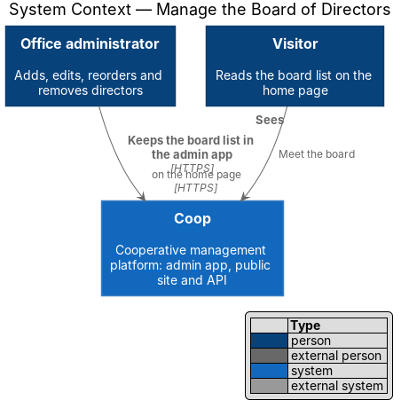
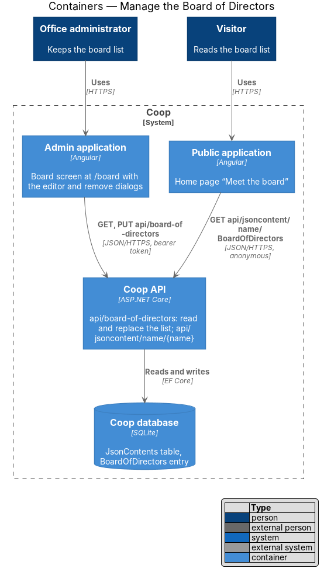
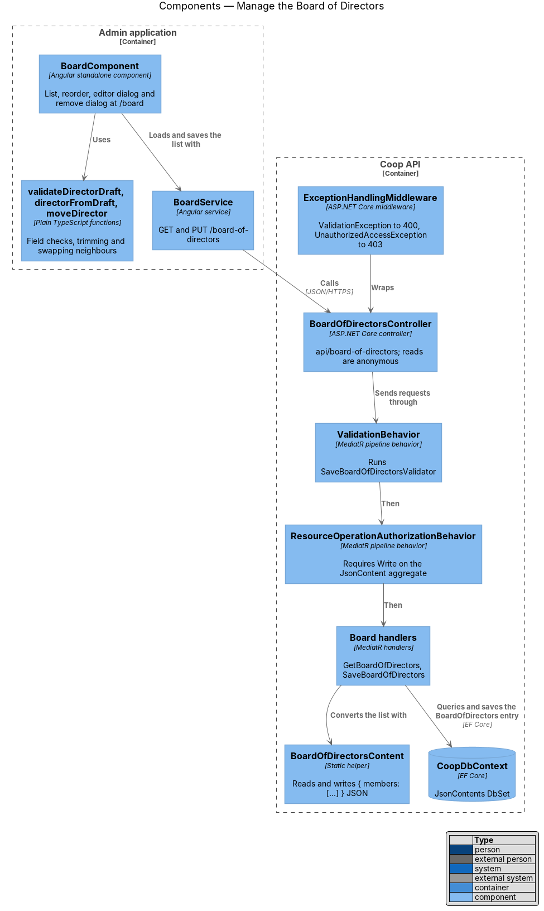
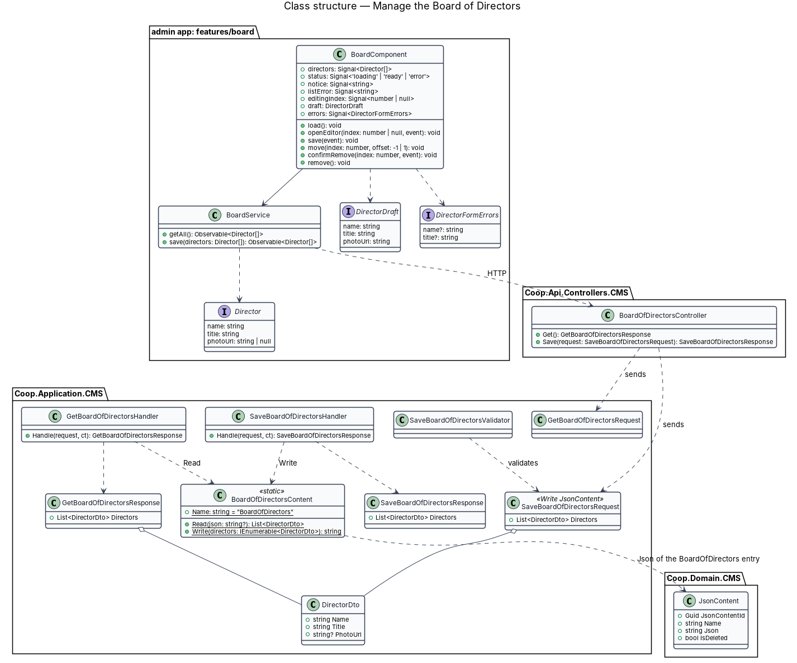
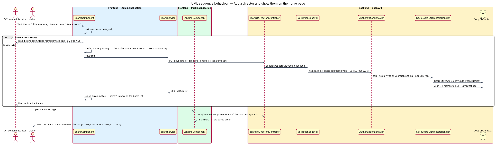
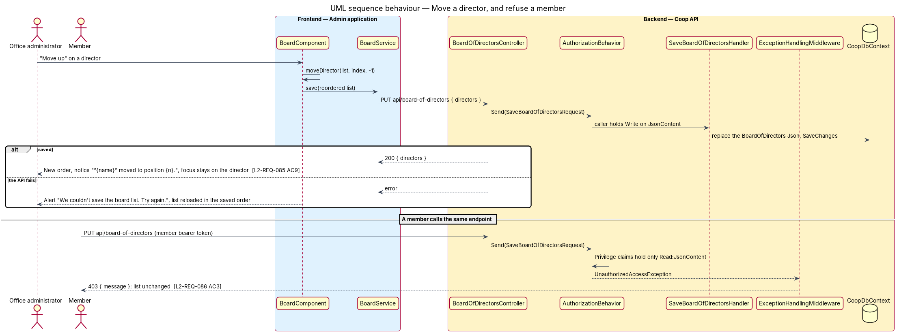

# Manage the Board of Directors

## Overview

The public home page lists the co-operative's directors under "Meet the board"
(`L2-REQ-070`). Office administrators keep that list from the "Board" screen
of the admin application at `/board`, drawn in `docs/mocks/pages/admin-board/`
with its dialogs in `docs/mocks/dialogs/admin-director-editor/` and
`docs/mocks/dialogs/admin-director-remove/`. After the yearly election the
office adds the new directors, removes those who stood down and puts the list
in order; each change is saved at once, so the website shows the new board the
same afternoon.

The feature belongs to the admin-app subsystem of Coop and to the CMS module
of the API. It reuses the `BoardOfDirectors` JSON content entry that the home
page already reads (`L2-REQ-046`), so the public application does not change.
The admin application's own landing page at `/` lists the same directors
under "Board of Directors": it reads them through `BoardService.getAll()`
(`GET api/board-of-directors`), so it never shows a different board.

Terms used in this design:

- **director** — person on the board list with a name, a role on the board
  (for example President or Treasurer) and an optional photograph address
- **board list** — the ordered list of directors; the order is the order the
  home page shows
- **photograph address** — URL of a portrait, usually one served by the asset
  library at `api/digitalasset/serve/{id}`; without one the home page shows
  the director's initials
- **`BoardOfDirectors` entry** — the JSON content entry named
  `BoardOfDirectors`, holding `{ "members": [{ "name", "title", "photoUrl" }] }`
- **editor dialog** — modal dialog that adds or edits one director
- **privilege** — pair of an access right (Read, Write, Create, Delete) and
  an aggregate name held by a role; the `JsonContent` aggregate governs this
  feature

## Description

### API

`BoardOfDirectorsController`
(`backend/src/Coop.Api/Controllers/CMS/BoardOfDirectorsController.cs`)
exposes `api/board-of-directors`. It translates HTTP to MediatR requests and
holds no rules:

| Route | Access | Request |
|-------|--------|---------|
| `GET api/board-of-directors` | anonymous | `GetBoardOfDirectorsRequest` → `{ directors: DirectorDto[] }` |
| `PUT api/board-of-directors` | `Write` on `JsonContent` | `SaveBoardOfDirectorsRequest { directors }` → `{ directors }` |

The whole list travels in one `PUT`, in order. Adding, editing, moving and
removing a director are all the same request with a different list, so there
is one rule set and one authorization check, and sending the same list twice
leaves the same list.

`DirectorDto` (`Coop.Application/CMS/Dtos/DirectorDto.cs`) holds `Name`,
`Title` and `PhotoUrl`. `BoardOfDirectorsContent`
(`Coop.Application/CMS/Board/BoardOfDirectorsContent.cs`) converts between
the list and the entry's JSON. `Read` takes the `members` array, keeps members
with a name, reads the role from `title` (or `role`, which the first seed
used) and treats a blank photograph address as none; JSON it cannot read
yields an empty list. `Write` serialises `{ members }` with camel-case names,
which is the shape the home page's `boardMembersFrom` reads.

The handlers live in `backend/src/Coop.Application/CMS/Board/`:

- `GetBoardOfDirectorsHandler` loads the `BoardOfDirectors` entry that is not
  deleted and returns `BoardOfDirectorsContent.Read` of its JSON, or an empty
  list when there is no entry.
- `SaveBoardOfDirectorsHandler` trims each name, role and photograph address,
  creates the entry when it is missing, replaces its JSON with
  `BoardOfDirectorsContent.Write` and saves.

`SaveBoardOfDirectorsValidator` (FluentValidation) requires a list and, for
each director, a name and a role of at most 100 characters and a photograph
address of at most 2048 characters. `ValidationBehavior` runs it before the
handler, so an invalid list changes nothing.

`SaveBoardOfDirectorsRequest` carries
`[AuthorizeResourceOperation(AccessRight.Write, Constants.Aggregates.JsonContent)]`.
`ResourceOperationAuthorizationBehavior` refuses a caller whose `Privilege`
claims do not reach `Write` on `JsonContent` with
`UnauthorizedAccessException`, and `ExceptionHandlingMiddleware` turns it into
403 and a `ValidationException` into 400. The seeded roles already hold the
`JsonContent` privilege at their level (SystemAdministrator `Delete`,
BoardMember `Create`, Staff and Support `Write`, Member `Read`), so no seed
change is needed.

### Admin application

`BoardComponent` (`frontend/projects/admin/src/app/features/board/`,
`board.component.ts`, `.html`, `.scss`) is the routed screen at `/board`,
reached from the "Board" sidebar link. It owns these signals: `directors`,
`status` (`loading`, `ready`, `error`), `notice` (the last success message),
`listError` (a failed move), `moving`, `editingIndex` (null while adding),
`errors`, `saving`, `saveFailed` and `removingIndex`, plus the `draft` the
editor binds to. The editor and the remove confirmation are native `<dialog>`
elements opened with `showModal()`, which trap focus, close on Escape and make
the page behind inert. Closing a dialog returns focus to the button that
opened it; after a removal focus goes to "Add director", because the opening
button has left the page.

Each card shows the photograph (or initials from `initialsOf`), the name, the
role, and Move up, Move down, Edit and Remove. Move up is disabled on the first
card and Move down on the last. After a move the focus stays on the moved
director's button in the same direction, or the other one when it has reached
the end. A failed move shows "We couldn't save the board list. Try again." and
reloads the saved order.

The rules beside the feature are plain functions: `validateDirectorDraft`
returns "Give the director's name" and "Give the director's role on the board"
for empty fields; `directorFromDraft` trims the fields and drops a blank
photograph address; `moveDirector` returns a copy of the list with one
director swapped with a neighbour. The server rules stay authoritative.

`BoardService` (`core/services/board.service.ts`) wraps `ApiService` for
`GET /board-of-directors` and `PUT /board-of-directors`. `Director`
(`core/models/director.ts`) and `DirectorDraft`
(`core/models/director-draft.ts`) are the two types the screen uses.

### Admin landing page

`LandingComponent` (`frontend/projects/admin/src/app/features/landing/`)
lists the directors from `BoardService.getAll()` under "Board of Directors"
and up to six documents from `DocumentService.getPublishedDocuments()` under
"Announcements" (`L2-REQ-101`). When a list is empty, or its request fails, the
section shows the `.empty` state drawn in
`docs/mocks/pages/admin-landing/empty.html` in place of the list card: "No
board members listed yet" or "No announcements yet", each with one line saying
when the list will fill (`L2-REQ-101` AC2, AC3).

### Public application

Nothing changes. `LandingComponent` reads
`api/jsoncontent/name/BoardOfDirectors` and shows one card per member in the
listed order, with the photograph from `photoUrl` or the initials
(`L2-REQ-070` AC2). When the list is empty it still falls back to the board
member profiles (`L2-REQ-070` AC3).

### Tests

Backend acceptance tests in `backend/tests/Coop.Api.Tests/BoardOfDirectorsTests.cs`
cover the API through HTTP over the in-memory database (ADR 0003): anonymous
reads, the list stored in the `BoardOfDirectors` entry, removal, reordering
and resending, validation, and the refusal of members and anonymous callers.
The Playwright `admin` project covers the screen in
`e2e/tests/admin/board.spec.ts` with selectors in `e2e/pages/admin/board.page.ts`;
the add, move and remove tests open the public home page in the same browser
context to check "Meet the board", and two tests open the admin landing page
(`e2e/pages/admin/landing.page.ts`) to check it shows the same list.
`e2e/tests/admin/landing.spec.ts` checks the landing page's empty board and
announcements states. The in-process mock API serves
`api/board-of-directors` from the same `BoardOfDirectors` entry with the same
role check.

## Requirements

| L2 ID | Refines (L1) | Requirement |
|-------|--------------|-------------|
| `L2-REQ-085` | `L1-REQ-010`, `L1-REQ-016` | The admin app shall let an office administrator add, edit, reorder and remove the directors that the public home page lists under "Meet the board", from a "Board" screen at `/board`. |
| `L2-REQ-086` | `L1-REQ-010`, `L1-REQ-016` | The API shall expose the board list at `/api/board-of-directors`, store it as the `BoardOfDirectors` JSON content entry that the home page reads, and restrict changes to roles that hold `Write` on the `JsonContent` aggregate. |
| `L2-REQ-101` | `L1-REQ-013` | The admin app's landing page shall list the Board of Directors and the co-op's announcements, and shall say plainly when either list is empty. |

## Diagrams

The system context places the office administrator, who keeps the board list,
beside the visitor who reads it on the home page.

The container view shows the admin application reading and replacing the list
through `api/board-of-directors`, and the public application reading the same
`BoardOfDirectors` entry through `api/jsoncontent/name/BoardOfDirectors`.

Inside the API, `BoardOfDirectorsController` sends requests through the
validation and authorization behaviors to the board handlers, which convert
the list with `BoardOfDirectorsContent`; inside the admin application,
`BoardComponent` uses `BoardService` and the plain helper functions.

The class diagram shows the stored entry, the two requests and their
handlers, and the admin screen with its service and types.

Adding a director checks the fields, sends the list with the new director at
the end, passes validation and authorization and replaces the entry; the next
visitor to the home page sees the director.

Moving a director swaps neighbours and saves the new order, or reloads the
saved order when the save fails; a member who calls the same endpoint is
refused before any handler runs.

