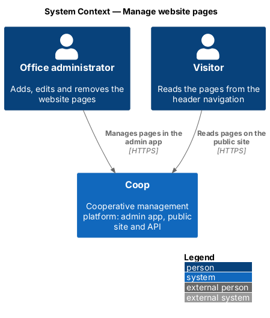
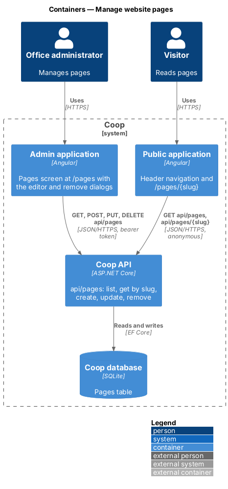
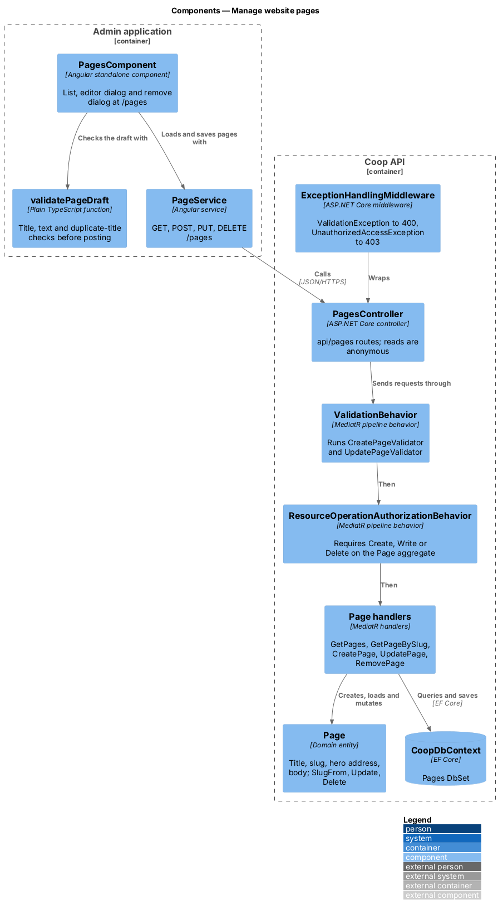
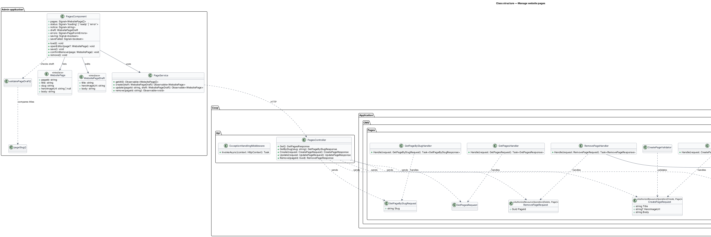
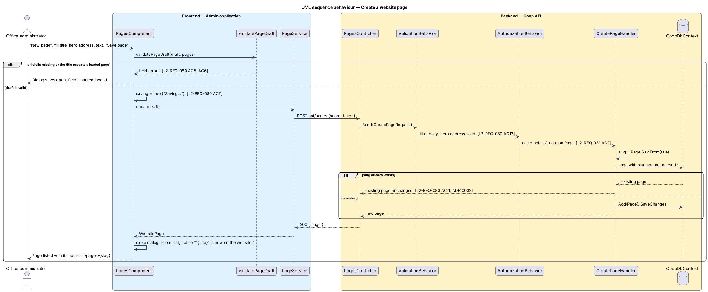
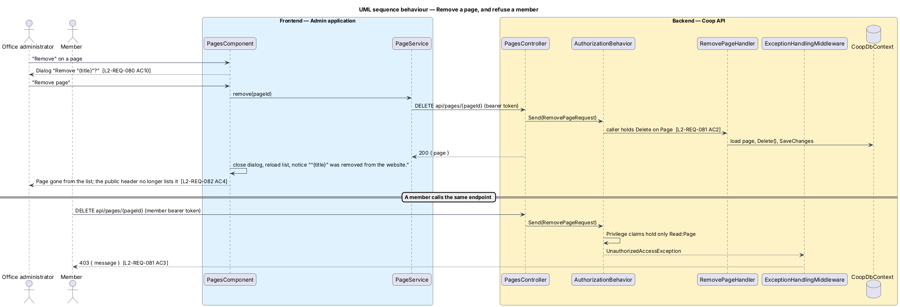

# Manage website pages

## Overview

Website pages are the content pages of the public site (About us, How to
apply, and whatever else the office decides) that visitors reach from the
header navigation. Office administrators add, edit and remove them from the
"Pages" screen of the admin application at `/pages`, drawn in
`docs/mocks/pages/admin-pages/` with its dialogs in
`docs/mocks/dialogs/admin-page-editor/` and
`docs/mocks/dialogs/admin-page-remove/`. The public application renders each
page at `/pages/{slug}` (see `../../public-app/show-content-page/`).

The feature belongs to the admin-app subsystem of Coop and to the CMS module
of the API. It is the first content type the office manages as a whole page
rather than as a named JSON block.

Terms used in this design:

- **website page** — page of the public site with a title, an optional hero
  photograph address with its description and an HTML body, stored as a `Page` entity
- **slug** — URL segment derived from the page title, for example `about-us`
  for "About us"; the public route is `/pages/{slug}`
- **hero photograph address** — URL of a photograph, usually one served by
  the asset library at `api/digital-asset/serve/{id}`, shown under the title
- **photo description** — the hero photograph's alternative text, required
  whenever the page has a photograph (`L2-REQ-097`)
- **page text** — HTML body the office writes in the editor; the public page
  renders it after sanitising
- **editor dialog** — modal dialog that creates or edits one page
- **privilege** — pair of an access right (Read, Write, Create, Delete) and
  an aggregate name held by a role; the `Page` aggregate governs this feature

## Description

### API

`PagesController` (`backend/src/Coop.Api/Controllers/CMS/PagesController.cs`)
exposes `api/pages`. It translates HTTP to MediatR requests and holds no
rules:

| Route | Access | Request |
|-------|--------|---------|
| `GET api/pages` | anonymous | `GetPagesRequest` → `{ pages: PageDto[] }` |
| `GET api/pages/{slug}` | anonymous | `GetPageBySlugRequest` → `{ page: PageDto }` or 404 |
| `POST api/pages` | `Create` on `Page` | `CreatePageRequest { title, heroImageUrl?, heroImageAlt?, body }` → `{ page }` |
| `PUT api/pages` | `Write` on `Page` | `UpdatePageRequest { pageId, title, heroImageUrl?, heroImageAlt?, body }` → `{ page }` |
| `DELETE api/pages/{pageId}` | `Delete` on `Page` | `RemovePageRequest` → `{ page }` |

`Page` (`backend/src/Coop.Domain/CMS/Page.cs`) holds `PageId`, `Title`,
`Slug`, `HeroImageUrl`, `HeroImageAlt`, `Body`, `CreatedOn` and `IsDeleted`. `Page.SlugFrom`
derives the slug: lower case, letters and digits kept, accents removed, other
runs collapsed to one hyphen, trimmed, at most 80 characters. `Update` sets
the title, slug, hero address, photo description and body together, and
keeps no description without a photograph; `Delete` sets `IsDeleted`.
`PageConfiguration` maps the entity with a required title of 120 characters,
a required slug of 80 characters, a hero address of 2048 characters and a
photo description of 250 characters.

The handlers live in `backend/src/Coop.Application/CMS/Pages/`:

- `GetPagesHandler` returns the pages that are not deleted, ordered by
  `CreatedOn`.
- `GetPageBySlugHandler` returns the page with the slug, or a null `Page`
  that the controller turns into 404.
- `CreatePageHandler` derives the slug and, when a page that is not deleted
  already has it, returns that page unchanged (ADR 0002). Otherwise it adds
  the page and saves.
- `UpdatePageHandler` loads the page by `PageId`, rejects a slug that another
  page that is not deleted already holds with a `ValidationException`, and
  saves the update.
- `RemovePageHandler` loads the page and calls `Delete`.

`CreatePageValidator` and `UpdatePageValidator` (FluentValidation) require a
title of at most 120 characters whose slug is not empty, a non-empty body,
a hero address of at most 2048 characters and, when there is a hero address,
a photo description of at most 250 characters (`PageRules.PageHeroImageAlt`). `ValidationBehavior` runs them
before every handler.

The three command requests carry
`[AuthorizeResourceOperation(AccessRight.X, Constants.Aggregates.Page)]`.
`ResourceOperationAuthorizationBehavior` reads the attribute and asks
`ResourceOperationAuthorizationHandler` whether the caller's `Privilege`
claims grant the access right on the aggregate. The handler parses each claim
in the `{AccessRight}:{Aggregate}` form that `AuthenticateHandler` issues; an
unparseable claim is ignored. A refused request throws
`UnauthorizedAccessException`.

`ExceptionHandlingMiddleware` (`backend/src/Coop.Api/Middleware/`) maps
`ValidationException` to 400 with the failure messages and
`UnauthorizedAccessException` to 403. It sits after CORS and before
authentication in `Program.cs`, so refused responses keep their CORS headers
and Serilog request logging records the real status.

`Constants.Aggregates.Page` joins `Aggregates.All`. `SeedData` grants the
`Page` privilege to each seeded role at the role's level (SystemAdministrator
`Delete`, BoardMember `Create`, Staff and Support `Write`, Member `Read`) and
adds a missing `Page` privilege to roles seeded before the aggregate existed,
so an existing development database works without a reset.

### Admin application

`PagesComponent` (`frontend/projects/admin/src/app/features/cms/pages/`,
`pages.component.ts`, `.html`, `.scss`) is the routed screen at `/pages`,
reached from the "Pages" sidebar link. It owns these signals: `pages`,
`status` (`loading`, `ready`, `error`), `notice` (the last success message),
`draft` (the fields of the editor), `errors` (per-field messages), `saving`,
`saveFailed` and `removing`. The editor and the remove confirmation are native
`<dialog>` elements opened with `showModal()`, which trap focus, close on
Escape and make the page behind inert. Closing a dialog returns focus to the
button that opened it.

The editor never shows the hero photograph's address. It shows the chosen
photograph as a thumbnail with "Current photo: {file name}" (or "Current
photo" when the address has no file name, or "No photo chosen yet"), a
"Choose photo" button that opens the shared `PhotoPickerComponent`
(`features/website/photo-picker/`, `L2-REQ-097` AC1) and, when a photograph
is chosen, a "Remove photo" button. Picking a different photograph clears its
description and moves focus to the description field.

`validatePageDraft` (`validate-page-draft.ts`) is a pure function that
returns the field errors: "Give the page a title", "Write something for the
page", "Describe this photo for people who cannot see it" when a hero
photograph address has no photo description, and "There is already a page
called “{title}”. Choose a different title." when `pageSlug` (`page-slug.ts`, the client copy of `Page.SlugFrom`)
matches another loaded page. The server rules stay authoritative; these
checks only avoid a round trip.

`PageService` (`core/services/page.service.ts`) wraps `ApiService` for
`GET /pages`, `POST /pages`, `PUT /pages` and `DELETE /pages/{id}`.
`WebsitePage` (`core/models/website-page.ts`) and `WebsitePageDraft`
(`core/models/website-page-draft.ts`) are the two types the screen uses.

Acceptance coverage is the Playwright `admin` project:
`e2e/tests/admin/pages.spec.ts` states intent and
`e2e/pages/admin/pages.page.ts` owns the selectors. The in-process mock API
serves `api/pages` with the same idempotent create and the same 403 for roles
below the required privilege. Backend acceptance tests in
`backend/tests/Coop.Api.Tests/PagesTests.cs` cover the API rules, including
the refusal of members and anonymous callers (ADR 0003).

## Requirements

| L2 ID | Refines (L1) | Requirement |
|-------|--------------|-------------|
| `L2-REQ-080` | `L1-REQ-010` | The admin app shall let an office administrator list, add, edit and remove the website pages that the public app shows (L2-REQ-083), from a "Pages" screen at `/pages`. |
| `L2-REQ-081` | `L1-REQ-010` | The API shall expose page management at `/api/pages` and restrict changes to roles that hold the matching privilege on the `Page` aggregate, enforced by the resource-operation authorization pipeline behavior. |

## Diagrams

The system context places the office administrator, who manages pages, beside
the visitor who reads them on the public site.

The container view shows the admin Angular application calling `api/pages`
on the Coop API, which stores pages in the SQLite database through EF Core;
the public application reads the same endpoint.

Inside the API, `PagesController` sends requests through the validation and
authorization behaviors to the page handlers, which work on the `Page`
entity; inside the admin application, `PagesComponent` uses `PageService`
and the draft validation function.

The class diagram shows the entity, the five requests and their handlers, and
the admin screen with its service and draft types.

Creating a page runs the client checks, posts the draft, passes validation
and authorization, derives the slug and either returns the existing page or
saves a new one.

Removing a page confirms in a dialog, deletes through the API and reloads the
list; a member or anonymous caller is refused before any handler runs.

