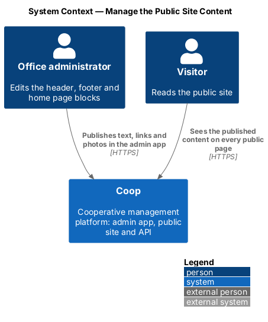
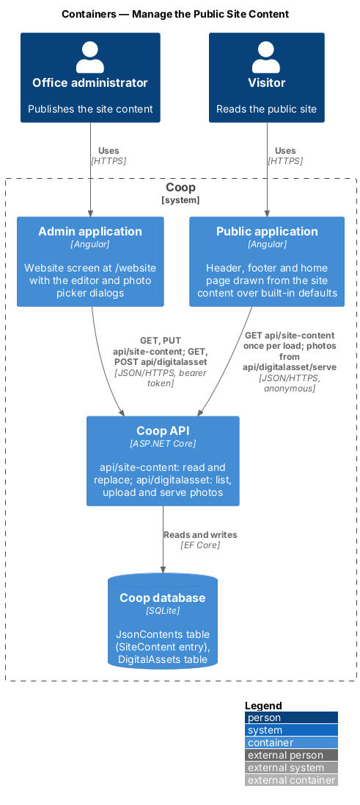
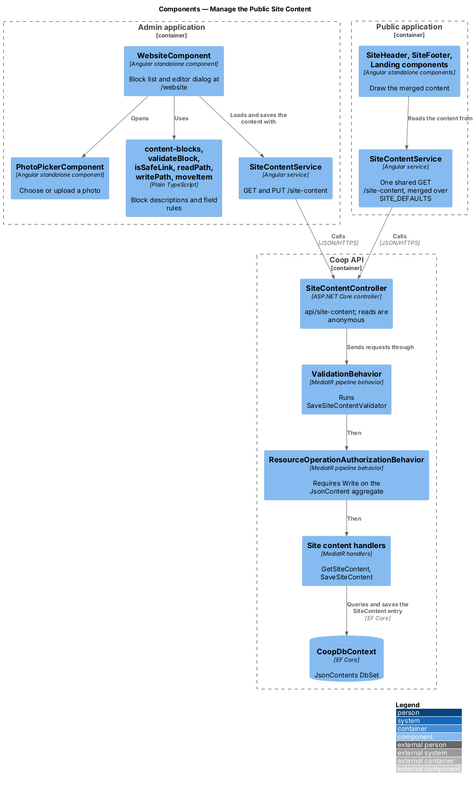
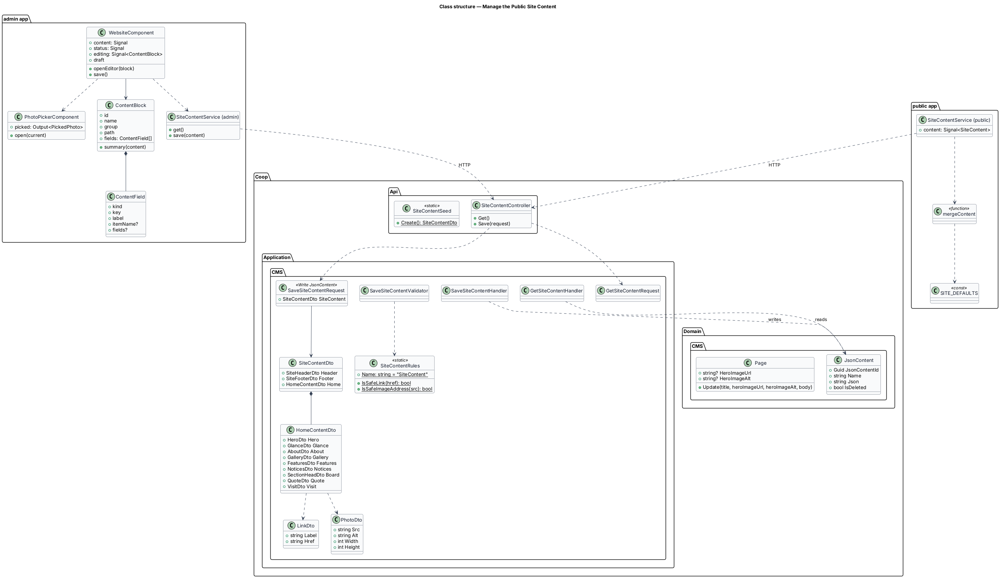
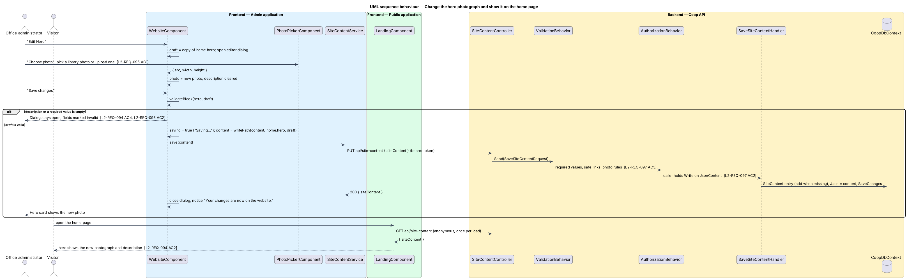
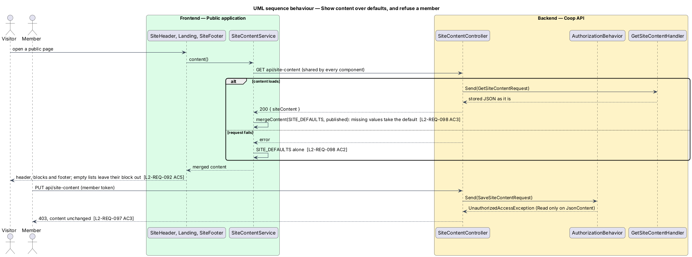

# Manage the Public Site Content

## Overview

Every image, link and piece of text that a visitor sees on the public site's
header, home page, website pages and footer comes from content that office
administrators publish in the admin application (`L1-REQ-020`). Before this
feature the copy, photograph addresses and link targets of the header, footer
and home page lived in the public application's code
(`layout/site-content.ts`, `pages/landing/landing-content.ts`), and only the
hero title and lead could be replaced through the `Hero` JSON content entry.

Office administrators keep the content from the "Website" screen of the admin
application at `/website`, drawn in `docs/mocks/pages/admin-website/` with its
dialogs in `docs/mocks/dialogs/admin-content-editor/` and
`docs/mocks/dialogs/admin-photo-picker/`. The screen lists the header, the
footer and each home page block; "Edit" opens a dialog holding every value of
that block, and saving publishes it at once.

The feature belongs to the admin-app subsystem of Coop, to the CMS module of
the API, and changes how the public application draws its shared header,
footer and home page. Website pages (`L2-REQ-080`), the board list
(`L2-REQ-085`) and published notices (`L2-REQ-032`) keep their own screens.
The member screens behind sign-in, the sign-in and registration screens, and
system messages such as validation, loading and error text stay in the
applications.

Terms used in this design:

- **site content** — the header, footer and home page content, stored
  together as the `SiteContent` JSON content entry (`L2-REQ-046`)
- **block** — one part of the site content edited as a unit: the header, the
  footer, or one home page block such as the hero or "A look around"
- **link** — a pair of a label and an address; the address is a site path
  starting with `/` (for example `/#visit`), an `http(s)://` address, a
  `mailto:` address or a `tel:` number
- **photo** — an image address with its description (alternative text) and
  intrinsic width and height; the address is a site path or an `http(s)://`
  address, usually one the asset library serves at
  `api/digitalasset/serve/{id}`
- **built-in default** — the copy the public application holds for a value
  that is missing from the published content; it matches the seeded content
- **editor dialog** — modal dialog that edits one block
- **photo picker** — modal dialog, stacked over the editor dialog, that
  chooses a photo from the Assets library or uploads a new one

## Description

### Stored content

The `SiteContent` entry holds one JSON object with three parts:

| Part | Blocks and values |
|------|-------------------|
| `header` | `siteName`, `siteSubtitle`, `menuLinks[]`, `signInLink`, `visitLink` |
| `footer` | `contactHeading`, `organisation`, `area`, `phone`, `email`, `siteLinksHeading`, `siteLinks[]`, `memberLinksHeading`, `memberLinks[]`, `copyright`, `websiteLine` |
| `home` | `hero` (`eyebrow`, `title`, `lead`, `badge`, `primaryAction`, `secondaryAction`, `photo`), `glance` (`figures[]` of `value`, `label`), `about` (`eyebrow`, `title`, `lead`, `values[]` of `icon`, `title`, `text`), `gallery` (`eyebrow`, `title`, `photos[]` of `photo`, `caption`, `size`), `features` (`rows[]` of `eyebrow`, `title`, `items[]`, `photo`), `notices` (`eyebrow`, `title`, `lead`, `emptyMessage`), `board` (`eyebrow`, `title`), `quote` (`text`, `attribution`, `photo`), `visit` (`eyebrow`, `title`, `lead`, `phone`, `hours`, `action`) |

A link is `{ label, href }` and a photo is `{ src, alt, width, height }`. A
value card's `icon` is one of `members`, `affordable` and `company`; a gallery
photo's `size` is `wide`, `tall` or `small`. Value-card colours follow position
(green, accent, plum, repeating) and feature rows alternate the photograph's
side by position, so neither is stored.

Rules (`L2-REQ-093` to `L2-REQ-097`):

- the site name, every block `title` (hero, who we are, a look around, each
  feature row, what's on, meet the board, visit or apply), the quotation text,
  each figure's value and label and each value card's title are required
- a link's label (at most 100 characters) and address (at most 2048
  characters) are required, and the address shall be a safe target
- a photo's address (at most 2048 characters, a site path or `http(s)://`)
  and description (at most 250 characters) are required, and its width and
  height lie between 1 and 10000
- every other text is optional and at most 2000 characters; lists may be
  empty, and the public site then leaves that block out

### API

`SiteContentController`
(`backend/src/Coop.Api/Controllers/CMS/SiteContentController.cs`) exposes
`api/site-content`. It translates HTTP to MediatR requests and holds no rules:

| Route | Access | Request |
|-------|--------|---------|
| `GET api/site-content` | anonymous | `GetSiteContentRequest` → `{ siteContent }`, 404 when the entry is missing |
| `PUT api/site-content` | `Write` on `JsonContent` | `SaveSiteContentRequest { siteContent }` → `{ siteContent }` |

`GetSiteContentHandler` returns the stored JSON as it is, so a value that an
older entry lacks stays absent and the public site can show its built-in
default for that value alone (`L2-REQ-098` AC3). `SaveSiteContentHandler`
creates the entry when it is missing, replaces its JSON with the serialised
`SiteContentDto` (camel-case names) and saves; sending the same content again
leaves the same content.

The DTOs live in `backend/src/Coop.Application/CMS/Dtos/`, one class per
file: `SiteContentDto`, `SiteHeaderDto`, `SiteFooterDto`, `HomeContentDto`,
`HeroDto`, `GlanceDto`, `FigureDto`, `AboutDto`, `ValueCardDto`,
`GalleryDto`, `GalleryPhotoDto`, `FeaturesDto`, `FeatureRowDto`,
`NoticesDto`, `SectionHeadDto` (meet the board), `QuoteDto`, `VisitDto`,
`LinkDto` and `PhotoDto`.

`SaveSiteContentValidator` (FluentValidation) applies the rules above through
`LinkValidator` and `PhotoValidator`, and `SiteContentRules`
(`Coop.Application/CMS/SiteContent/SiteContentRules.cs`) holds the shared
pieces: `IsSafeLink`, `IsSafeImageAddress`, the 2000-character text limit and
the messages. `ValidationBehavior` runs the validator before the handler, so
invalid content changes nothing.

`SaveSiteContentRequest` carries
`[AuthorizeResourceOperation(AccessRight.Write, Constants.Aggregates.JsonContent)]`.
`ResourceOperationAuthorizationBehavior` refuses a caller whose privileges do
not reach `Write` on `JsonContent`, and `ExceptionHandlingMiddleware` turns
that into 403 and a `ValidationException` into 400. The seeded roles already
hold the `JsonContent` privilege at their level, so no role change is needed.

`SiteContentSeed` (`backend/src/Coop.Api/SiteContentSeed.cs`) builds the
seeded content: every value the public site showed before this feature, with
the photographs addressed as the public application's own files
(`/own/hero.svg` and so on). `SeedData` adds the `SiteContent` entry only when
no entry of that name exists, so re-running the seed keeps saved content
(`L2-REQ-098` AC1). The obsolete `Hero` entry is no longer seeded or read.

### Website page photo description

`Page` gains `HeroImageAlt`, set by `Page.Update` alongside the hero photo
address and returned in `PageDto`. `PageRules.PageHeroImageAlt` requires a
description when an address is given and limits it to 250 characters; the
create and update validators apply it (`L2-REQ-080` AC13, `L2-REQ-095` AC4).
The admin page editor adds a "Photo description" field after the hero photo
address, and `ContentPageComponent` uses the description as the photo's
alternative text.

### Admin application

`WebsiteComponent` (`frontend/projects/admin/src/app/features/website/`,
`website.component.ts`, `.html`, `.scss`) is the routed screen at `/website`,
reached from the "Website" sidebar link after "Board". It owns these signals:
`content` (the loaded site content), `status` (`loading`, `ready`, `error`),
`notice`, `editing` (the block being edited), `errors`, `saving` and
`saveFailed`, plus the `draft` the editor binds to. The screen groups the
blocks under "On every page" and "Home page", each as a card with its name, a
one-line summary, a thumbnail of its first photo where it has one, and
"Edit".

The blocks are described as data in `content-blocks.ts`: each
`ContentBlock` has an `id`, a `name`, a `group`, the `path` of its object
inside the site content (for example `home.hero`), a `summary` function and
its `fields`. A `ContentField` has a `kind` — `text`, `textarea`, `lines`
(one item per line), `link`, `photo`, `choice` or `list` — a `key`, a
`label`, and for a list the `itemName`, the item `fields` and a `newItem`
factory. The editor dialog renders the fields of any block from this data, so
the header, footer and nine home page blocks share one dialog and one set of
rules. Lists hold flat items, and each item has "Move up", "Move down" and
"Remove", with "Add {item name}" after the list.

The rules beside the feature are plain functions: `validateBlock` walks the
fields of a block and returns a message per field path (`Fill in “{label}”`,
`Fill in “{label}” for {item name} {n}`, "Describe this photo for people who
cannot see it", "Keep the description under 250 characters", and "Use a page
on this site, a web address, an e-mail address or a phone number.");
`isSafeLink` and `isSafeImageAddress` match the server's rules;
`readPath` and `writePath` read and replace a block inside a copy of the site
content; `moveItem` swaps a list item with a neighbour. The server rules stay
authoritative.

Saving sends the whole site content with the edited block replaced. The save
button reads "Saving…" and is disabled until the API answers; on success the
dialog closes and "Your changes are now on the website." is announced; on
failure the dialog keeps the entered values and shows "We couldn't save your
changes. Try again." Escape and "Cancel" close the dialog without saving, and
focus returns to the block's "Edit" button.

`PhotoPickerComponent` (`features/website/photo-picker/`) is a second native
`<dialog>` opened over the editor. It lists the image assets from
`DigitalAssetService` as buttons, marks the current photo with
`aria-pressed`, and offers "Upload a new photo" for a JPEG, PNG or WebP file
of at most 10 MB. Picking or uploading emits `{ src, width, height }`; the
editor puts the photo in the field and clears its description, so the
description is written for the new photo. Width and height come from the
loaded image's natural size. A photo address that is a site path is previewed
from the public site's origin (`PUBLIC_SITE_URL`).

`SiteContentService` (`core/services/site-content.service.ts`) wraps
`ApiService` for `GET /site-content` and `PUT /site-content`. Both dialogs are
native `<dialog>` elements opened with `showModal()`, which trap focus, close
on Escape and make the page behind inert.

### Public application

`SiteContentService` (`core/services/site-content.service.ts`) requests
`api/site-content` once per application load and shares the answer, so the
header, footer and page blocks of a page cost one request (`L2-REQ-097` AC6).
`mergeContent` lays the published content over `SITE_DEFAULTS`
(`core/site-content/site-defaults.ts`, the former header, footer and home page
copy) value by value: a published string, even an empty one, wins; a missing
value takes the default; a published list replaces the default list; a
failed request yields the defaults (`L2-REQ-098` AC2, AC3).

`SiteHeaderComponent`, `SiteFooterComponent` and `LandingComponent` read the
merged content as a signal. Empty optional texts are left out, empty lists
leave their block out, and the notices block keeps its empty message
(`L2-REQ-092` AC5). `linkTarget` turns a link address into a router link for
a site path without a section, and a plain `href` otherwise; links to other
websites carry `rel="noopener noreferrer"` and open in the same tab
(`L2-REQ-096` AC2). `telHref` builds `tel:` from the digits of a phone number,
keeping a leading `+`; the e-mail address links with `mailto:`. Angular
interpolation escapes every published text (`L2-REQ-096` AC3).

Each photograph carries its published description, width and height. When a
photograph fails to load, `showPhotoUnavailable` replaces it once with the
built-in `own/photo-unavailable.svg` and the description "Photo not
available" (`L2-REQ-095` AC5).

### Tests

Backend acceptance tests in `backend/tests/Coop.Api.Tests/SiteContentTests.cs`
cover the API through HTTP over the in-memory database (ADR 0003): the seeded
content read anonymously, a saved block stored in the `SiteContent` entry,
resending, every validation rule, and the refusal of members and anonymous
callers; `PagesTests.cs` covers the photo description. The Playwright
`admin` project covers the screen in `e2e/tests/admin/website.spec.ts` with
selectors in `e2e/pages/admin/website.page.ts`; the `public` project covers
the published and fallback content in `e2e/tests/public/site-content.spec.ts`.
The in-process mock API serves `api/site-content` from the same entry with the
same role check and rules.

## Requirements

| L2 ID | Refines (L1) | Requirement |
|-------|--------------|-------------|
| `L2-REQ-092` | `L1-REQ-020` | The public app shall take every visible image, link and text on the header, home page, website pages and footer from content published through the admin app. |
| `L2-REQ-093` | `L1-REQ-020` | The admin app shall let an office administrator edit and publish the header and footer from a "Website" screen at `/website`. |
| `L2-REQ-094` | `L1-REQ-020` | The admin app shall let an office administrator edit and publish every block of the home page. |
| `L2-REQ-095` | `L1-REQ-020` | Every image shall be chosen from the Assets library and carry alternative text the administrator writes. |
| `L2-REQ-096` | `L1-REQ-020` | Every published link shall point to a safe target, and the public site shall render it safely. |
| `L2-REQ-097` | `L1-REQ-020` | The API shall expose the site content at `/api/site-content`, store it as the `SiteContent` JSON content entry, and restrict changes to roles that hold `Write` on `JsonContent`. |
| `L2-REQ-098` | `L1-REQ-020` | The public site shall never render blank or broken when content is missing, and a fresh installation shall start with every value published. |

## Diagrams

The system context places the office administrator, who publishes the site
content, beside the visitor who reads it on the public site.

The container view shows the admin application reading and replacing the
content and uploading photos through the API, and the public application
reading the same `SiteContent` entry once per load.

Inside the API, `SiteContentController` sends requests through the validation
and authorization behaviors to the site content handlers; inside the admin
application, `WebsiteComponent` draws every block from `content-blocks.ts`
and uses `PhotoPickerComponent`; inside the public application, the shared
components read the merged content from `SiteContentService`.

The class diagram shows the stored entry, the content DTOs, the two requests
and their handlers, the admin screen with its block descriptions, and the
public service with its merge function.

Changing the hero photograph opens the editor, picks a photo, requires a new
description, saves the whole content and shows the new photograph to the next
visitor.

A visitor's page lays the published content over the built-in defaults, or
shows the defaults alone when the content cannot be loaded; a member who
saves content is refused before any handler runs.

