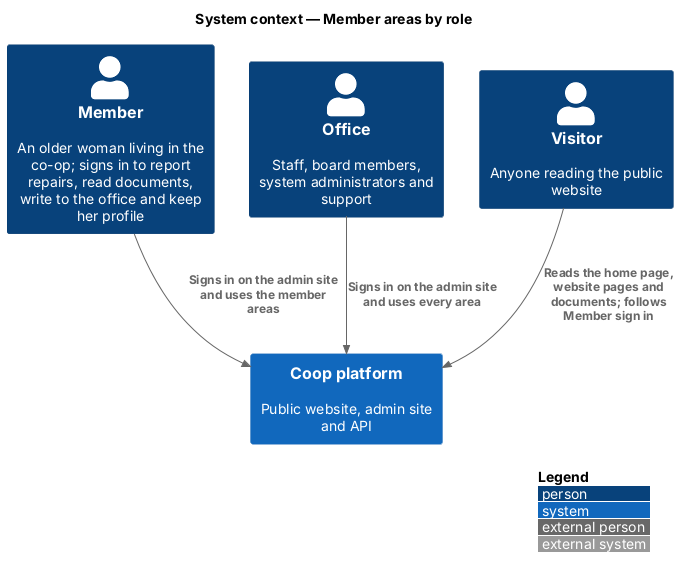
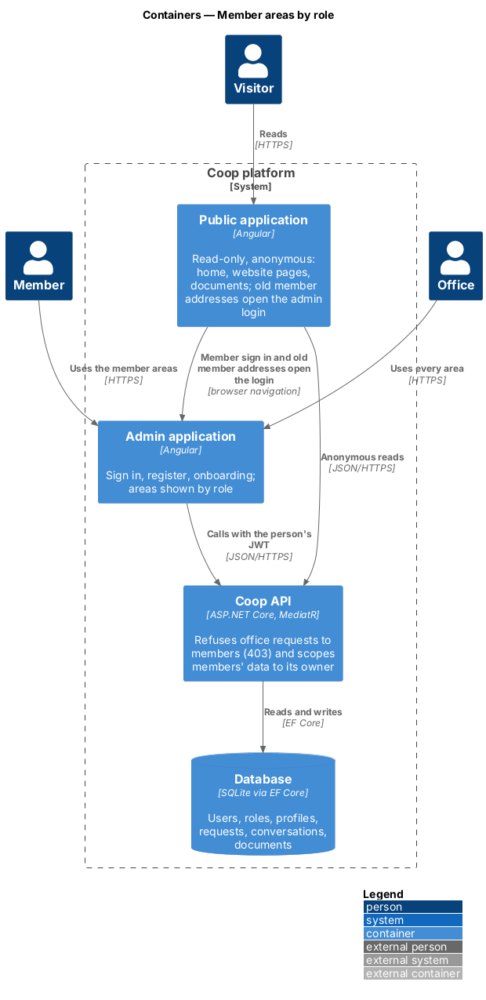
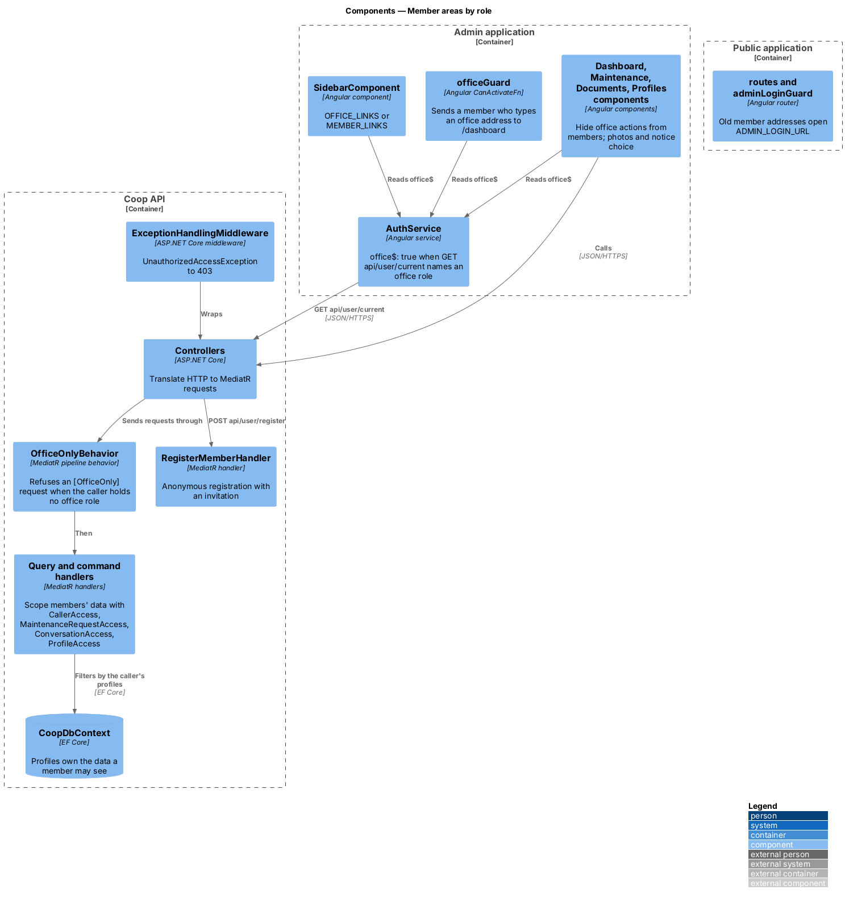
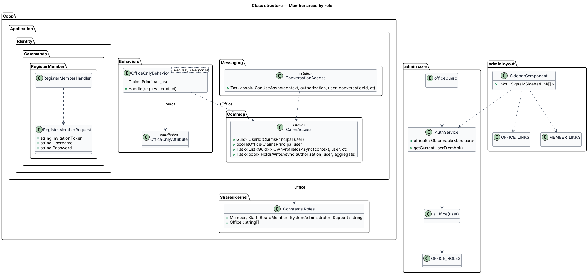
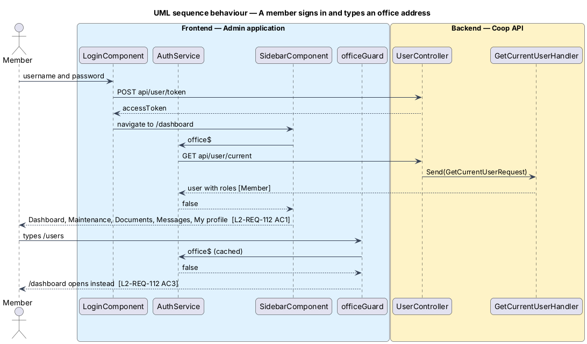
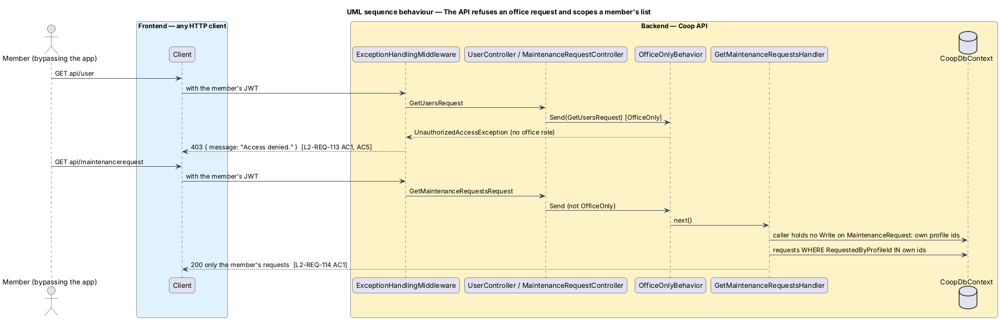
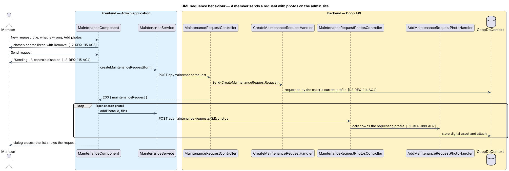

# Member areas by role

## Overview

Coop's members are older women who live in the co-op. Until 21 October 2026
they had member pages on the public website (a dashboard, requests, messages,
a profile and onboarding) and signed in on the admin site's login screen
(L2-REQ-101), yet the admin sign-in never reached those public pages. This
feature finishes the move: the public site becomes read-only and anonymous,
and everything a person does while signed in happens on the admin site. What
each person can see there depends on their role (L1-REQ-018, L1-REQ-022,
ADR 0016).

The screens are drawn in `docs/mocks/pages/admin-member-dashboard/`,
`admin-member-maintenance/`, `admin-member-documents/`,
`admin-member-messaging/`, `admin-member-profile/` and
`docs/mocks/dialogs/admin-member-maintenance-create/`, and the sidebar's
member variant in `docs/design-system/components/sidebar.html`. The public
screens that remain are `public-landing`, `public-page` and
`public-documents`.

The feature belongs to the admin-app subsystem of Coop. It changes the public
app, the admin app, the API's application layer and the Playwright mock API.

Terms used in this design:

- **office** — a signed-in person holding at least one of the roles Staff,
  BoardMember, SystemAdministrator or Support (`Constants.Roles.Office`)
- **member** — any other signed-in person: someone with only the Member role,
  or someone who registered and has no role yet
- **office area** — Pages, Board, Website, Users, Roles & Privileges,
  Profiles, Assets, Invitations and Settings
- **member area** — Dashboard, Maintenance, Documents, Messages and My
  profile, with Change password and Onboarding
- **own data** — data tied to a profile whose `UserId` is the caller's user:
  requests made from that profile, conversations it takes part in, the
  profile itself
- **office for a record** — a caller holding Write or higher on the aggregate
  the record belongs to, the rule the photo and picture features already use
  (L2-REQ-089, L2-REQ-091); in the seeded roles it is the same people as the
  office

## Description

### How the admin learns the roles

The admin asks the server. `AuthService.office$`
(`frontend/projects/admin/src/app/core/services/auth.service.ts`) is an
observable of `boolean`, built once per sign-in from `GET /api/user/current`
(`getCurrentUserFromApi`) and replayed to every reader. `isOffice(user)`
(`core/is-office.ts`) is true when the user's `roles` names one of
`OFFICE_ROLES` (`core/office-roles.ts`). A failed request yields `false`, so
the app falls back to the member areas (L2-REQ-112 AC8); the API still
refuses anything else. `logout()` and `login()` drop the cached answer.

The token's `Role` claims carry the same names, but the admin does not
decode the token: the answer stays with the server, and the Playwright mock
API, whose tokens are not JWTs, answers `GET /api/user/current` with the
seeded user's role as it already did.

### Sidebar, tab bar and guard

`SidebarComponent` (`layout/sidebar.component.ts`) shows `OFFICE_LINKS`
(`layout/office-links.ts`, the thirteen sections as before) for the office
and `MEMBER_LINKS` (`layout/member-links.ts`: Dashboard, Maintenance,
Documents, Messages and My profile at `/profile`) for a member. Until the
answer arrives it shows `MEMBER_LINKS`, so a member never sees an office
link. The phone tab bar in `LayoutComponent` already lists Home, Requests,
Documents, Messages and Profile, the member areas, and is unchanged.

`officeGuard` (`core/guards/office.guard.ts`) is a `CanActivateFn` on the
nine office routes of `app.routes.ts`. It reads `office$` and returns `true`
for the office and `router.createUrlTree(['/dashboard'])` for a member, so a
typed address opens the dashboard and the office screen never renders
(L2-REQ-112 AC3). The choice of the dashboard over a "not available" screen
is recorded in ADR 0016: it adds no screen, and the dashboard is where the
member starts anyway.

### Member screens

The admin screens are shared by the office and members. Each reads
`office$` and hides only what a member may not use; the office sees them
as before.

- **Dashboard** (`features/dashboard/`): a member gets Open requests, Unread
  messages and Documents, without Active members (which reads the Users
  area) and without the quick actions "Create document" and "Send
  invitation". The request list and counts come from the scoped API.
- **Maintenance** (`features/maintenance/`): a member gets their own requests
  from the scoped API and a detail without "Receive request", "Start work",
  "Finish work" and "Edit description". The create dialog's photo picker,
  which was a dead control, now works for everyone: chosen files are checked
  by `photoFileError` (`photo-file-error.ts`, the public app's rule moved
  here), listed with "Remove", and sent one by one after the request through
  `MaintenanceService.addPhoto` (`POST /api/maintenance-requests/{id}/photos`).
  While sending, the submit button reads "Sending…" and the dialog's
  controls are disabled. A member's detail has "Add a photo" (L2-REQ-115).
  Statuses keep the office's words, New, Received, Started and Completed
  (L2-REQ-088). The Comments tab lists only the open request's comments; it
  used to list every comment the API returned. Empty Title and Description
  fields say "Give the request a title" and "Say what is wrong".
- **Documents** (`features/documents/`): a member gets no New document,
  Delete, Publish or Send; the API returns them published documents only.
- **Messages** (`features/messaging/`): unchanged; the API returns a member
  only their own conversations.
- **My profile** (`features/profiles/`, route `/profile`): for everyone, the
  picture controls of L2-REQ-091 (`ProfileService.uploadAvatar` and
  `removeAvatar`, `POST` and `DELETE /api/profiles/{id}/avatar`) and the
  "New notices" row and "Send me new notices" checkboxes of L2-REQ-092
  (`ProfileService.getNoticeChoice` and `saveNoticeChoice`, `GET` and `PUT
  /api/user/profile`; `noticeChoiceLabel` and `noticeChoiceError` in
  `notice-choice.ts`, moved from the public app). A save says "Your profile
  is saved." in a polite status.
- **Onboarding** and **Change password** are unchanged screens a member
  already reaches.

### Server-side enforcement

**Office areas.** `[OfficeOnly]` (`Coop.Application/Behaviors/OfficeOnlyAttribute.cs`)
marks every request type of an office area (the list in L2-REQ-113 AC1).
`OfficeOnlyBehavior<TRequest, TResponse>`
(`Coop.Application/Behaviors/OfficeOnlyBehavior.cs`), registered in
`Dependencies.cs` beside `ValidationBehavior` and
`ResourceOperationAuthorizationBehavior`, throws
`UnauthorizedAccessException("Access denied.")` when the request carries the
attribute and `CallerAccess.IsOffice(user)` is false.
`ExceptionHandlingMiddleware` already turns that into 403. Controllers are
unchanged, and the middleware order of Swagger, CORS, authentication and
authorization is untouched. The existing privilege checks on page, board,
site content and notice-sending stay as they are.

**Registration.** `POST /api/user/register` is anonymous and used to create
the user through `CreateUserRequest`, which is now office-only. It now sends
`RegisterMemberRequest`
(`Coop.Application/Identity/Commands/RegisterMember/`), whose handler checks
the invitation, creates the user with no role, as before, and signs them in.
The controller only maps the answer.

**Owner scoping.** Handlers that read or change own data ask
`CallerAccess` (`Coop.Application/Common/CallerAccess.cs`) for the caller's
user and own profile ids, and whether the caller holds Write on the
aggregate:

| Data | Handlers | A member gets |
|------|----------|---------------|
| Maintenance requests | `GetMaintenanceRequests`, `GetMaintenanceRequestsPage`, `GetMaintenanceRequestById`, `CreateMaintenanceRequest` | Requests made from their profiles; another's by id is 403; a new request is made from their current profile |
| Comments | `GetMaintenanceRequestComments`, `GetMaintenanceRequestCommentById`, `CreateMaintenanceRequestComment` | Comments on their requests; commenting on another's request is 403 |
| Conversations | `GetConversationsByProfile`, `GetConversationById`, `GetConversationBetween`, `CreateConversation` | Conversations one of their profiles takes part in; the empty profile id means "all I take part in"; starting one always includes their profile |
| Messages | `GetMessagesByConversation`, `GetMessageById`, `SendMessage`, `MarkConversationRead`, `MarkMessageAsRead`, `GetUnreadMessages`, `GetUnreadMessageCount` | Only in their conversations; sent from their own profile |
| Profiles | `GetProfiles`, `GetProfileById`, `GetProfilesByUserId`, `CreateMember`, `UpdateMember` | Their own profiles; a new member profile belongs to them |
| Documents | `GetDocuments`, `GetDocumentById` | Published documents only |

Sending a request from the admin's create dialog carries no phone number, so
`CreateMaintenanceRequestValidator` now requires a title and a description,
and the handler takes the phone from the requesting profile. A comment
without a named author is written by the caller's current profile.

`ConversationAccess` (`Coop.Application/Messaging/ConversationAccess.cs`)
holds the conversation rule; `MaintenanceRequestAccess` and `ProfileAccess`
keep theirs, and `MaintenanceRequestScope` lists the profiles whose requests a
caller may see. The office for a record is Write on `MaintenanceRequest`,
`Message`, `Member` or `Notice`.

### The public app

`app.routes.ts` keeps `''`, `pages/:slug`, `documents` and `login`. The
addresses `dashboard`, `maintenance`, `messaging`, `profile`, `onboarding`,
`register` and `forgot-password` each have `canActivate: [adminLoginGuard]`
and no component, so they open the admin login (L2-REQ-110, L2-REQ-111).
`AuthService`, `authGuard`, `authInterceptor` and the member services
(`maintenance`, `messaging`, `profile`, `user`, `invitation` and
`digital-asset`) are removed with the member pages; `app.config.ts` provides
`HttpClient` without an interceptor. `LayoutComponent`, which `/documents`
uses, keeps only its top bar with the logo and the main region.

### The public BFF

`PublicBffController` keeps its anonymous endpoints (register, documents,
board members, JSON content) and the three authenticated endpoints the admin
app calls: `GET` and `PUT api/user/profile` (the notice choice) and `POST
api/conversations` and `api/conversations/{id}/messages` (admin messaging).
Every other authenticated endpoint had only the public member pages as its
client and is removed: `GET api/user/profiles`, `POST
api/user/change-password`, `api/maintenance-requests` (my, by id, create,
delete, comments), `POST` and `DELETE api/documents`, `GET` and `DELETE
api/conversations`, `GET api/conversations/{id}/messages` and `GET
api/user/members`. The photo routes under `api/maintenance-requests/{id}/photos`
belong to `MaintenanceRequestPhotosController` and stay.

### Audit of the public member capabilities

| Capability on the public site | Where it lives now |
|---|---|
| Sign in, sign out | Admin login and My profile → Sign out (unchanged) |
| Register with an invitation, forgot password | Admin `/register` and `/forgot-password` (L2-REQ-111) |
| Onboarding | Admin `/onboarding`, reached after registering |
| Dashboard: greeting, open requests, unread messages, recent requests | Admin dashboard, member view (L2-REQ-112 AC5) |
| Dashboard: members count | Deferred: it reads the office's user list |
| Submit a maintenance request | Admin Maintenance → New request |
| Own requests, filters, detail, comments | Admin Maintenance, scoped (L2-REQ-114, L2-REQ-115) |
| Progress in plain words (L2-REQ-088) | Admin Maintenance and dashboard, with the office's words |
| Photos on requests (L2-REQ-089) | Admin create dialog and "Add a photo" on the detail |
| Read documents | Admin Documents, read only (the public list also stays) |
| Messages: list, read, reply | Admin Messages, scoped |
| Sender pictures beside messages (L2-REQ-091 AC7) | Deferred: the admin conversation shows no sender pictures for anyone |
| Profile: view, edit, switch profiles | Admin My profile |
| Profile picture (L2-REQ-091) | Admin My profile |
| New notices choice (L2-REQ-092) | Admin My profile |
| Change password | Admin My profile and `/change-password` |
| Notification bell | Dropped: it had no behaviour on the public site |

### Mock API

`e2e/fixtures/mock-api/mock-api.ts` mirrors the server: a member (a user
whose role is not an office role) gets 403 from the office-area routes it
answers and the scoped lists of the table above, and the admin auth fixture
gains `memberPage`, a page signed in as the seeded member. Tests
in `e2e/tests/admin/member-*.spec.ts` cover the member view; the public specs
for removed pages are deleted and their behaviours are covered there.

### Deferred

- Showing sender pictures beside messages in the admin conversation.
- The members count on the member dashboard.
- 48 px targets: the admin's controls are 44 px (`--target-comfortable`);
  raising them would resize the office's screens too.
- A separate "not available" screen; a typed office address opens the
  dashboard.
- New roles or privileges, and any change to how roles are assigned.

## Requirements

| L2 ID | Refines (L1) | Requirement |
|-------|--------------|-------------|
| `L2-REQ-110` | `L1-REQ-018` | The public app shall be read-only and anonymous, with no route, page, guard, interceptor or stored token that serves a signed-in member; every old member address opens the admin site's login screen. |
| `L2-REQ-111` | `L1-REQ-018` | Registering with an invitation and asking for a password reset shall happen only on the admin site. |
| `L2-REQ-112` | `L1-REQ-022` | The admin app shall show a member only the member areas and keep the office's areas out of their reach. |
| `L2-REQ-113` | `L1-REQ-022` | The API shall refuse a signed-in member, with status 403, every request that belongs to an office area, even when the admin app is bypassed. |
| `L2-REQ-114` | `L1-REQ-022` | On every admin screen a member can open, the API shall return a member only their own maintenance requests, comments, conversations, messages and profiles, and refuse with 403 any request that names another household's. |
| `L2-REQ-115` | `L1-REQ-022` | The admin Maintenance screen shall give a member their own requests, sending a request, progress in plain words, comments and photos. |
| `L2-REQ-116` | `L1-REQ-022` | The admin "My profile" screen shall give every signed-in person the profile picture and the notice choice for their own profile. |
| `L2-REQ-117` | `L1-REQ-022` | Every admin screen a member can open shall meet WCAG 2.2 AA: keyboard access, visible focus, large targets and reflow at 400% zoom. |
| `L2-REQ-101` | `L1-REQ-018` | The public app shall have no login screen of its own; every sign-in link and sign-in redirect on the public site shall open the admin site's login screen. |
| `L2-REQ-088` | `L1-REQ-005` | The admin app's maintenance list and detail as a member sees them, and the member dashboard's recent requests, shall show the member each request's status in plain words. |
| `L2-REQ-089` | `L1-REQ-005` | The system shall let a member attach photos to their own maintenance request and let the office see them, keeping the photos private to the requesting household and the office. |
| `L2-REQ-091` | `L1-REQ-004` | The system shall let a member set, replace and remove the picture on their own profile. |
| `L2-REQ-092` | `L1-REQ-004` | The system shall let a member choose on their own profile whether new notices reach them by email, by text message, by both or not at all. |

## Diagrams

Visitors read the public site; members and the office both sign in on the
admin site, which shows each of them only their areas.

The public app sends members to the admin app's login; the admin app calls
the API with the person's token, and the API decides what each caller may do.

Inside the admin app the sidebar, the guard and the screens read one answer,
`office$`; inside the API one pipeline behaviour refuses office requests and
the handlers scope members' data.

The class diagram shows the role list, the attribute and behaviour, the
caller helpers, the registration command and the admin pieces that read the
roles.

A member signs in, sees the five member areas, and is sent to the dashboard
when she types an office address.

A member who bypasses the app gets 403 from an office request and only her
own requests from a shared list.

A member sends a request with photos from the admin create dialog; each
photo follows the request.

