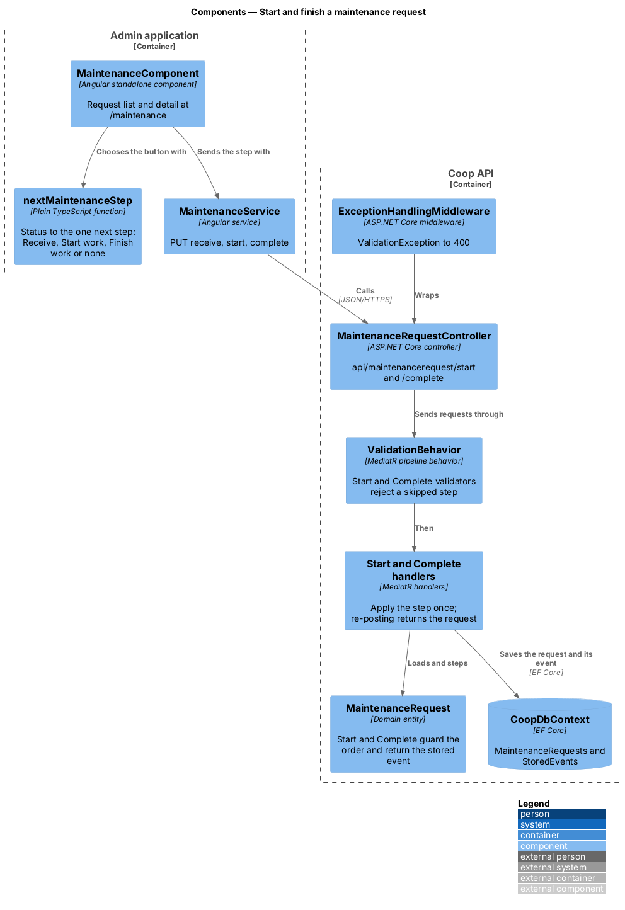
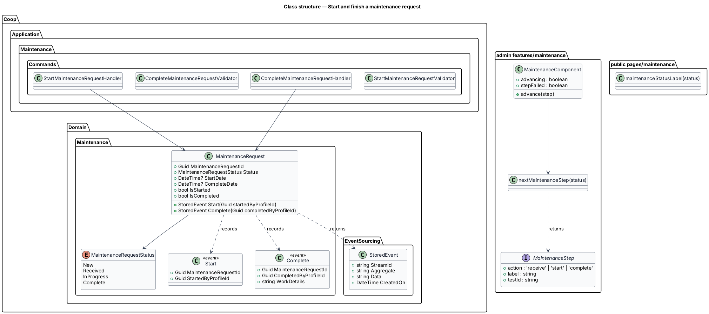
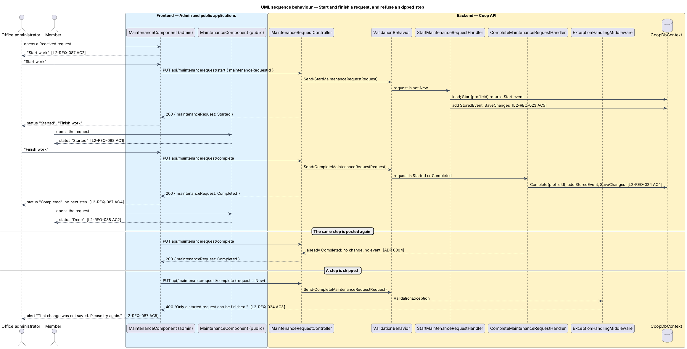

# Start and finish a maintenance request

## Overview

A maintenance request moves through New, Received, Started and Completed
(L1-REQ-005). Members report a request from the public app, and the office
receives it from the admin app at `/maintenance`. This design adds the last
two office steps, "Start work" and "Finish work", to the request detail drawn
in `docs/mocks/pages/admin-maintenance/detail-*.html`, and shows the member
the new statuses in plain words in the list and detail drawn in
`docs/mocks/pages/public-maintenance/`.

The feature belongs to the admin-app subsystem of Coop and to the Maintenance
module of the API. The endpoints already existed; this design adds the order
rule, the audit entry and the retry behaviour to them.

Terms used in this design:

- **step** — one forward move of a request: receive, start or complete
- **next step** — the one step the office can take from the request's
  current status; a completed request has none
- **audit history** — the `StoredEvents` table; each step writes one stored
  event whose stream is the request identifier
- **re-posting** — sending a step that already happened, for example after a
  dropped connection (ADR 0004)

## Description

### API

`MaintenanceRequestController`
(`backend/src/Coop.Api/Controllers/Maintenance/MaintenanceRequestController.cs`)
exposes the steps. It translates HTTP to MediatR requests and holds no rules:

| Route | Request | Answer |
|-------|---------|--------|
| `PUT api/maintenancerequest/start` | `StartMaintenanceRequestRequest { maintenanceRequestId }` | `{ maintenanceRequest }` |
| `PUT api/maintenancerequest/complete` | `CompleteMaintenanceRequestRequest { maintenanceRequestId }` | `{ maintenanceRequest }` |

`MaintenanceRequest` (`backend/src/Coop.Domain/Maintenance/MaintenanceRequest.cs`)
holds the order rule. `Start(startedByProfileId)` requires the status
`Received`, sets `StartDate` and the status `InProgress` (shown as
"Started"), and returns a `StoredEvent` that carries the `Start` event.
`Complete(completedByProfileId)` requires `InProgress`, sets `CompleteDate`
and the status `Complete`, and returns a `StoredEvent` that carries the
`Complete` event with the work details. Both throw
`InvalidOperationException` when called out of order. `IsStarted` is true for
`InProgress` and `Complete`; `IsCompleted` is true for `Complete`. The stored
event has the request identifier as `StreamId`, `MaintenanceRequest` as
`Aggregate`, and the event serialised to JSON as `Data`.

`StartMaintenanceRequestValidator` rejects Start for a `New` request with
"Only a received request can be started."
`CompleteMaintenanceRequestValidator` rejects Complete for a `New` or
`Received` request with "Only a started request can be finished."
`ValidationBehavior` runs them before the handler, and
`ExceptionHandlingMiddleware` turns the `ValidationException` into 400.

`StartMaintenanceRequestHandler` and `CompleteMaintenanceRequestHandler` load
the request. When the step has already happened (`IsStarted` or
`IsCompleted`) they return the request unchanged (ADR 0004). Otherwise they
find the caller's current profile, as `ReceiveMaintenanceRequestHandler`
does, call the domain method, add the returned stored event and save once,
so the status and its audit entry are written together.

### Admin application

`MaintenanceComponent` (`frontend/projects/admin/src/app/features/maintenance/`)
shows one lifecycle button in the detail. `nextMaintenanceStep`
(`next-maintenance-step.ts`) is a pure function from the status (string or
number) to a `MaintenanceStep` (`maintenance-step.ts`) or null:

| Status | Button | Test id |
|--------|--------|---------|
| New | Receive Request | `maintenance-receive-button` |
| Received | Start work | `maintenance-start-button` |
| Started | Finish work | `maintenance-finish-button` |
| Completed | none | |

`advance(step)` calls `MaintenanceService.receiveMaintenanceRequest`,
`startMaintenanceRequest` or `completeMaintenanceRequest`, disables the
button while `advancing`, and on success takes the status from the answer and
re-applies the list filter. On failure it leaves the status unchanged and sets
`stepFailed`, which shows "That change was not saved. Please try again." with
`role="alert"`. Numeric statuses read "New", "Received", "Started" and
"Completed".

### Public application

`MaintenanceComponent` (`frontend/projects/public/src/app/pages/maintenance/`)
shows the status through `maintenanceStatusLabel`
(`maintenance-status-label.ts`), which returns "New", "Received", "Started"
or "Done". The badge colour classes are unchanged.

### Tests

`backend/tests/Coop.Api.Tests/MaintenanceLifecycleTests.cs` covers the order,
the audit entries, the 400 answers and re-posting through the API over an
in-memory database (ADR 0003). The Playwright mock API answers the start and
complete routes with the same order and retry rules;
`e2e/tests/admin/maintenance.spec.ts` covers Start and Finish in the admin
app and `e2e/tests/public/maintenance.spec.ts` covers "Started" and "Done" for
the member.

## Requirements

| L2 ID | Refines (L1) | Requirement |
|-------|--------------|-------------|
| `L2-REQ-023` | `L1-REQ-005` | Staff can mark a received request as work started; the step is audited and re-posting returns the request. |
| `L2-REQ-024` | `L1-REQ-005` | Staff can mark a started request as completed; the step is audited and re-posting returns the request. |
| `L2-REQ-025` | `L1-REQ-005` | The status moves forward only, without skipping a step. |
| `L2-REQ-087` | `L1-REQ-005` | The admin request detail offers the one next step. |
| `L2-REQ-088` | `L1-REQ-005` | The member sees "Started" and "Done" in plain words. |

## Diagrams

Inside the API the controller sends each step through validation to its
handler, which steps the entity and saves the request with its stored event;
the admin screen picks the button with `nextMaintenanceStep`, and the public
screen words the status with `maintenanceStatusLabel`.

The class diagram shows the entity with its two step methods and events, the
validators and handlers, and the plain functions beside each screen.

Starting and finishing a request, the member following along, a re-posted
step and a skipped step:

