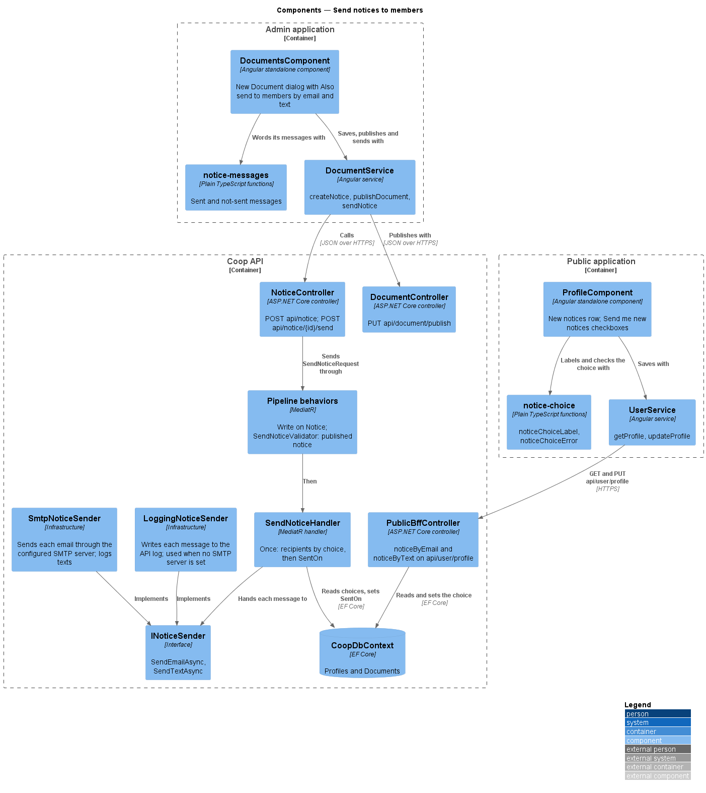
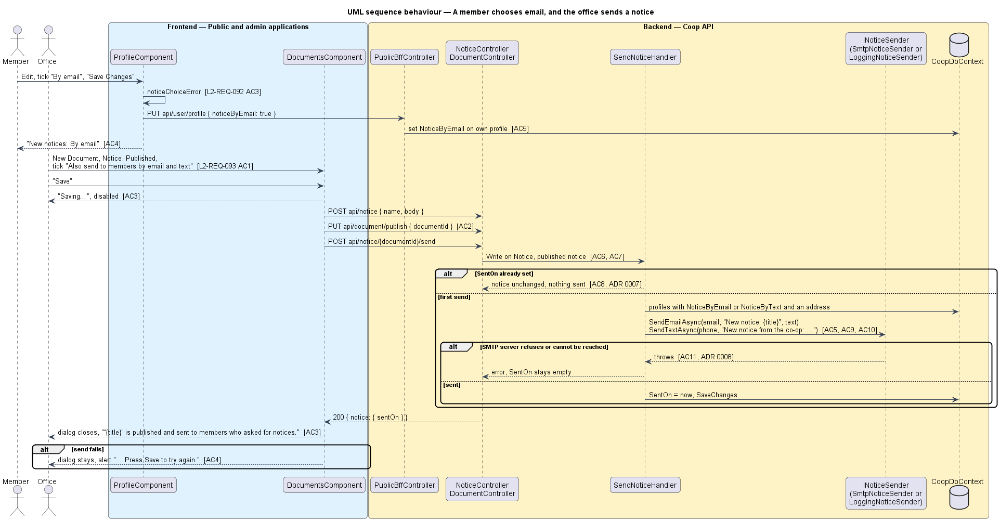

# Send notices to members

## Overview

A notice on the website only helps the members who look at it. Members
choose on their own profile whether new notices reach them by email, by text
message, by both or not at all (L2-REQ-092), and the office can send a
notice it publishes to those members, once (L2-REQ-093). Nobody is sent
anything until they choose to.

Every message goes through one sender service, `INoticeSender`. Emails go
out through an SMTP server when one is configured (ADR 0008). Without one,
and always for text messages, the default sender writes each message to the
API log and sends nothing outside the system. No text message provider is
connected yet.

The screens are drawn in `docs/mocks/pages/public-profile/` (default, edit,
notices-invalid), `docs/mocks/dialogs/admin-document-create/` (send,
busy, send-error) and
`docs/mocks/notifications/admin-notice-sent/success.html`.

The feature belongs to the admin-app and public-app subsystems of Coop and
to the Documents and Profiles modules of the API.

Terms used in this design:

- **notice choice** — the two flags on a profile, `NoticeByEmail` and
  `NoticeByText`, both `false` until the member ticks them
- **office** — a role holding Write or higher on the `Notice` aggregate
  (Staff, Support, BoardMember, SystemAdministrator in the seed)
- **send** — handing one message per address to `INoticeSender`; a notice is
  sent once and records `SentOn` (ADR 0007)

## Description

### API

`ProfileBase` (`backend/src/Coop.Domain/Profiles/`) gains `NoticeByEmail`
and `NoticeByText`. `PublicBffController` returns them as `noticeByEmail`
and `noticeByText` on `GET api/user/profile`, and `PUT api/user/profile`
sets each one that the body carries on the caller's own profile, as it
already does for the name, email and phone.

`Notice` (`backend/src/Coop.Domain/Documents/`) gains `SentOn`, and
`NoticeDto` carries it as `sentOn`.

`NoticeController` adds one route:

| Route | Request | Answer |
|-------|---------|--------|
| `POST api/notice/{documentId}/send` | `SendNoticeRequest { documentId }` | `{ notice }` |

`SendNoticeRequest` carries `[AuthorizeResourceOperation(Write, Notice)]`,
so `ResourceOperationAuthorizationBehavior` refuses other callers with 403.
`SendNoticeValidator` requires a published notice with that id ("Only a
published notice can be sent."), and `ExceptionHandlingMiddleware` answers
400.

`SendNoticeHandler` returns the notice unchanged when `SentOn` is set
(ADR 0007). Otherwise it reads the profiles that are not deleted, takes the
distinct email addresses of those with `NoticeByEmail` and the distinct
phone numbers of those with `NoticeByText`, skipping empty ones, and calls
`INoticeSender`:

- `SendEmailAsync(email, "New notice: {name}", body)`
- `SendTextAsync(phone, "New notice from the co-op: {name}. {body}")`

Then it sets `SentOn` and saves. An exception from the sender stops the
send before `SentOn` is set, and `ExceptionHandlingMiddleware` answers with
an error.

`INoticeSender` lives in `Coop.Application/Common/Interfaces/`. Two
implementations live in `Coop.Infrastructure/Notifications/`:

- `LoggingNoticeSender` logs the recipient and the subject or message with
  `ILogger` at Information level and sends nothing. It is used when no SMTP
  server is configured.
- `SmtpNoticeSender` sends each email through the configured SMTP server as
  plain text from the configured sender address, over STARTTLS with the
  configured credentials. It logs text messages as `LoggingNoticeSender`
  does. When the server refuses a message or cannot be reached, it throws,
  `SentOn` stays empty and the office can send again (ADR 0007).

`Dependencies.cs` registers `SmtpNoticeSender` when `Notices:Email:Host` is
set, or `Notices:Email:PickupDirectory` is set for local runs and tests, and
`LoggingNoticeSender` otherwise. The settings, bound to
`NoticeEmailOptions`:

| Setting | Purpose |
|---------|---------|
| `Notices:Email:Host`, `Port` | SMTP server, port 587 by default |
| `Notices:Email:UserName`, `Password` | Credentials; supplied by user secrets or environment variables, never `appsettings.json` |
| `Notices:Email:FromAddress`, `FromName` | Sender shown to members |
| `Notices:Email:PickupDirectory` | Development and tests only: write each email as an `.eml` file in this folder instead of using the network |

### Admin application

`DocumentsComponent` (`frontend/projects/admin/src/app/features/documents/`):

- When the dialog's type is Notice and its status is Published, a checkbox
  "Also send to members by email and text" (`dialogDoc.send`, unticked)
  shows with the hint "Only members who asked for new notices on their
  profile get one."
- `saveDocument` creates a Notice with `DocumentService.createNotice`
  (`POST api/notice`) and other types with `createDocument` as before. When
  the status is Published it then calls `publishDocument`, and when the box
  is ticked, `DocumentService.sendNotice` (`POST api/notice/{id}/send`).
- While `saving`, "Save" reads "Saving…" and is disabled. The created
  document's id is kept in `savedDocumentId` while the dialog is open, so a
  second "Save" after a failed send only publishes and sends again.
- After a send, the dialog closes and the page shows the message from
  `noticeSentMessage(title)` with `role="status"`. A failed send keeps the
  dialog open and shows `noticeNotSentMessage(title)` with `role="alert"`.
  Both live in `notice-messages.ts` beside the component.

### Public application

`ProfileComponent` (`frontend/projects/public/src/app/pages/profile/`):

- The profile shows a "New notices" row with the text from
  `noticeChoiceLabel(byEmail, byText)` (`notice-choice.ts`).
- The edit form adds a `fieldset` with the legend "Send me new notices", the
  checkboxes "By email" and "By text message", and the hint "We use the
  email address and phone number above."
- `saveProfile` checks the form with `noticeChoiceError(form)` first; an
  error is shown in the group with `role="alert"` and nothing is saved.
  `UserService.updateProfile` sends `noticeByEmail` and `noticeByText`
  with the other fields, and `UserService.getProfile` reads them.

### Tests

`backend/tests/Coop.Api.Tests/NoticeDeliveryTests.cs` covers the default and
saved notice choice, sending to members who chose email and text, skipping
those who did not choose or have no address, sending once, refusing a draft
and a member, and a send that fails and is tried again. `CoopApiFactory`
replaces `INoticeSender` with `RecordingNoticeSender`, a test double that
keeps the messages and can be told to fail. A separate test points
`Notices:Email:PickupDirectory` at a temporary folder and reads the `.eml`
files `SmtpNoticeSender` writes there, so no test uses the network. The
Playwright mock API serves `POST notice`, `POST notice/{id}/send` and the
notice choice on `user/profile`; `e2e/tests/admin/documents.spec.ts` and
`e2e/tests/public/profile.spec.ts` cover the screens.

## Requirements

| L2 ID | Refines (L1) | Requirement |
|-------|--------------|-------------|
| `L2-REQ-032` | `L1-REQ-006` | A document can be published. |
| `L2-REQ-092` | `L1-REQ-004`, `L1-REQ-006` | Members choose on their profile whether new notices reach them by email, text message, both or neither. |
| `L2-REQ-093` | `L1-REQ-006` | The office sends a published notice once to the members who asked for it, by email through an SMTP server when one is configured. |

## Diagrams

Components in the two applications and the API, with the sender service:

A member chooses email, and the office publishes and sends a notice:

