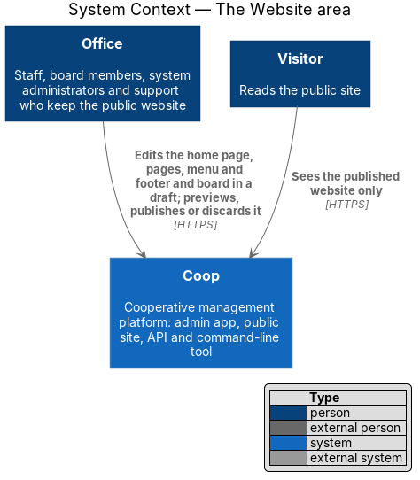
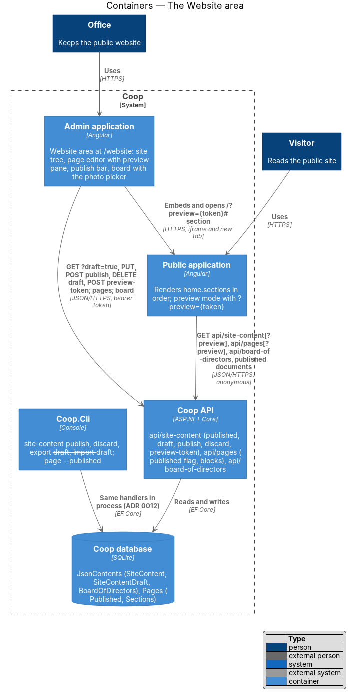
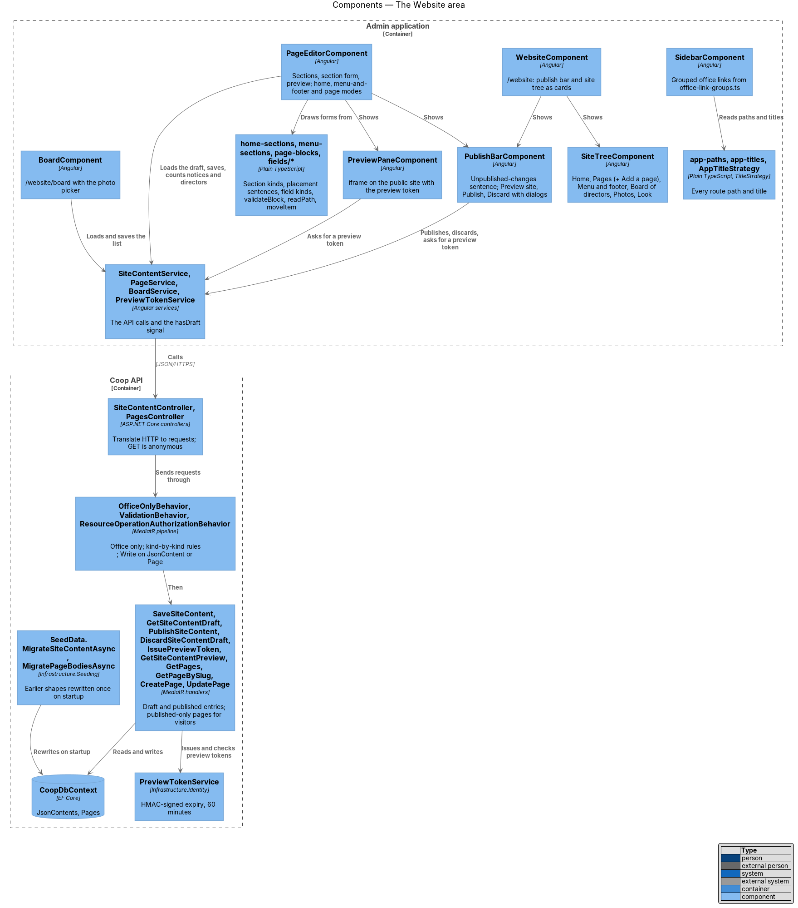
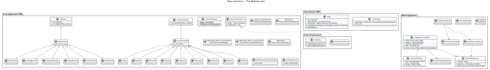
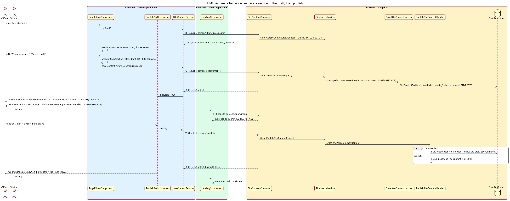
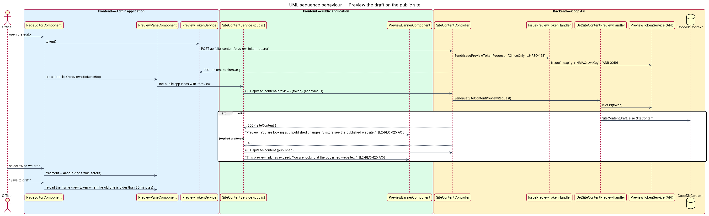

# The Website area

## Overview

The office keeps everything a visitor can see on the public website from one
**Website** area of the admin application, laid out the way the visitor
sees the site. The area replaces the former Website, Pages, Board and Assets
screens (`docs/proposals/content-management-reimagined.md`, sections 2
and 3). It adds a working **draft** of the site content beside the
published copy, so the office can try a change, look at it on the public
site and publish it when ready, or discard it (`L1-REQ-023`). The decisions
are ADR 0018 (draft and publish), ADR 0019 (preview tokens), ADR 0020 (the
area as the admin's content information architecture) and ADR 0021 (the
home page as an ordered list of sections, designed in
`../../public-app/render-home-sections/`).

The area belongs to the admin-app subsystem of Coop and to the CMS module
of the API. It is drawn in `docs/mocks/pages/admin-website/`,
`docs/mocks/pages/admin-page-editor/`, `docs/mocks/dialogs/admin-publish-confirm/`,
`docs/mocks/dialogs/admin-discard-confirm/`, `docs/mocks/pages/admin-board/`
and the notifications `admin-website-saved`, `admin-website-published` and
`admin-website-discarded`. Documents and notices stay under Community
(`../send-notices/`), the photo library keeps its own design
(`L2-REQ-040`) and the theme editor keeps its logic (`L2-REQ-045`); both are
reached from the site tree.

Terms used in this design:

- **site tree** — the Website area's navigation: Home, Pages (one entry per
  page and "Add a page"), Menu and footer, Board of directors, Photos, Look
- **page editor** — the full screen that edits the home page, the menu and
  footer, or one website page: sections, the selected section's form and
  the preview
- **section** — one part of a page the office edits as a unit; on the home
  page one of the nine kinds (`hero`, `glance`, `about`, `gallery`,
  `features`, `notices`, `board`, `quote`, `visit`), on the menu and footer
  the menu and the footer, on a website page the Page banner and the body
  blocks
- **draft** — the `SiteContentDraft` JSON content entry every save writes;
  the **published copy** is the `SiteContent` entry visitors read
- **publish bar** — the row on the Website landing and the page editors
  that says whether there are unpublished changes and holds Preview site,
  Publish and Discard changes
- **preview token** — a short-lived, read-only token the public site
  presents as `?preview={token}` to read the draft and unpublished pages
- **linked section** — a home page section whose items come from another
  screen ("What's on" from the published notices, "Board of directors" from
  the board list); its form shows a summary and a Manage link
- **block** — one part of a website page's body: Heading, Paragraph, Bullet
  list, Photo, Link button or Existing content

## Description

### Routes, paths and titles

`core/app-paths.ts` holds every route path of the admin as constants and
functions (`APP_PATHS.website`, `APP_PATHS.websiteHome`,
`APP_PATHS.websitePage(pageId)`, `APP_PATHS.websitePageNew`,
`APP_PATHS.websiteMenu`, `APP_PATHS.websiteBoard`, `APP_PATHS.websitePhotos`,
`APP_PATHS.websiteLook`, and the existing areas). `core/app-titles.ts` holds
the screen titles and `core/app-title-strategy.ts` an Angular
`TitleStrategy` that sets the document title to
"{title} · OWN Housing Co-op Office" from each route's `title`
(`L2-REQ-118` AC5). `app.routes.ts`, the sidebar, the tab bar, the site
tree and the breadcrumbs read from the registry; no feature repeats a route
string.

The routes under the layout are:

| Path | Component | Title |
|------|-----------|-------|
| `/website` | `WebsiteComponent` | Website |
| `/website/home` | `PageEditorComponent` (mode `home`) | Home |
| `/website/menu-and-footer` | `PageEditorComponent` (mode `menu`) | Menu and footer |
| `/website/pages/new` | `PageEditorComponent` (mode `page`, new) | Add a page |
| `/website/pages/:pageId` | `PageEditorComponent` (mode `page`) | the page's title |
| `/website/board` | `BoardComponent` | Board of directors |
| `/website/photos` | `PhotosComponent` | Photos |
| `/website/look` | `SettingsComponent` | Look |
| `/pages`, `/board`, `/assets` | redirects to `/website`, `/website/board`, `/website/photos` | |

Every Website route carries `canActivate: [officeGuard]` (`L2-REQ-112`).

### Sidebar

`layout/office-link-groups.ts` replaces the flat `office-links.ts` with
`SidebarGroup[]` (`layout/sidebar-group.ts`): a group has an optional
heading and its links. The office's groups are Dashboard and Website
without a heading, Community (Documents, Messages, Profiles), Operations
(Maintenance), Access (Users, Roles and privileges, Invitations) and
Settings without a heading (`L2-REQ-118` AC1). `SidebarComponent` draws a
heading with the library's `SidebarGroupComponent`
(`span[libSidebarGroup]`, class `sidebar__group`) and the links as before.
`member-links.ts` is unchanged (ADR 0016). The sidebar marks Website as
current for every address under `/website`.

### The Website landing and the site tree

`WebsiteComponent` (`features/website/website.component.*`) is the area's
landing at `/website`: the page header, the publish bar and the site tree
drawn as cards. `SiteTreeComponent` (`features/website/site-tree/`) stays in
the app because it loads the page list through `PageService` and reads the
registry; it renders the library's `nav[libSiteTree]`, `ul[libSiteTreeList]`
(with `nested`), `a[libSiteTreeLink]` (with `add`) and
`span[libSiteTreeGroup]`. Its `current` input marks the current item with
`aria-current="page"`. While the pages load, the Pages group shows a
loading row; when the list fails, the landing shows "We couldn't load the
website. Check your connection and try again." with Try again
(`L2-REQ-118` AC6). On the board screen the tree sits in the library's
`div[libWebsiteShell]`, a two-column grid from 64rem (`L2-REQ-118` AC7).
The page editor shows the breadcrumb "Website / {name}" instead of the tree
(ADR 0020).

### The page editor

`PageEditorComponent` (`features/website/page-editor/`) is one screen in
three modes, chosen by the route: `home` edits `home.sections` of the site
content, `menu` edits `header` and `footer`, and `page` edits one website
page (or a new one). It owns the signals `status` (`loading`, `ready`,
`error`), `content` (the whole site content draft, in `home` and `menu`
modes) or `page` (in `page` mode), `sections` (the `SectionDefinition[]` in
public order), `selected`, `draft` (the selected section's values as the
form binds them, from `toDraft`), `errors`, `saving`, `saveFailed`, `notice`
and `tab` (`sections`, `edit` or `preview`, for narrow viewports).

A `SectionDefinition` (`features/website/section-definition.ts`) has a
`kind`, a `name`, the `placement` sentence, the `anchor` (the public
section id the preview scrolls to), the `fields` (`ContentField[]`, the
same field kinds as before: `text`, `textarea`, `lines`, `address`,
`choice`, `photo`, `group`, `list`) and, for a linked section, `linked`
(`notices` or `board`). `home-sections.ts` lists the nine home kinds with
their fields (moved from the former `content-blocks.ts`) and sentences
("Appears first on the home page, under the menu." and so on,
`L2-REQ-119` AC4); `menu-sections.ts` lists the menu and the footer;
`page-blocks.ts` lists the Page banner and the six block kinds with their
fields (`L2-REQ-123` AC1). The field helpers move unchanged to
`features/website/fields/`: `content-field.ts`, `content-field-kind.ts`,
`content-path.ts` (`readPath`, `writePath`), `block-draft.ts` (`toDraft`,
`fromDraft`), `validate-block.ts`, `move-item.ts`, `safe-address.ts`, and
the photo picker in `features/website/photo-picker/`.

The screen is the library's `div[libPageEditor]` with three panes. The left
pane is the section list (`ol[libSectionList]`, `li[libSectionListItem]`
with `hidden` and `fixed`, `button[libSectionListButton]` with
`aria-current="true"` on the selected one, `div[libSectionListTools]`,
`div[libSectionListAdd]`). The centre pane is the section form: the
heading, the placement note (`p[libPlacementNote]`), the error summary, the
fields drawn by kind from the `fieldTemplate` the former Website screen
used, the linked summary for a linked section, and "Save to draft" (or
"Save page", "Create page") with "Undo changes". The right pane is
`PreviewPaneComponent`. Below 64rem the library's `div[libPageEditorTabs]`
draws the tabs Sections, Edit and Preview (the `tabs` component with
`aria-selected` and `aria-controls`) and shows one pane at a time;
choosing a section moves to the Edit tab (`L2-REQ-119` AC3).

Selecting a section writes the current form values back into `content` (or
`page`) through `writePath` and `fromDraft`, so switching sections loses
nothing (`L2-REQ-119` AC8); "Undo changes" re-reads the saved draft. "Save
to draft" runs `validateBlock`, and on success sends the whole site content
with `SiteContentService.save` (`PUT api/site-content`), announces "Saved to
your draft. Publish when you are ready for visitors to see it." and
reloads the preview frame. Move up, Move down and Hide or Show change
`home.sections` (`moveItem`, `hidden`) and save the draft at once with their
own messages (`L2-REQ-120`). In `page` mode "Save page" sends
`PageService.create` or `update` with `title`, `heroImageUrl`,
`heroImageAlt`, `published` and `sections` (the blocks through `fromDraft`),
"Remove page" opens the former remove dialog, and the Page banner shows
"Page address: /pages/{slug}" as a link to `PUBLIC_SITE_URL` (`L2-REQ-123`
AC7, AC8). Pages have no draft.

The linked summaries read their counts when a linked section is selected:
`DocumentService.getNotices` filtered to published for "What's on" and
`BoardService.getAll` for "Board of directors", shown with the library's
`div[libLinkedSummary]` and a Manage link to `APP_PATHS.documents` or
`APP_PATHS.websiteBoard` (`L2-REQ-124` AC1 to AC4).

### Publish bar, dialogs and preview

`PublishBarComponent` (`features/website/publish-bar/`) draws the library's
`div[libPublishBar]` with `changes` bound to `SiteContentService.hasDraft`,
a signal every call to the service updates. "Preview site" is a link to
`PUBLIC_SITE_URL/?preview={token}` opened in a new tab; "Publish" and
"Discard changes" open native `<dialog>` alert dialogs ("Publish your
changes?", "Discard your unpublished changes?") whose confirm buttons call
`SiteContentService.publish` (`POST api/site-content/publish`) and
`discard` (`DELETE api/site-content/draft`), announce the outcome in a
polite status and, after a discard, emit `discarded` so the editor reloads
(`L2-REQ-121` AC6 to AC8).

`PreviewPaneComponent` (`features/website/preview-pane/`) asks
`PreviewTokenService` (`core/services/preview-token.service.ts`, `POST
api/site-content/preview-token`, cached until 60 minutes have passed) for a
token and draws the library's `section[libPreviewPane]` with an
`iframe[libPreviewPaneFrame]` whose `src` is the public address, the token
and the selected section's anchor; `reload()` after a save sets a new
`src`. The admin's JWT never reaches the public site (ADR 0019).

### Board under Website

`BoardComponent` moves to `features/website/board/` and is reached at
`/website/board`, beside the site tree. Its director editor replaces the
typed "Photo address" with the photo picker: a thumbnail, "Current photo:
{name}", "Choose photo" opening `PhotoPickerComponent` and "Remove photo";
the saved `photoUrl` is the picked address (`L2-REQ-124` AC5). Everything
else in `../manage-board/` holds.

### API

`SiteContentController` keeps `api/site-content` and translates only:

| Route | Access | Request |
|-------|--------|---------|
| `GET api/site-content` | anonymous | `GetSiteContentRequest` → the published entry |
| `GET api/site-content?draft=true` | office | `GetSiteContentDraftRequest` → `{ siteContent, hasDraft }` |
| `GET api/site-content?preview={token}` | anonymous, valid token | `GetSiteContentPreviewRequest` → the draft, else published; 403 otherwise |
| `PUT api/site-content` | `Write` on `JsonContent` | `SaveSiteContentRequest` → writes `SiteContentDraft` |
| `POST api/site-content/publish` | office, `Write` on `JsonContent` | `PublishSiteContentRequest` → copies draft to published, idempotent |
| `DELETE api/site-content/draft` | office, `Write` on `JsonContent` | `DiscardSiteContentDraftRequest` → removes the draft, idempotent |
| `POST api/site-content/preview-token` | office | `IssuePreviewTokenRequest` → `{ token, expiresOn }` |

The office-only requests carry `[OfficeOnly]` and `OfficeOnlyBehavior`
refuses a member with 403 (`L2-REQ-128`); an anonymous caller is refused by
`[Authorize]` with 401 except on the anonymous `GET`. `SiteContentRules`
gains `DraftName = "SiteContentDraft"`. The handlers live under
`Coop.Application/CMS/SiteContent/`, one folder per request.
`IPreviewTokenService` (`Coop.Application/Common/Interfaces/`) issues and
checks tokens; `PreviewTokenService` (`Coop.Infrastructure/Identity/`) signs
an expiry with HMAC-SHA256 keyed by `Authentication:JwtKey` and registered
in `AddCoopCore` so the command-line tool shares it.

`HomeContentDto` holds `List<HomeSectionDto> Sections`. `HomeSectionDto` is
abstract with `[JsonPolymorphic(TypeDiscriminatorPropertyName = "kind")]`
and one `[JsonDerivedType]` per kind; `HeroDto`, `GlanceDto`, `AboutDto`,
`GalleryDto`, `FeaturesDto`, `NoticesDto`, `BoardDto`, `QuoteDto` and
`VisitDto` derive from it and keep their values; each has `Hidden`.
`AddJsonOptions` sets `AllowOutOfOrderMetadataProperties` so `kind` may
follow other properties, and `CliFiles` uses the same options.
`SaveSiteContentValidator` applies each kind's rules through
`SetInheritanceValidator` with one validator class per kind
(`HeroValidator`, …) and rejects a repeated kind; an unknown kind fails
model binding with 400 (`L2-REQ-122` AC6).

`Page` gains `Published` and `Sections` (a JSON string of blocks) and keeps
`Body` for the migration only. `PageDto` carries `published` and
`sections` (`List<PageBlockDto>`, polymorphic on `kind`: `heading`,
`paragraph`, `bullets`, `photo`, `link`, `html`). `CreatePageRequest` and
`UpdatePageRequest` accept `sections` and `published`, and a `body` without
`sections` becomes one `html` block (`L2-REQ-123` AC4). `PageRules` gains
`PageBlockValidator`. `GetPagesRequest` and `GetPageBySlugRequest` carry
`PreviewToken`; their handlers include unpublished pages for an office
caller (`CallerAccess.IsOffice`) or a valid token (`L2-REQ-123` AC5,
`L2-REQ-125` AC3).

`SeedData` gains two idempotent steps run on every start:
`MigrateSiteContentAsync` rewrites a `SiteContent` or `SiteContentDraft`
entry whose `home` has no `sections` into the list in the default order
(`L2-REQ-122` AC7), and `MigratePageBodiesAsync` wraps a page's non-empty
`Body` into one `html` block when `Sections` is empty, then clears `Body`
(`L2-REQ-123` AC4). `SiteContentSeed.Create` builds `Home.Sections`. No
draft is seeded (`L2-REQ-121` AC11).

### Command-line tool

`SiteContentCommands` gains `publish` and `discard`, and `--draft` on
`export` and `import` (`L2-REQ-127`); `PageCommands` gains `--published`
on `create` and `update` and a Published column on `list`. Each sends the
same requests as the API (ADR 0012); `import` without `--draft` sends
`SaveSiteContentRequest` then `PublishSiteContentRequest`.

### Public application

The public side is designed in `../../public-app/render-home-sections/`:
the sections rendered in order, preview mode with the banner, the board
from `api/board-of-directors`, the Documents page from the published
endpoints and the dead calls removed.

### Tests

Backend acceptance tests in `backend/tests/Coop.Api.Tests/SiteContentDraftTests.cs`
cover the draft, publish, discard, preview token and preview reads and their
refusals; `SiteContentTests.cs` covers the section list's rules and the
migration; `PageBlocksTests.cs` covers blocks, the Published flag, the body
migration and published-only reads; `backend/tests/Coop.Cli.Tests/ContentCommandTests.cs`
covers the new commands. The Playwright `admin` project covers the area in
`e2e/tests/admin/website.spec.ts` (site tree), `publish.spec.ts` (publish
bar, dialogs, preview pane), `page-editor.spec.ts` (sections, forms, linked
sections), `sections.spec.ts` (hide and move), `pages.spec.ts` (pages and
blocks) and `board.spec.ts`, with page objects `e2e/pages/admin/website.page.ts`,
`page-editor.page.ts`, `publish-bar.component.ts` and `board.page.ts`; the
`public` project covers `landing.spec.ts`, `home-sections.spec.ts`,
`site-content.spec.ts`, `preview.spec.ts`, `content-page.spec.ts` and
`published-documents.spec.ts`. The in-process mock API serves
the draft, publish, discard, preview-token and preview routes with the same
rules and the same 401 and 403 answers.

### Decisions and deferred items

- The three-pane editor keeps the site tree off the editor screen and uses
  a breadcrumb; the tree is one tap away.
- Pages and the board list save at once; only the site content has a draft
  (ADR 0018).
- The theme editor is reached as Look and keeps its logic and the Settings
  route; a contrast check for the public colours (drift D27) stays open.
- The publish bar sits on the Website landing and the page editors, where
  the mocks draw it; the board, Photos and Look screens show no bar since
  they have no draft (`L2-REQ-121` AC6).
- Creating a page keeps the editor on screen and replaces the address with
  the page's own (`Location.replaceState`), so the saved message is heard.
- A page's save message says whether visitors can open it ("… is saved.
  Visitors can open it from the menu." or "… It is not in the website menu
  yet."); the block tools report "moved … to position n" and "was removed
  from the page. Save the page to keep the change."
- The library's section list item takes `hiddenSection` rather than `hidden`,
  which the browser would read as the native attribute.
- Deferred, outside the proposal's sections 2 and 3: version history,
  scheduled publishing, a rich-text editor, a draft for pages or the board,
  finer roles.

## Requirements

| L2 ID | Refines (L1) | Requirement |
|-------|--------------|-------------|
| `L2-REQ-118` | `L1-REQ-023` | The admin app shall group the office's sidebar and offer one Website area at `/website` whose site tree lists everything a visitor can see in the shape of the public site. |
| `L2-REQ-119` | `L1-REQ-023` | The admin app shall edit the home page, the menu and footer, and each website page on a full editor screen with the sections in public order, the selected section's form and a preview of the draft. |
| `L2-REQ-120` | `L1-REQ-023` | The office shall be able to move a home page section up or down and to hide or show it from the page editor's section list. |
| `L2-REQ-121` | `L1-REQ-023` | The site content shall have one draft copy and one published copy, with preview, idempotent publish, discard and a publish bar. |
| `L2-REQ-123` | `L1-REQ-023` | A website page shall be a Page banner and a body made of blocks, with a `Published` flag; earlier HTML becomes one Existing content block. |
| `L2-REQ-124` | `L1-REQ-023` | The linked sections shall show what visitors will see with a Manage link; the board shall have one source, managed under Website with the photo picker. |
| `L2-REQ-125` | `L1-REQ-023` | The public site shall render the draft when opened with a short-lived, read-only preview token and shall say so. |
| `L2-REQ-127` | `L1-REQ-021` | The command-line tool shall publish and discard the draft and export and import it. |
| `L2-REQ-128` | `L1-REQ-023` | The draft, publishing, discarding and preview tokens shall be the office's only, refused by the pipeline behaviors. |
| `L2-REQ-080` | `L1-REQ-010` | The admin app shall let an office administrator list, add, edit and remove the website pages from the Website area's site tree and page editor. |
| `L2-REQ-085` | `L1-REQ-010` | The admin app shall let an office administrator keep the board list from the "Board of directors" screen under the Website area. |
| `L2-REQ-095` | `L1-REQ-020` | The admin app shall let an office administrator edit the header and footer from the Menu and footer page editor. |
| `L2-REQ-096` | `L1-REQ-020` | The admin app shall let an office administrator edit every section of the home page from the Home page editor. |

## Diagrams

The system context places the office, who edits a draft and publishes it,
beside the visitor, who sees only the published website.

The container view shows the admin application driving the draft through
the API, embedding the public application in preview mode, and the
command-line tool reaching the same handlers.

Inside the admin application the registry, the grouped sidebar, the
landing, the site tree, the page editor with its section definitions and
preview pane, the publish bar and the board use the services; inside the
API the controllers send requests through the pipeline behaviors to the
handlers, the preview token service and the migration steps.

The class diagram shows the two JSON content entries and the page with its
blocks, the polymorphic section and block DTOs, the office-only requests,
the token service, and the admin's editor, definitions, bar and services.

Saving a section writes the draft and the publish bar reports it; a
visitor still reads the published copy until Publish copies the draft over
it, which is harmless to repeat.

The editor asks for a preview token and embeds the public site with it;
the public site reads the draft with the token and shows a banner, or the
published content with an "expired" banner when the API refuses it.

