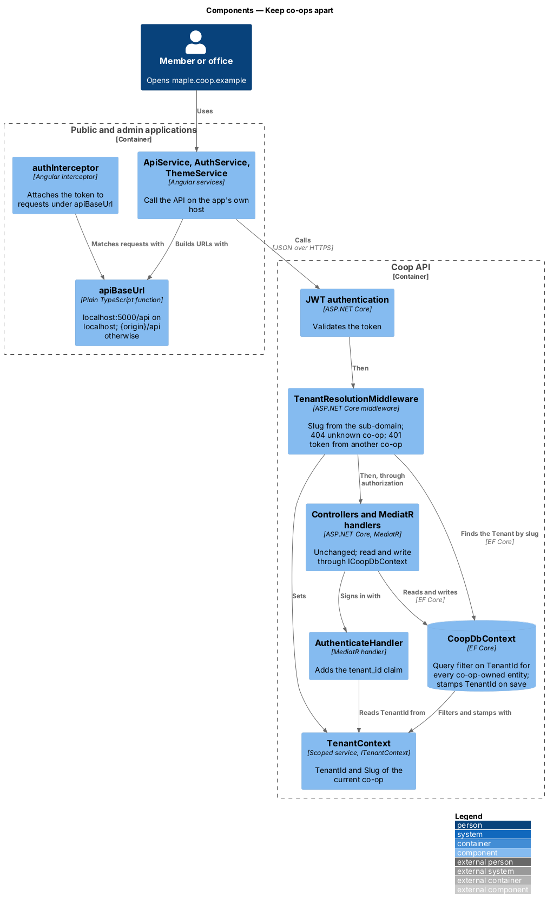
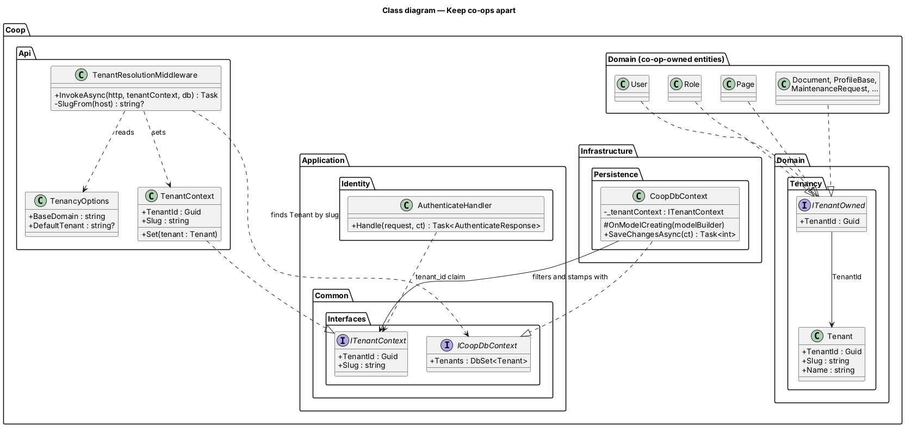
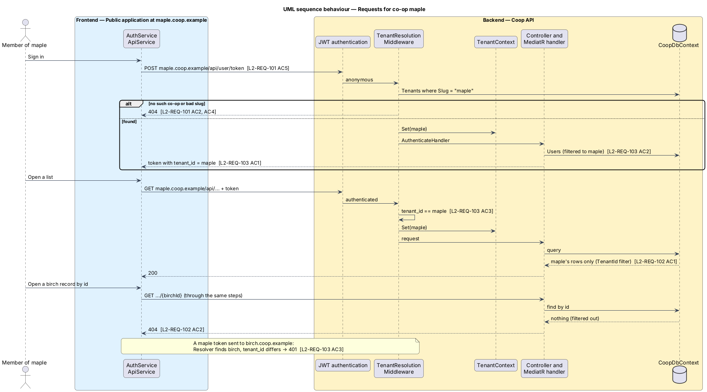

# Keep co-ops apart

## Overview

The platform serves one co-operative today. This feature lets one deployment
and one database serve several co-operatives, each at its own web address,
while no co-op can see or change another's data (L1-REQ-021).

The feature is cross-cutting. It changes the Coop API's persistence, sign-in
and request pipeline, and the way the public and admin apps find the API. It
adds no screen, dialog or notification, and no mock changes. ADR 0009
records the choices: one database, the sub-domain names the co-op, EF Core
query filters enforce the limit, and the token names its co-op.

Terms used in this design:

- **co-op** — one co-operative served by the platform; the code calls it a
  tenant
- **slug** — a co-op's short web name, lowercase letters, digits and
  hyphens, 3 to 63 characters, for example `maple`
- **base domain** — the platform's domain, `Tenancy:BaseDomain`, for
  example `coop.example`; co-op `maple` is reached at `maple.coop.example`
- **co-op-owned** — an entity with a `TenantId`; every entity except
  `Tenant`
- **current co-op** — the co-op a request is for, held by `ITenantContext`
  for the length of the request

## Description

### Domain

`Tenant` (`backend/src/Coop.Domain/Tenancy/`) holds `TenantId` (`Guid`),
`Slug` and `Name`. `ITenantOwned` (same folder) declares `Guid TenantId`.
These entities implement it and gain the property:

| Module | Entities |
|--------|----------|
| Identity | `User`, `Role`, `Privilege` |
| Profiles | `ProfileBase` (and so `Member`, `BoardMember`, `StaffMember`, `OnCall`) |
| Maintenance | `MaintenanceRequest`, `MaintenanceRequestComment`, `MaintenanceRequestDigitalAsset` |
| Documents | `Document` (and so `Notice`, `ByLaw`, `Report`) |
| Messaging | `Conversation`, `Message` |
| Assets | `DigitalAsset` |
| CMS | `Theme`, `JsonContent`, `Page` |
| Onboarding | `InvitationToken` |
| Event sourcing | `StoredEvent` |

`Constants.ClaimTypes` (`Coop.SharedKernel`) gains `TenantId = "tenant_id"`.

### Application

`ITenantContext` (`Coop.Application/Common/Interfaces/`) exposes
`Guid TenantId` and `string Slug` for the current request. `ICoopDbContext`
gains `DbSet<Tenant> Tenants`. Handlers do not filter by co-op; the
persistence layer does it for them.

`AuthenticateHandler` adds a `tenant_id` claim with the current co-op's
`TenantId`. Because `Users` is filtered, an account from another co-op is
not found, and sign-in fails with the existing "Invalid credentials."
message (L2-REQ-103 AC2).

### Infrastructure

`CoopDbContext` takes `ITenantContext` through its constructor. In
`OnModelCreating`, for every entity type that implements `ITenantOwned`, it:

- adds the query filter `e => e.TenantId == _tenantContext.TenantId`,
  combined with the existing `IsDeleted` filter where one exists, because
  EF Core keeps one filter per entity type;
- adds an index that starts with `TenantId`.

`UserConfiguration` changes the username index to unique
`(TenantId, Username)`. `PageConfiguration` changes the slug index to unique
`(TenantId, Slug)`. `TenantConfiguration` adds a unique index on `Slug`.

`SaveChangesAsync` sets `TenantId` on every `Added` entry that implements
`ITenantOwned` to the current co-op, before the existing domain-event
dispatch, so a value sent in a request body is overwritten (L2-REQ-102 AC3).

No handler calls `IgnoreQueryFilters()` or raw SQL on co-op-owned tables.
`TenantResolutionMiddleware` reads `Tenants`, which has no filter.

### API

`TenancyOptions` binds the `Tenancy` section:

| Setting | Purpose |
|---------|---------|
| `Tenancy:BaseDomain` | Domain under which each co-op's sub-domain is read, for example `coop.example` |
| `Tenancy:DefaultTenant` | Slug used when the host is not under the base domain; set to the seeded co-op in `appsettings.Development.json` and in the acceptance tests |

`TenantContext` (`Coop.Api/Tenancy/`) implements `ITenantContext` and is
registered scoped. `TenantResolutionMiddleware` (`Coop.Api/Middleware/`):

1. Takes the request host. When it ends with `.{BaseDomain}`, the label
   before it is the slug; otherwise the slug is `DefaultTenant`.
2. Answers 404 when there is no slug, the slug breaks the slug rule, or no
   `Tenant` has it (case ignored). Nothing else runs (L2-REQ-101 AC2–AC4).
3. Sets `TenantContext`.
4. When the caller is authenticated, answers 401 unless the `tenant_id`
   claim equals the current co-op's `TenantId` (L2-REQ-103 AC3, AC4).

`Program.cs` places it after `UseAuthentication()` and before
`UseAuthorization()`, keeping the order Swagger, CORS, exception handling,
authentication, authorization (AGENTS.md):

```
UseSerilogRequestLogging → Swagger → UseCors → ExceptionHandlingMiddleware
→ UseAuthentication → TenantResolutionMiddleware → UseAuthorization → MapControllers
```

Controllers, routes and response bodies do not change. A record in another
co-op is not found by its handler, which answers 404 as it already does for
a missing id (L2-REQ-102 AC2, AC4, AC5).

### Seed data

`SeedData.SeedAsync` first ensures one fictional co-op, `Tenant` with slug
`sunrise` and name "Sunrise Co-op (sample)", and seeds every existing
record inside it. It sets the seeding scope's `TenantContext` to that co-op,
so `SaveChangesAsync` stamps every seeded row. Its existing "already
present" checks run under the co-op's filter, so a second run adds nothing
(L2-REQ-105). The schema is still created with `EnsureCreated`; an existing
development database is recreated (ADR 0009).

### Public and admin applications

Each app replaces its hard-coded `http://localhost:5000/api` with one
function, `apiBaseUrl(location)`, in plain TypeScript beside its
`ApiService`:

- `http://localhost:5000/api` when the host is `localhost` or `127.0.0.1`;
- `{location.origin}/api` otherwise, so `maple.coop.example` calls
  `maple.coop.example/api` (L2-REQ-101 AC5).

`ApiService`, `AuthService` and the public `ThemeService` use it, and the
public `authInterceptor` attaches the token when the request URL starts with
it instead of testing for `localhost:5000`. The apps send no co-op name. The
Playwright suite keeps answering `http://localhost:5000` and needs no change.

Serving both apps and the API on each co-op's host in production is a
reverse-proxy and wildcard DNS and TLS setting: `<TO SUPPLY>`.

### Tests

`backend/tests/Coop.Api.Tests/TenancyTests.cs` covers the API through
`CoopApiFactory` with an in-memory database (ADR 0003). The factory seeds a
second co-op, `birch`, and its `HttpClient`s set the `Host` header to choose
the co-op. The tests cover: an unknown or malformed co-op answering 404; the
default co-op at `localhost`; lists and counts holding only the caller's
co-op; another co-op's record answering 404 to read, change and delete; a
created record belonging to the caller's co-op whatever the body says;
another co-op's asset and invitation token; sign-in at the wrong co-op;
a token sent to another co-op, and one with no co-op, answering 401; and the
same username and page slug in two co-ops.

## Requirements

| L2 ID | Refines (L1) | Requirement |
|-------|--------------|-------------|
| `L2-REQ-101` | `L1-REQ-021` | The API shall decide which co-op a request is for from the sub-domain of the address the request was sent to, before any other work on the request, and the public and admin apps shall call the API on the address they were opened at. |
| `L2-REQ-102` | `L1-REQ-021` | Every read and every change shall be limited to the co-op the request is for, for every endpoint and every role, with no handler or controller able to forget the limit. |
| `L2-REQ-103` | `L1-REQ-021` | Each account shall belong to exactly one co-op, sign in only at that co-op's address, and work only at that address. |
| `L2-REQ-104` | `L1-REQ-021` | Usernames and page slugs shall be unique within a co-op, and two co-ops shall be free to use the same ones. |
| `L2-REQ-105` | `L1-REQ-021` | Seeding shall create one clearly fictional co-op and put every seeded record in it, and shall stay safe to re-run. |

## Diagrams

The components that find the co-op and keep its data apart, across the two
apps and the API:



The co-op entity, the interfaces that carry the current co-op, and the
classes that use them:



A member of `maple` signs in, reads a list, asks for a `birch` record and
sends a `maple` token to `birch`:


