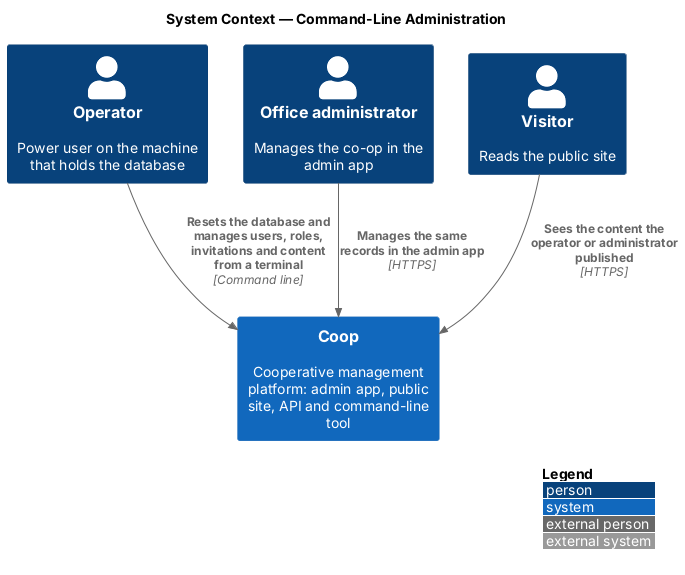
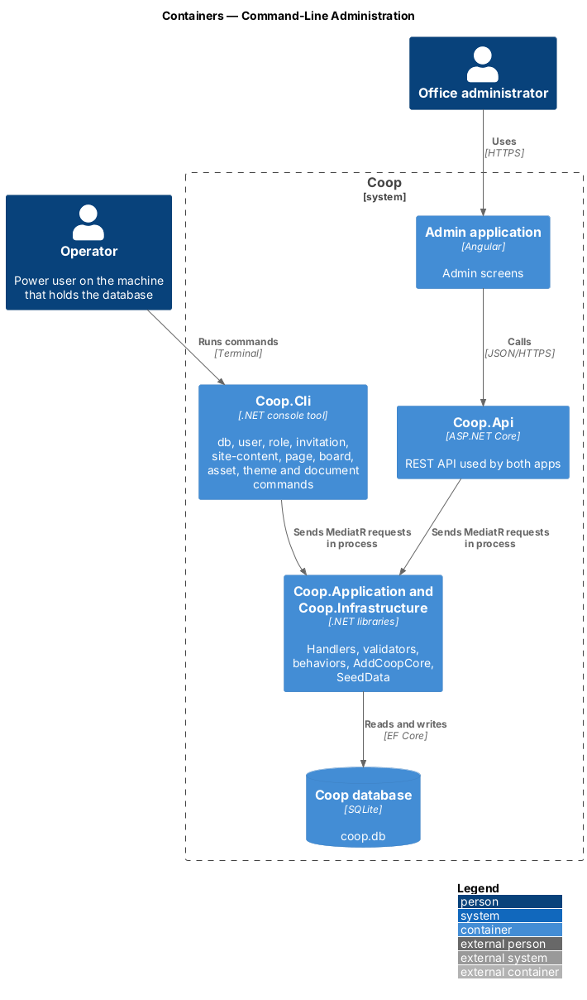
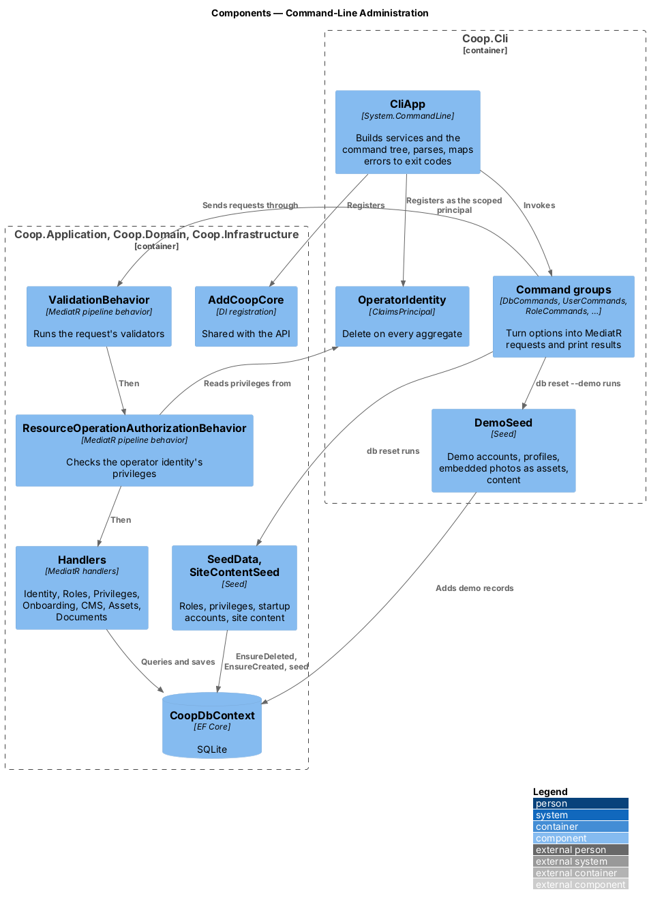
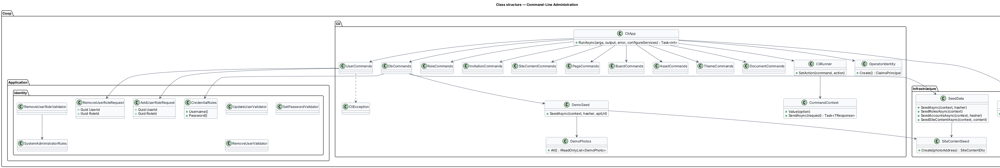
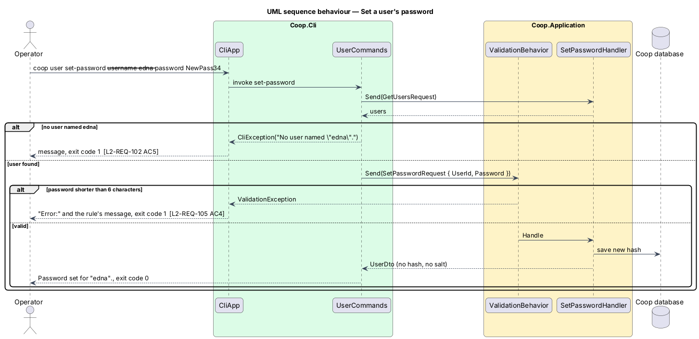
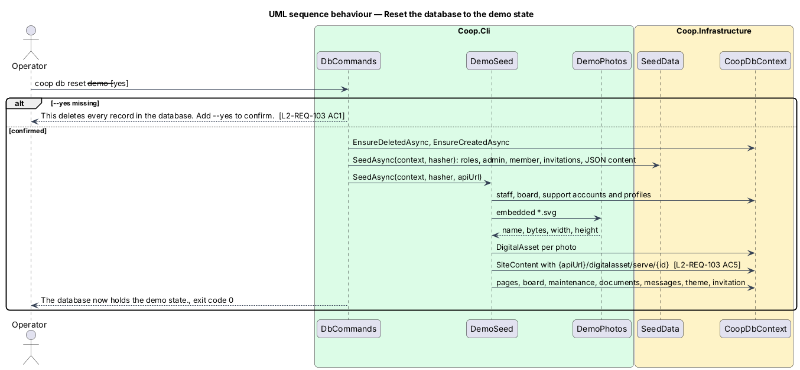

# Command-Line Administration

## Overview

`Coop.Cli` is a .NET console tool in `backend/src/Coop.Cli` for a trusted
operator on the machine that holds the database (`L1-REQ-021`). It resets the
database to a demo state or to a new, empty installation, and it administers
users, roles and privileges, invitations, the public site content, website
pages, the board list, digital assets, themes and documents from the
terminal.

The tool adds no API endpoint, entity or screen. It builds the same services
the API builds and sends the same MediatR requests through the same
validation and authorization behaviors (ADR 0012), so every rule the admin app
meets applies to the tool too. Before this feature the only way to seed a
database was the API's startup seed, which always creates the `admin` and
`member` accounts with known passwords, and there was no way to change a
password or a role without the admin app.

Terms used in this design:

- **operator** — the person running the tool; trusted because they already
  hold the database
- **operator identity** — the `ClaimsPrincipal` the tool runs every request
  as, holding `Delete` on every aggregate (ADR 0014)
- **demo state** — the database after `db reset --demo`: one sign-in per role
  and fictional content for every screen (`L2-REQ-103`)
- **new instance** — the database after `db reset --new-instance`: roles,
  privileges, one administrator and the baseline site content (`L2-REQ-104`)
- **startup seed** — `SeedData.SeedAsync`, run by the API on every start;
  unchanged by this feature

## Description

### Project and references

`Coop.Cli` (`Microsoft.NET.Sdk`, `OutputType` `Exe`) references
`Coop.Infrastructure`, `Coop.Application`, `Coop.Domain` and
`Coop.SharedKernel`, and the `Microsoft.AspNetCore.App` shared framework,
because the application contracts use `IFormFile`, `IHttpContextAccessor`
and the ASP.NET Core authorization service. It does not reference `Coop.Api`.
Its one package is `System.CommandLine` (ADR 0013).

| File | Responsibility |
|------|----------------|
| `Program.cs` | Calls `CliApp.RunAsync(args, Console.Out, Console.Error)` and returns its exit code |
| `CliApp.cs` | Builds the configuration, the services and the command tree; parses and invokes; turns exceptions into messages and exit codes |
| `CliServices.cs` | `AddCoopCore` plus the operator identity, `IHttpContextAccessor` and the authorization service |
| `OperatorIdentity.cs` | Builds the operator's `ClaimsPrincipal` |
| `CliException.cs` | A plain message for something not found or refused, printed without a stack trace |
| `CliRunner.cs` | Runs a command action in a fresh service scope and writes results |
| `Commands/*Commands.cs` | One class per group: `DbCommands`, `UserCommands`, `RoleCommands`, `InvitationCommands`, `SiteContentCommands`, `PageCommands`, `BoardCommands`, `AssetCommands`, `ThemeCommands`, `DocumentCommands` |
| `Seeding/DemoSeed.cs` | The demo accounts, profiles and content |
| `Seeding/DemoPhotos.cs` | Reads the embedded photographs |
| `appsettings.json` | `ConnectionStrings:DefaultConnection` = `Data Source=coop.db`, as the API |

The public app's photographs, `frontend/projects/public/public/own/*.svg`,
are linked into the project as embedded resources
(`<EmbeddedResource Include="..\..\..\frontend\projects\public\public\own\*.svg" LinkBase="Photos" />`),
so the tool carries them without a second copy in the repository.

### Shared services

`Coop.Infrastructure/Dependencies.cs` holds `AddCoopCore(services,
configuration)`, moved out of the API's `Dependencies.cs`: the `CoopDbContext`
on SQLite from `DefaultConnection`, `ICoopDbContext`, MediatR with
`ValidationBehavior` and `ResourceOperationAuthorizationBehavior`, the
validators, `IPasswordHasher`, `ITokenProvider`, `ITokenBuilder`,
`INotificationService`, the notice sender chosen by `Notices:Email` (ADR 0008)
and `ResourceOperationAuthorizationHandler`. The API's `AddCoopServices`
calls it and then adds the HTTP context, the JWT bearer scheme, CORS, Swagger
and controllers, so the API's behaviour is unchanged.

`CliServices` calls `AddCoopCore`, then `AddLogging`, `AddAuthorizationCore`,
`AddHttpContextAccessor` (no request, so handlers that need one are not
exposed) and a scoped `ClaimsPrincipal` from `OperatorIdentity.Create()`. No
web host starts. Configuration comes from the tool's `appsettings.json`, then
environment variables, then `--connection`, which replaces
`ConnectionStrings:DefaultConnection`.

### Command tree

Every command takes the global `--connection <connection string>` option and
`--help`.

| Command | Example | Request(s) |
|---------|---------|------------|
| `db reset --demo --yes [--api-url]` | `coop db reset --demo --yes` | reset, `SeedData`, `DemoSeed` |
| `db reset --new-instance --admin-username --admin-password --yes` | `coop db reset --new-instance --admin-username ruth --admin-password "S3cure-pass" --yes` | reset, `SeedData.SeedRolesAsync`, `CreateUserRequest`, `SeedData.SeedSiteContentAsync` |
| `user list` | `coop user list` | `GetUsersRequest` |
| `user create --username --password [--role]...` | `coop user create --username edna --password "Garden12" --role Member` | `GetRolesRequest`, `CreateUserRequest` |
| `user rename --username --new-username` | `coop user rename --username edna --new-username edna.w` | `UpdateUserRequest` |
| `user set-password --username --password` | `coop user set-password --username edna --password "NewPass34"` | `SetPasswordRequest` |
| `user add-role` / `user remove-role --username --role` | `coop user add-role --username edna --role BoardMember` | `AddUserRoleRequest`, `RemoveUserRoleRequest` |
| `user remove --username` | `coop user remove --username edna` | `RemoveUserRequest` |
| `role list` | `coop role list` | `GetRolesRequest` |
| `role create` / `role remove --name` | `coop role create --name Volunteer` | `CreateRoleRequest`, `RemoveRoleRequest` |
| `role grant` / `role revoke --role --aggregate --access` | `coop role grant --role Volunteer --aggregate Notice --access Read` | `CreatePrivilegeRequest`, `RemovePrivilegeRequest` |
| `invitation list` | `coop invitation list` | `GetInvitationTokensRequest` |
| `invitation create --value --type [--expires]` | `coop invitation create --value spring-2027 --type Member --expires 2027-06-30` | `CreateInvitationTokenRequest` |
| `invitation remove --value` | `coop invitation remove --value spring-2027` | `RemoveInvitationTokenRequest` |
| `site-content export [--file]` | `coop site-content export --file site.json` | `GetSiteContentRequest` |
| `site-content import --file` | `coop site-content import --file site.json` | `SaveSiteContentRequest` |
| `page list` | `coop page list` | `GetPagesRequest` |
| `page create --title --body-file [--hero-image-url --hero-image-alt]` | `coop page create --title "Our garden" --body-file garden.html` | `CreatePageRequest` |
| `page update --slug [--title] [--body-file] [--hero-image-url] [--hero-image-alt]` | `coop page update --slug our-garden --title "Our rooftop garden"` | `GetPageBySlugRequest`, `UpdatePageRequest` |
| `page remove --slug` | `coop page remove --slug our-garden` | `RemovePageRequest` |
| `board export [--file]` / `board import --file` | `coop board import --file board.json` | `GetBoardOfDirectorsRequest`, `SaveBoardOfDirectorsRequest` |
| `asset list` | `coop asset list` | `GetDigitalAssetsRequest` |
| `asset upload --file` | `coop asset upload --file lobby.png` | `CreateDigitalAssetRequest` |
| `asset remove --id` | `coop asset remove --id 3f2c…` | `RemoveDigitalAssetRequest` |
| `theme list` | `coop theme list` | `GetThemesRequest` |
| `theme create --css-file [--default]` | `coop theme create --css-file theme.css --default` | `CreateThemeRequest` |
| `theme update --id --css-file [--default]` / `theme remove --id` | `coop theme remove --id 7a1e…` | `UpdateThemeRequest`, `RemoveThemeRequest` |
| `notice`/`bylaw`/`report list` | `coop notice list` | `GetNoticesRequest`, `GetByLawsRequest`, `GetReportsRequest` |
| `<type> create --name [--body] [--asset-id] [--publish]` | `coop notice create --name "Window cleaning" --body "Tuesday 9 am." --publish` | `CreateNoticeRequest` (…), `PublishDocumentRequest` |
| `<type> update --id --name [--body] [--asset-id]` | `coop report update --id 1b9d… --name "2026 budget"` | `UpdateNoticeRequest` (…) |
| `<type> publish --id` / `<type> remove --id` | `coop bylaw publish --id 5c0a…` | `PublishDocumentRequest`, `RemoveByLawRequest` (…) |
| `notice send --id` | `coop notice send --id 9e44…` | `SendNoticeRequest` |

Commands that take a name (a username, a role name, a slug, an invitation
value) look the record up with the list query and send the request with its
id; when nothing matches they raise a `CliException` such as
`No user named "ghost".` Bylaws have no body, so `bylaw create` and
`bylaw update` do not offer `--body`.

### Results and errors

Each command action runs in a new service scope. A list prints one line per
record with aligned columns; a change prints one line such as
`Created user "edna" with roles Member.`; an export prints indented camel-case
JSON, the API's own shape. Users are printed from `UserDto`, which holds no
password, hash or salt, and no command echoes a password (`L2-REQ-102` AC6).

`CliApp` maps exceptions to exit code 1: a `ValidationException` prints
`Error:` and each failure's message on its own line; a `CliException`, an
`UnauthorizedAccessException` or a `JsonException` reading an input file
prints its message. Parse errors are printed by System.CommandLine with exit
code 1. Success is exit code 0.

### Application changes

The tool needs a few rules the handlers did not have. They live in
`Coop.Application`, so the API gets them too:

- `Identity/CredentialRules.cs` holds the username rule (at least 3
  characters) and the password rule (at least 6 characters) that
  `CreateUserValidator` already applied; `CreateUserValidator`,
  `ChangePasswordValidator` and a new `SetPasswordValidator` use them, and the
  new-instance reset checks the administrator's options against them before
  deleting anything (`L2-REQ-104` AC3).
- `CreateUserValidator` and a new `UpdateUserValidator` reject a username
  another user holds with `The username "{name}" is already taken.`
  (`L2-REQ-001` AC4, `L2-REQ-105` AC2, AC3).
- `AddUserRole` and `RemoveUserRole` (`Identity/Commands/`) add or remove one
  role, which `UpdateUserRequest` cannot do because it replaces the whole set
  and ignores an empty one. Adding a role the user holds changes nothing.
- `RemoveUserValidator` and `RemoveUserRoleValidator` refuse to leave no
  active user holding SystemAdministrator (`At least one system administrator
  must remain.`), and `RemoveRoleValidator` refuses to remove the
  SystemAdministrator role (`L2-REQ-105` AC8, `L2-REQ-106` AC3). Allowing it
  would leave an installation nobody can administer except by resetting it.
- `CreatePrivilegeValidator` rejects an aggregate outside
  `Constants.Aggregates.All`.
- `CreateRoleHandler`, `CreatePrivilegeHandler` and
  `CreateInvitationTokenHandler` return the existing record on a repeat
  (ADR 0015), and `CreateInvitationTokenValidator` requires a value.

### Seeding

`SeedData` and `SiteContentSeed` move from `Coop.Api` to
`Coop.Infrastructure/Persistence/Seeding/`. `SeedData.SeedAsync` keeps its
steps and order, so the API's startup seed is unchanged; it is split into
`SeedRolesAsync` (roles and privileges, including the `Page` back-fill),
`SeedAccountsAsync`, `SeedInvitationsAsync`, `SeedBoardAsync`,
`SeedJsonContentAsync` and `SeedSiteContentAsync`, which the resets reuse.
`SiteContentSeed.Create(photo)` takes an optional function that maps each
photograph's file name (`hero.svg`) to its address; without it the addresses
stay the public app's own files (`/own/hero.svg`), the baseline of
`L2-REQ-100` AC1.

`db reset` asks for `--yes` before anything else, then calls
`EnsureDeletedAsync` and `EnsureCreatedAsync` on `CoopDbContext`, the way the
API creates the schema; no migrations are added.

`--new-instance` checks the administrator's username and password against
`CredentialRules` before deleting, then seeds roles, sends
`CreateUserRequest` with the SystemAdministrator role, and seeds the
baseline site content. Nothing else is created.

`--demo` runs `SeedData.SeedAsync` (roles, `admin`, `member`, invitation
tokens and JSON content), then `DemoSeed.SeedAsync(context, hasher, apiUrl)`:

| Area | Demo content |
|------|--------------|
| Accounts | `staff` / `Staff123!` (Staff), `board` / `Board123!` (BoardMember), `support` / `Support123!` (Support), beside `admin` / `Admin123!` and `member` / `Member123!` |
| Profiles | the member's Member profile renamed to a fictional resident with a unit; a StaffMember profile for `staff` and a BoardMember profile for `board`, each current and default |
| Assets | each embedded photograph as a `DigitalAsset` (`image/svg+xml`) with its width and height |
| Site content | `SiteContentSeed.Create` with every photo at `{api-url}/digitalasset/serve/{id}` |
| Pages | "About us" and "Living here", each with a hero photo asset and its description |
| Board | four directors with portrait photo assets |
| Maintenance | one request in each status (New, Received, Started, Completed) from the member, with comments from the member and the office, and a photo on one stored as its own asset, because the API serves maintenance photos only to the household and the office |
| Documents | published and draft notices, bylaws and reports |
| Messages | a conversation between the member and the office, the last message unread; the admin app reads the office's conversations under the empty profile id, so the office takes part under that id |
| Themes | one default theme |
| Invitations | the startup seed's tokens and a Board member invitation that expires in 2027 |

Photo addresses are absolute, `{api-url}/digitalasset/serve/{id}`, because
both apps call the API at `http://localhost:5000/api` and the admin photo
picker stores the same form. `--api-url` changes the base when the API runs
elsewhere. Resetting again deletes everything first, so two demo resets give
the same state (`L2-REQ-103` AC7). Every name, unit, phone number and address
is fictional; e-mail addresses use `.test` and `.example`.

### Tests

`backend/tests/Coop.Cli.Tests` references `Coop.Cli` and `Coop.Api`.
`CliTestHost` is a `WebApplicationFactory<Program>` like `CoopApiFactory`:
it puts the API on an in-memory database with a named `InMemoryDatabaseRoot`
and records notices with `RecordingNoticeSender`. `RunAsync(args)` calls
`CliApp.RunAsync` with string writers and a service override that puts the
tool on the same in-memory database and notice sender, and returns the exit
code, output and error. Tests then check the result through HTTP: after
`user set-password` they sign in through `POST /api/user/token` with the new
password; after `site-content import` they read `GET /api/site-content`. No
test uses SQLite or a file (ADR 0003).

## Requirements

| L2 ID | Refines (L1) | Requirement |
|-------|--------------|-------------|
| `L2-REQ-102` | `L1-REQ-021` | The tool shall group its commands, read the API's connection setting, print plain results and errors with exit codes, and run as the operator identity. |
| `L2-REQ-103` | `L1-REQ-021` | `db reset --demo --yes` shall recreate the database with one sign-in per role and fictional content for every admin screen and the public site. |
| `L2-REQ-104` | `L1-REQ-021` | `db reset --new-instance` shall recreate the database with roles, privileges, one given administrator and the baseline site content only. |
| `L2-REQ-105` | `L1-REQ-021` | The `user` group shall list, create, rename, re-password, change the roles of and remove users. |
| `L2-REQ-106` | `L1-REQ-021` | The `role` group shall list, create and remove roles and grant or revoke privileges. |
| `L2-REQ-107` | `L1-REQ-021` | The `invitation` group shall list, create and remove invitation tokens. |
| `L2-REQ-108` | `L1-REQ-021` | The tool shall manage the site content, pages, board list, assets and themes. |
| `L2-REQ-109` | `L1-REQ-021` | The document groups shall list, create, update, publish and remove documents and send a notice. |

## Diagrams

The system context places the operator beside the office administrator: both
change the same database, one through the admin app and the API, the other
through the tool.

The container view shows the tool reaching the database directly, beside the
API, and sharing the application and infrastructure libraries with it.

Inside the tool, `CliApp` parses the arguments into a command group, which
sends requests through the same behaviors as the API under the operator
identity.

The class diagram shows the tool's classes, the shared registration and seed,
and the new application requests.

Setting a password resolves the user by name, sends the request through
validation and saves the new hash; a weak password is refused before the
handler runs.

A demo reset deletes and creates the database, runs the startup seed, then
stores the photographs as assets and points the site content at them.

