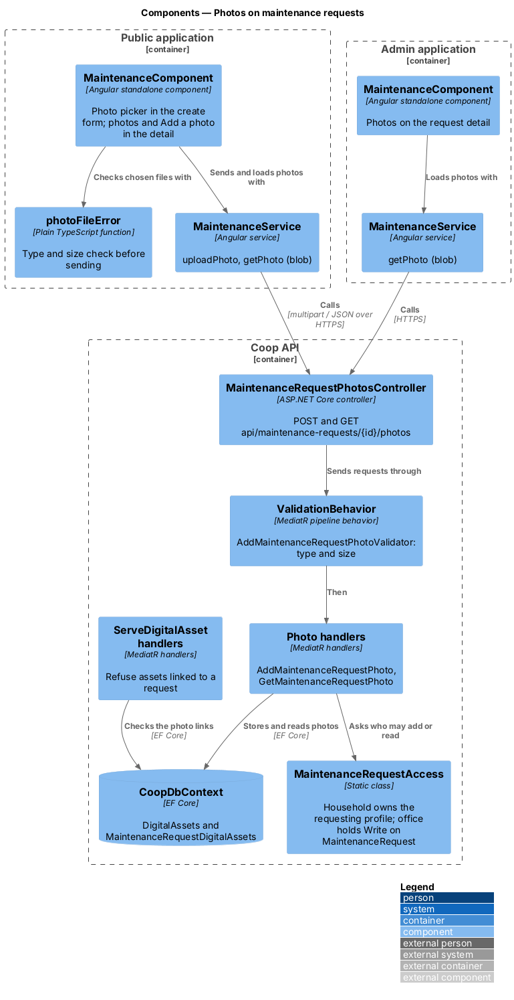
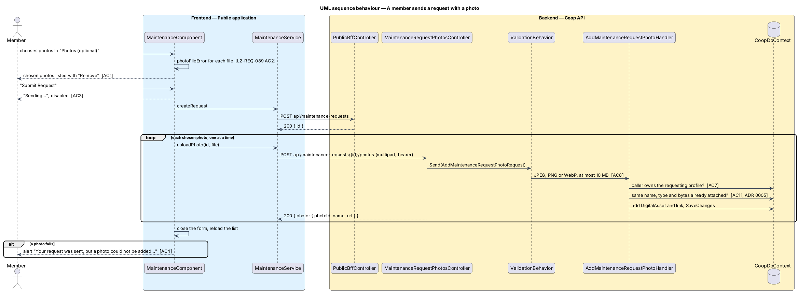
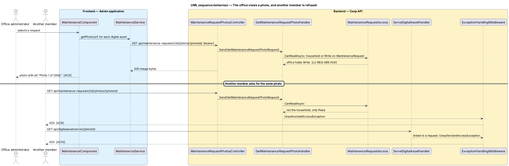

# Photos on maintenance requests

**Status:** Moved to the admin site on 21 October 2026. Members now do this on
the admin Maintenance screen's create dialog and the member's request detail (L2-REQ-115); the public member pages are removed (L2-REQ-110, ADR 0016). The API
part of this design still holds. The design of the admin screens is
`docs/detailed-designs/admin-app/member-areas-by-role/README.md`; the public
screens, mocks and tests described below are kept for the record only.

## Overview

A photo often says more about a leak or a crack than a description can.
Members attach photos to their own maintenance requests from the public app,
when they create a request or later from its detail, and the office sees them
on the request detail of the admin app. The photos are private: only the
household that made the request and the office can read them.

The screens are drawn in `docs/mocks/dialogs/public-maintenance-create/`
(photos, sending, photo-invalid), `docs/mocks/dialogs/public-maintenance-detail/`
(photos, adding-photo, photo-error), `docs/mocks/pages/public-maintenance/photo-failed.html`
and `docs/mocks/pages/admin-maintenance/detail-photos.html`.

The feature belongs to the public-app subsystem of Coop and to the
Maintenance and Assets modules of the API. Photos are stored through the
existing digital asset service: one `DigitalAsset` holds the bytes and one
`MaintenanceRequestDigitalAsset` links it to the request.

Terms used in this design:

- **photo** — JPEG, PNG or WebP picture of at most 10 MB attached to a request
- **household** — the user who owns the profile that made the request
- **office** — a role holding Write or higher on the `MaintenanceRequest`
  aggregate (Staff, Support, BoardMember, SystemAdministrator in the seed)
- **photo address** — `/api/maintenance-requests/{id}/photos/{photoId}`; the
  apps fetch it with the signed-in user's token and show it from a blob URL

## Description

### API

`MaintenanceRequestPhotosController`
(`backend/src/Coop.Api/Controllers/Maintenance/`) translates HTTP to MediatR:

| Route | Who | Request |
|-------|-----|---------|
| `POST api/maintenance-requests/{id}/photos` | the household | `AddMaintenanceRequestPhotoRequest { maintenanceRequestId, file }` (multipart) → `{ photo: { photoId, name, url } }` |
| `GET api/maintenance-requests/{id}/photos/{photoId}` | the household and the office | `GetMaintenanceRequestPhotoRequest` → the photo bytes with their content type |

`AddMaintenanceRequestPhotoValidator` requires a file whose content type is
`image/jpeg`, `image/png` or `image/webp` ("Choose a JPEG, PNG or WebP
photo.") and whose length is between 1 byte and 10 MB ("Choose a photo
smaller than 10 MB."). `ValidationBehavior` runs it, and
`ExceptionHandlingMiddleware` answers 400.

`MaintenanceRequestAccess` (`backend/src/Coop.Application/Maintenance/`)
holds the access rule. `IsHouseholdAsync` is true when a profile with the
request's `RequestedByProfileId` belongs to the caller's user.
`CanReadAsync` is true for the household, or when `IAuthorizationService`
grants Write on the `MaintenanceRequest` aggregate from the caller's privilege
claims.

`AddMaintenanceRequestPhotoHandler` loads the request and throws
`UnauthorizedAccessException` (403) unless the caller is the household. It
reads the file, returns the photo already attached when one with the same
name, content type and bytes exists (ADR 0005), and otherwise adds the
`DigitalAsset` and the link and saves once.

`GetMaintenanceRequestPhotoHandler` loads the request, throws
`UnauthorizedAccessException` unless `CanReadAsync` passes, and returns the
bytes of the linked asset.

`ServeDigitalAssetHandler` refuses (403) an asset that is linked to a
maintenance request, and `ServeDigitalAssetByNameHandler` skips such assets,
so the anonymous asset routes never serve a photo.

`MaintenanceRequestDigitalAssetDto` carries the photo address as `Url`; the
admin app reads it from `digitalAssets`, and `PublicBffController` returns it
as each item of `attachments`.

### Public application (removed on 21 October 2026)

`MaintenanceComponent` (`frontend/projects/public/src/app/pages/maintenance/`)
adds:

- In the create form, a labelled "Photos (optional)" picker that accepts
  several files, the hint "JPEG, PNG or WebP, up to 10 MB each.", the list of
  chosen photos with "Remove", and an alert for refused files.
  `photoFileError` (`photo-file-error.ts`) is the pure check with the same
  rules as the API.
- On "Submit Request", `sending` disables the button and shows "Sending…";
  the request is created, then each photo is sent one at a time with
  `concatMap`. If a photo fails, the form closes and `photoNotice` shows the
  page alert.
- In the detail, a "Photos" list that shows each photo with the alternative
  "Photo {n} of {title}", "No photos yet" when there are none, and an
  "Add a photo" picker with its sending text and failure alert.

`MaintenanceService.uploadPhoto` posts the file as multipart form data and
`getPhoto` fetches a photo address as a blob; the component keeps
`photoUrls` of object URLs by photo id.

### Admin application

`MaintenanceComponent` (`frontend/projects/admin/src/app/features/maintenance/`)
loads each digital asset of the selected request with
`MaintenanceService.getPhoto` (`ApiService.getBlob`) and shows the photos in
the detail's "Photos" list, each linking to the full picture.

### Tests

`backend/tests/Coop.Api.Tests/MaintenancePhotosTests.cs` covers adding,
reading by the household and the office, refusal of another member and of
the anonymous asset route, the type and size rules, and re-posting.
`CoopApiFactory.CreateNeighbourClientAsync` seeds a fictional member of
another household. The Playwright mock API serves the two photo routes with
the same rules; `e2e/tests/public/maintenance.spec.ts` and
`e2e/tests/admin/maintenance.spec.ts` cover the screens.

## Requirements

| L2 ID | Refines (L1) | Requirement |
|-------|--------------|-------------|
| `L2-REQ-029` | `L1-REQ-005` | Photos can be attached to a maintenance request as evidence. |
| `L2-REQ-089` | `L1-REQ-005`, `L1-REQ-008` | Members attach photos to their own requests, the office sees them, and the photos stay private to the household and the office. |

## Diagrams

Components in the two applications and the API, with the access rule shared
by the photo handlers and the refusal in the general asset routes:

A member sends a request with a photo:

The office views a photo, and another member is refused:

