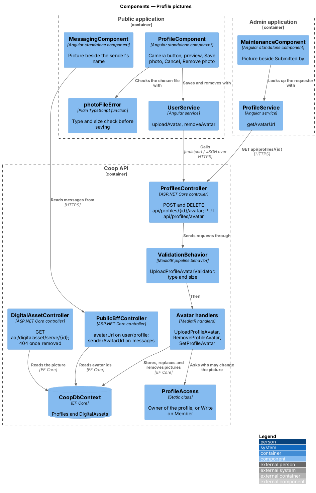
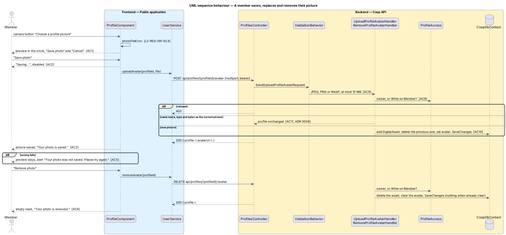

# Profile pictures

## Overview

A face helps neighbours see who is writing. Members set, replace and remove
the picture on their own profile from the public app, and the picture shows
beside their name on messages and, for the office, on the maintenance
requests they make (L2-REQ-091). The pictures are kept by the existing
digital asset service: the profile's `AvatarDigitalAssetId` points at one
`DigitalAsset` (L2-REQ-016).

The screens are drawn in `docs/mocks/pages/public-profile/` (photo,
photo-preview, photo-saving, photo-invalid, photo-too-large, photo-error,
photo-removed),
`docs/mocks/pages/public-messaging/chat-photo.html` and
`docs/mocks/pages/admin-maintenance/detail-submitter-photo.html`.

The feature belongs to the public-app subsystem of Coop and to the Profiles
and Assets modules of the API.

Terms used in this design:

- **picture** — JPEG, PNG or WebP image of at most 10 MB set on a profile
- **owner** — the user the profile belongs to
- **office** — a role holding Write or higher on the `Member` aggregate
  (Staff, Support, BoardMember, SystemAdministrator in the seed)
- **picture address** — `/api/digitalasset/serve/{digitalAssetId}`; the apps
  turn it into a full address with `ApiService.assetUrl` and show it in an
  `img`. The route is anonymous, as it already was, so an image tag can load
  it; the identifier cannot be guessed and changes on every new picture.

## Description

### API

`ProfilesController` (`backend/src/Coop.Api/Controllers/Profile/`)
translates HTTP to MediatR:

| Route | Request | Answer |
|-------|---------|--------|
| `POST api/profiles/{profileId}/avatar` | `UploadProfileAvatarRequest { profileId, file }` (multipart) | `{ profile }` |
| `DELETE api/profiles/{profileId}/avatar` | `RemoveProfileAvatarRequest { profileId }` | `{ profile }` |
| `PUT api/profiles/avatar` | `SetProfileAvatarRequest { profileId, digitalAssetId }` (unchanged, now guarded) | `{ profile }` |

`UploadProfileAvatarValidator` requires a file whose content type is
`image/jpeg`, `image/png` or `image/webp` ("Choose a JPEG, PNG or WebP
photo.") and whose length is between 1 byte and 10 MB ("Choose a photo
smaller than 10 MB."). `ValidationBehavior` runs it, and
`ExceptionHandlingMiddleware` answers 400.

`ProfileAccess.CanChangePictureAsync` (`backend/src/Coop.Application/Profiles/`)
is true when the caller's user id is the profile's `UserId`, or when
`IAuthorizationService` grants Write on the `Member` aggregate. The three
handlers throw `UnauthorizedAccessException` (403) otherwise.

`UploadProfileAvatarHandler` reads the file and returns the profile
unchanged when the current picture has the same name, content type and bytes
(ADR 0006). Otherwise it adds the new `DigitalAsset`, removes the previous
one, sets the avatar with `ProfileBase.SetAvatar` and saves once.
`RemoveProfileAvatarHandler` removes the asset and calls
`ProfileBase.ClearAvatar`; a profile without a picture is returned
unchanged.

`ProfileDto` carries the picture address as `AvatarUrl`
(`ProfileDto.AvatarUrlFor`). `PublicBffController` returns it as `avatarUrl`
on `GET api/user/profile` and as `senderAvatarUrl` on each message of
`api/conversations/{id}/messages`. `ServeDigitalAssetHandler` returns nothing
for an asset that no longer exists, and `DigitalAssetController.Serve`
answers 404, so a replaced or removed picture is no longer served.

### Public application

`ProfileComponent` (`frontend/projects/public/src/app/pages/profile/`):

- The camera button, named "Choose a profile picture", opens a file picker
  for JPEG, PNG and WebP. `photoFileError` (shared with maintenance photos)
  checks the file; a refused file shows its message as an alert.
- A chosen file shows in the circle from an object URL (`previewUrl`) with
  "Save photo" and "Cancel". `savePhoto` sends it with
  `UserService.uploadAvatar`; while `savingPhoto` the button reads "Saving…"
  and both buttons are disabled. Success shows "Your photo is saved." with
  `role="status"`; failure keeps the preview and shows "Your photo was not
  saved. Please try again." with `role="alert"`.
- With a saved picture, "Remove photo" calls `UserService.removeAvatar`
  ("Removing…", then "Your photo is removed.").
- The hint "JPEG, PNG or WebP, up to 10 MB." sits under the controls. The
  camera button and the photo buttons are at least 44 px tall.

`MessagingComponent` shows `senderAvatarUrl` as a 28 px circle before the
sender's name when it is set; `MessagingService` maps it with
`ApiService.assetUrl`. When it is not set, the same circle shows the
sender's initials (`sender-initials.ts`), so every message has one.

### Admin application

`MaintenanceComponent` (`frontend/projects/admin/src/app/features/maintenance/`)
looks up the requester with `ProfileService.getAvatarUrl`
(`GET api/profiles/{id}`) when a request is selected, and shows the picture
as a 32 px circle before "Submitted by" when there is one.

### Tests

`backend/tests/Coop.Api.Tests/ProfilePictureTests.cs` covers saving and
reloading, refusal of another member on all three routes, the office, the
type and size rules, replacing and removing (the old pictures answer 404),
re-posting and removing twice, and `senderAvatarUrl` on messages. The
Playwright mock API serves the avatar routes and `digitalasset/serve/{id}`
with the same rules; `e2e/tests/public/profile.spec.ts`,
`e2e/tests/public/messaging.spec.ts` and `e2e/tests/admin/maintenance.spec.ts`
cover the screens.

## Requirements

| L2 ID | Refines (L1) | Requirement |
|-------|--------------|-------------|
| `L2-REQ-016` | `L1-REQ-004` | A profile's avatar can be set or cleared. |
| `L2-REQ-091` | `L1-REQ-004`, `L1-REQ-008` | Members set, replace and remove their own picture; only the owner and the office change it; it shows beside their name on messages and requests. |

## Diagrams

Components in the two applications and the API, with the access rule shared
by the avatar handlers:

A member saves, replaces and removes their picture:

