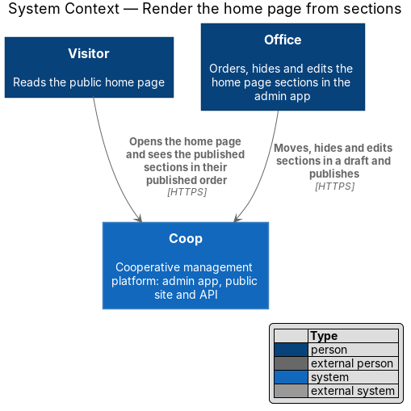
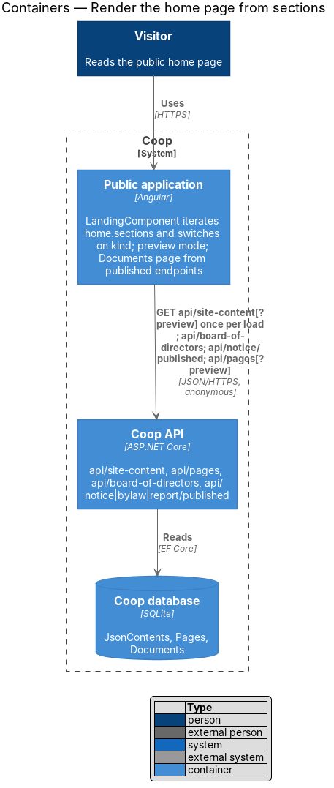
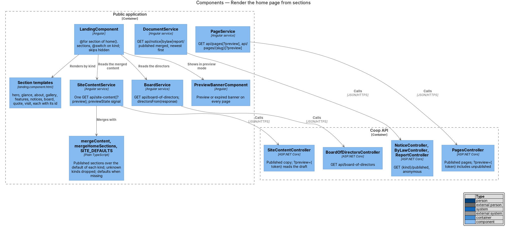
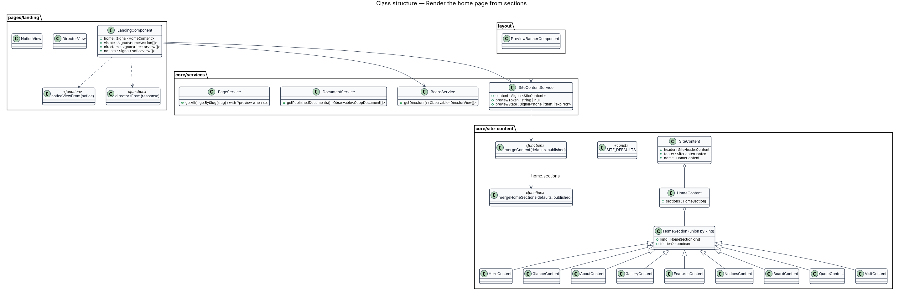
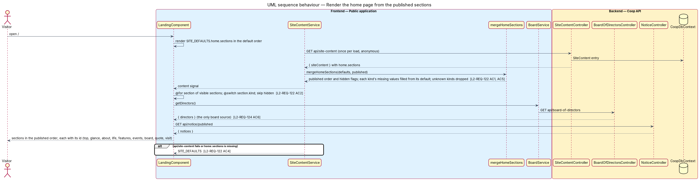

# Render the home page from sections

## Overview

The public home page at `/` used to draw its sections in an order fixed in
`landing.component.html`, from one named object per block in the site
content (`home.hero`, `home.glance`, …). The office could change every word
but could not move or hide a section without a release. The home content
now holds an ordered list, `home.sections`, each entry with a `kind` and an
optional `hidden` flag, and `LandingComponent` renders the list in order by
kind with the templates it already had (`L2-REQ-122`, ADR 0021). The
built-in defaults stay the fallback (`L2-REQ-100`).

The same change tidies what the public application reads: the board comes
from `api/board-of-directors` only (`L2-REQ-124`), the Documents page reads
the published by-laws, notices and reports (`L2-REQ-126`), the calls to
routes that did not exist are gone, and the application renders the
office's draft when opened with a preview token (`L2-REQ-125`, ADR 0019).
Website pages render their blocks (`L2-REQ-123`), designed with the page in
`../show-content-page/`.

The feature belongs to the public-app subsystem of Coop. The office edits
the sections in the admin's Website area (`../../admin-app/website-area/`).

Terms used in this design:

- **section** — one horizontal part of the home page with a `kind`: `hero`,
  `glance`, `about`, `gallery`, `features`, `notices`, `board`, `quote` or
  `visit`
- **hidden section** — a section the office kept but took off the public
  page; it is skipped when rendering
- **default sections** — the nine sections in `SITE_DEFAULTS`, in the
  default order, shown when the content cannot be loaded or lacks a value
- **preview mode** — the application opened with `?preview={token}`,
  reading the draft and unpublished pages and saying so in a banner
- **section id** — the `id` each rendered section carries (`top`,
  `glance`, `about`, `life`, `features`, `events`, `board`, `quote`,
  `visit`) for menu links, footer links and the admin's preview pane

## Description

### Content types

`core/site-content/home-content.ts` becomes `{ sections: HomeSection[] }`.
`home-section.ts` is the discriminated union of the nine section types and
`home-section-kind.ts` the union of their `kind` strings. Each existing
content type (`HeroContent`, `GlanceContent`, `AboutContent`,
`GalleryContent`, `FeaturesContent`, `NoticesContent`, `BoardContent`
replacing `SectionHead`, `QuoteContent`, `VisitContent`) gains `kind` and
`hidden?: boolean` and keeps its values. `site-defaults.ts` lists
`home.sections` in the default order with `hidden` unset.

### Merging

`mergeContent` keeps its value-by-value rule for the header and footer and
hands `home.sections` to `mergeHomeSections`
(`core/site-content/merge-home-sections.ts`): when the published value is a
list, each entry whose `kind` names a default section is laid over that
default value by value (so a hero without a badge gets the default badge,
`L2-REQ-122` AC5), its `hidden` is kept when it is `true`, entries with an
unknown kind are dropped and the published order is kept; when the value
is missing or not a list, the default list is used (`L2-REQ-122` AC4). A
kind the published list leaves out is left out.

### Rendering

`LandingComponent` (`pages/landing/`) exposes `sections`, a computed signal
of the merged list without the hidden entries, and renders
`@for (section of sections(); track section.kind)` with
`@switch (section.kind)`; each case is the former section template with the
section's values and its id. The first case, `hero`, keeps the page's only
`h1`. Value-card colours and feature-row sides still follow position within
their section. Nothing else in the templates changes, so the Playwright
page object's selectors hold.

The board section reads `BoardService.getDirectors()`
(`core/services/board.service.ts`, `GET api/board-of-directors`), mapped by
`directorsFrom` in `landing-view-model.ts` to `DirectorView` (name, title,
initials, optional photo). The former `JsonContentService`, the
`board-members` and `boardmembers` fallbacks and `boardMembersFrom*` are
removed (`L2-REQ-124` AC6, `L2-REQ-126` AC3). The notices section keeps
`GET api/notice/published`.

### Preview mode

`SiteContentService` reads `preview` from the page's query string when it
is created, keeps it as `previewToken`, and requests
`api/site-content?preview={token}` when set; a 403 sets `previewState` to
`expired` and the service requests the published copy instead; a success
sets it to `draft`; without a token it is `none` (`L2-REQ-125` AC2, AC6,
AC7). `PageService` appends the same token to `api/pages` and
`api/pages/{slug}` so the header lists and the page route serves
unpublished pages in preview (`L2-REQ-125` AC3). Router links keep the
query through `queryParamsHandling: 'preserve'` in the shared header and
footer. `PreviewBannerComponent` (`layout/preview-banner/`) shows the
banner at the top of `SiteHeaderComponent` and of the Documents layout:
"Preview. You are looking at unpublished changes. Visitors see the published
website." or the expired sentence, as a polite status in the site's own
styles (`own-preview-banner`, both themes).

### Website page blocks

`ContentPageComponent` (`../show-content-page/`) renders `page.sections` in
order: a Heading as `h2`, a Paragraph as `p`, a Bullet list as `ul`, a
Photo as `img` with its description and size, a Link button as `a.own-btn`
through `SiteLinkDirective`, and an Existing content block through
`[innerHTML]` with the existing sanitising (`L2-REQ-123` AC6). `WebsitePage`
(`core/models/website-page.ts`) gains `published` and `sections`
(`PageBlock[]`, `core/models/page-block.ts`).

### Documents page

`DocumentService.getPublishedDocuments` requests `api/notice/published`,
`api/bylaw/published` and `api/report/published` together, merges the
answers newest first, and keeps the documents of the requests that
succeeded; when all fail it errors so `DocumentsComponent` shows "We
couldn't load the documents right now." with Try again instead of an empty
list (`L2-REQ-126` AC1, AC2). The `documents` and `documents/{id}` calls
are gone.

### Tests

The Playwright `public` project covers the order, hidden sections and the
defaults in `e2e/tests/public/home-sections.spec.ts`, `site-content.spec.ts`
and `landing.spec.ts`, preview mode in `preview.spec.ts`, pages with blocks
in `content-page.spec.ts` and the Documents page in `documents.spec.ts` and
`published-documents.spec.ts` (the published endpoints, the error state and
the removed routes), with the page objects in `e2e/pages/public/`. The mock API serves
`home.sections`, the preview routes, `board-of-directors`, the three
published document routes and the pages with their `published` flag, and
answers the removed routes with 404 (`L2-REQ-126` AC4).

## Requirements

| L2 ID | Refines (L1) | Requirement |
|-------|--------------|-------------|
| `L2-REQ-122` | `L1-REQ-023` | The home page content shall hold an ordered list `home.sections` and the public home page shall render it in order by kind, with `SITE_DEFAULTS` and `mergeContent` as the fallback. |
| `L2-REQ-124` | `L1-REQ-023` | The board shall have one source, the board list at `GET /api/board-of-directors`; the public site shall read no other board source. |
| `L2-REQ-125` | `L1-REQ-023` | The public site shall render the draft when opened with a short-lived, read-only preview token and shall say so in a banner. |
| `L2-REQ-126` | `L1-REQ-023` | The public Documents page shall read the published by-laws, notices and reports anonymously, and the dead calls shall be removed. |
| `L2-REQ-070` | `L1-REQ-016` | Below the hero, the home page shall show the body blocks of the OWN design in this order unless the office has reordered or hidden them. |
| `L2-REQ-083` | `L1-REQ-017` | The public app shall render a website page with a title banner, the optional photograph and the page body's blocks. |
| `L2-REQ-100` | `L1-REQ-020` | The public site shall never render blank or broken when content is missing. |

## Diagrams

The system context places the visitor who reads the published sections
beside the office that orders, hides and edits them.

The container view shows the public application reading the site content
once, the board list, the published notices and the pages, with the preview
token when it has one.

Inside the public application `LandingComponent` renders the merged list
by kind, the services read the anonymous endpoints, and the banner shows
preview mode.

The class diagram shows the section union, the defaults and merge
functions, the services with the preview state, and the landing component
with its view models.

Loading the page renders the defaults first, lays the published sections
over them in the published order, skips the hidden ones, and reads the
board and the notices for their sections.

