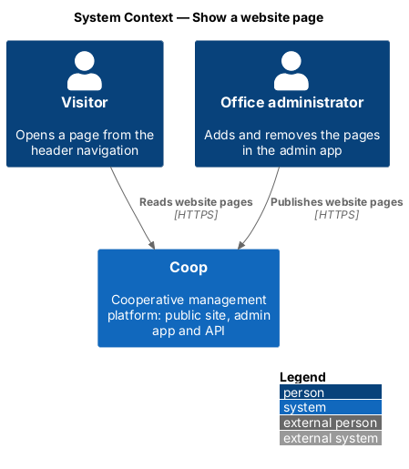
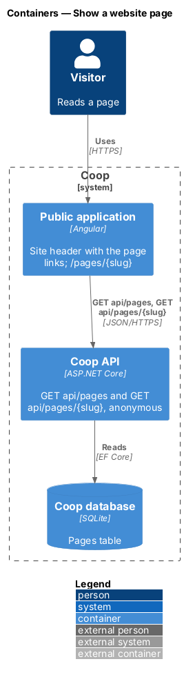
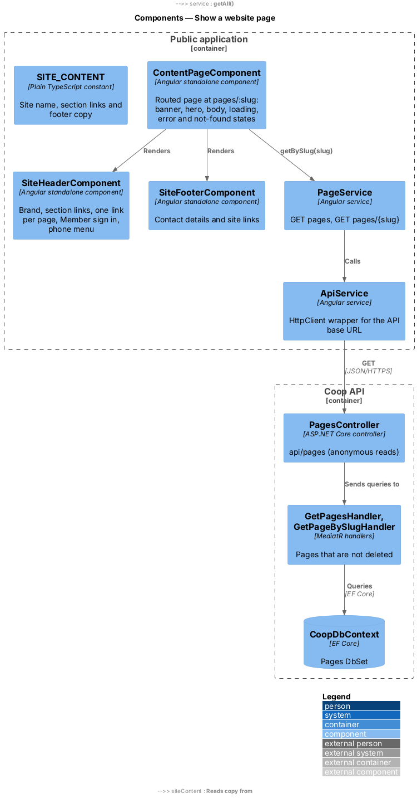
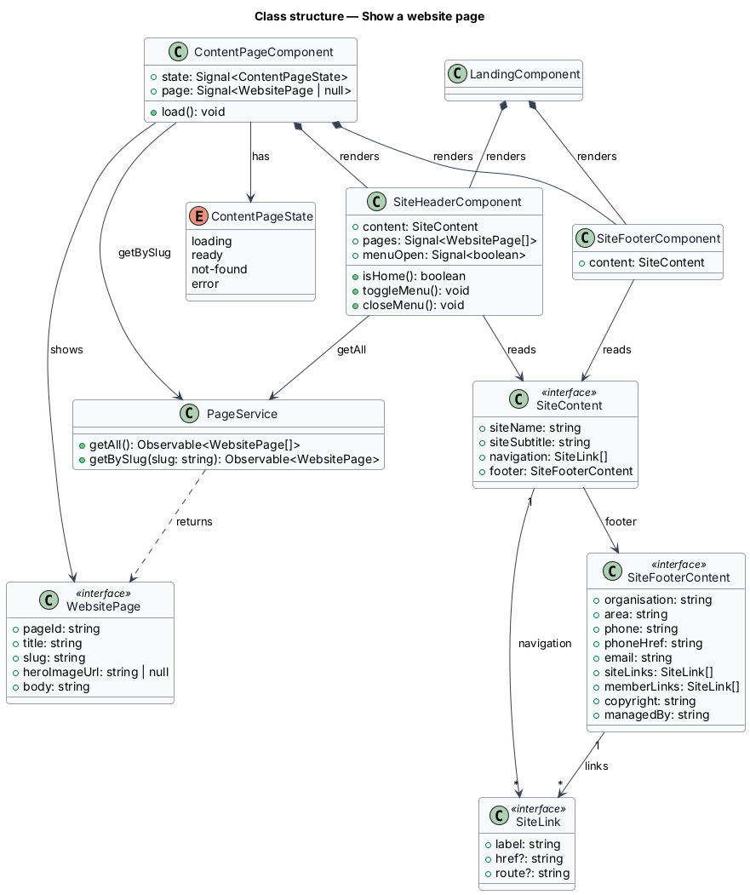
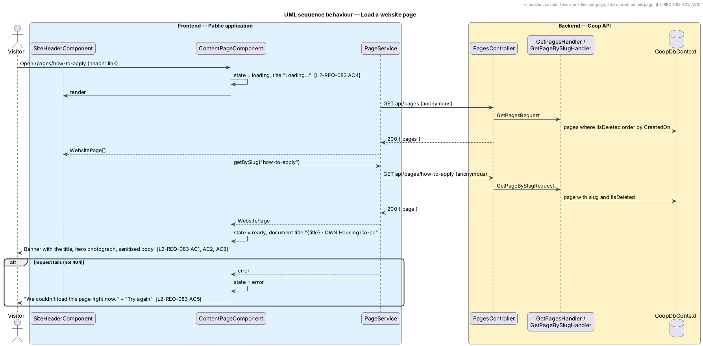
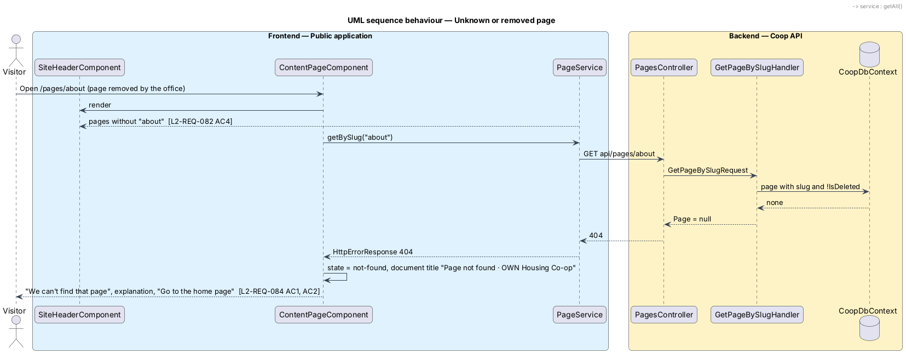

# Show a website page

## Overview

A website page is a content page of the public site (About us, How to apply,
and so on) that the office adds from the admin application (see
`../../admin-app/manage-pages/`). The public application renders each page at
`/pages/{slug}` inside the same header and footer as the home page, drawn in
`docs/mocks/pages/public-page/` (states `default`, `loading`, `error` and
`not-found`). The page is read without signing in.

The feature belongs to the public-app subsystem of Coop. Pages are read-only
in the public application; it reads them through the anonymous `api/pages`
endpoints and never writes.

Terms used in this design:

- **website page** — page with a title, an optional hero photograph address
  and an HTML body, served by `GET api/pages/{slug}`
- **slug** — URL segment derived from the title on the server, for example
  `how-to-apply`
- **site header** — sticky header shared by the home page and every website
  page: Co-op mark and name, navigation, "Member sign in" and the phone menu
- **site footer** — footer shared by the same pages
- **not-found experience** — page shown inside the site layout when no page
  matches the slug, instead of a redirect

## Description

The site header and footer move out of the home page into two standalone
components in `frontend/projects/public/src/app/layout/`:
`SiteHeaderComponent` (`site-header/site-header.component.ts`, `.html`,
`.scss`) and `SiteFooterComponent` (`site-footer/`). `LandingComponent` and
`ContentPageComponent` both render them. `SITE_CONTENT`
(`layout/site-content.ts`, typed by `SiteContent` in
`site-content-shape.ts`) holds the copy that was previously in
`LANDING_CONTENT`: site name and subtitle, the home page section links
(`SiteLink`, `site-link.ts`) and the footer (`SiteFooterContent`,
`site-footer-content.ts`). Section links are absolute (`/#about`), so they
work from a website page as well as from the home page. The `--own-*` design
tokens and the base rules shared by these components live in the SCSS mixins
of `layout/own-foundation.scss`, which each component's stylesheet includes.

`SiteHeaderComponent` loads the pages with `PageService.getAll()` on
initialisation and appends one link per page after the section links, in both
the horizontal navigation and the phone menu. A failed request leaves the
section links alone. The Home link carries `aria-current="page"` when the
router URL is `/`; a page link carries it through `routerLinkActive` with
`ariaCurrentWhenActive`. The phone menu keeps the behaviour of the home page
design: `menuOpen`, "Menu"/"Close", `aria-expanded`, Escape, and focus back on
the button.

`ContentPageComponent` (`pages/content-page/content-page.component.ts`,
`.html`, `.scss`) is the routed page at `pages/:slug`. It reads the slug from
the route, calls `PageService.getBySlug(slug)` and keeps a `state` signal of
type `ContentPageState` (`content-page-state.ts`: `loading`, `ready`,
`not-found`, `error`) beside the loaded `page`:

- `ready` renders the title banner (`own-page-banner`, the only `h1`), the
  hero photograph when `heroImageUrl` is set, and the body in an
  `own-prose` reading column bound with `[innerHTML]`. Angular's sanitiser
  removes script elements and event-handler attributes before rendering.
- `loading` renders a "Loading…" status line in the same column.
- `error` (any failure other than 404) renders "We couldn't load this page
  right now." with a "Try again" button that calls `load()` again.
- `not-found` (404) renders "We can't find that page", the explanation and a
  "Go to the home page" link.

The component sets the document title to "{title} · OWN Housing Co-op" or
"Page not found · OWN Housing Co-op" through Angular's `Title` service.
Re-navigating between pages re-runs `load()` because the component subscribes
to the route parameters.

`PageService` (`core/services/page.service.ts`) wraps `ApiService` for
`GET pages` and `GET pages/{slug}`; `WebsitePage`
(`core/models/website-page.ts`) is the response type.

Acceptance coverage is the Playwright `public` project:
`e2e/tests/public/content-page.spec.ts` and the header cases in
`e2e/tests/public/landing.spec.ts` state intent;
`e2e/pages/public/content-page.page.ts` and `landing.page.ts` own the
selectors. The in-process mock API seeds one page, "How to apply", and
answers 404 for an unknown or removed slug.

## Requirements

| L2 ID | Refines (L1) | Requirement |
|-------|--------------|-------------|
| `L2-REQ-066` | `L1-REQ-015` | The public app header at desktop breakpoints shall display the Co-op mark, site name, horizontal navigation links to CMS pages, and a "Member sign in" button. |
| `L2-REQ-067` | `L1-REQ-015` | The public app header below LG (1024) shall collapse navigation into a labelled "Menu" button. |
| `L2-REQ-082` | `L1-REQ-015` | The public app header shall list, after the home page section links, one link per website page the office has added (L2-REQ-080), on every page that shows the header. |
| `L2-REQ-072` | `L1-REQ-017` | A generic CMS content page at XL (1440) shall have the header, an optional page hero/banner, a title, and a rendered HTML body. |
| `L2-REQ-073` | `L1-REQ-017` | CMS content pages shall adapt responsively. |
| `L2-REQ-083` | `L1-REQ-017` | The public app shall render a website page at `/pages/{slug}` with the shared header and footer, a title banner, the optional hero photograph and the page text. |
| `L2-REQ-084` | `L1-REQ-017` | When no page matches the slug, the public app shall show a not-found experience inside the site layout instead of redirecting. |

## Diagrams

The system context places the visitor who reads a page beside the office
administrator who publishes it.

The container view shows the public Angular application reading the two
anonymous page endpoints of the Coop API, which reads the SQLite database
through EF Core.

Inside the public application, the content page and the shared header both
use `PageService`; on the API side, `PagesController` sends the two queries
to their handlers.

The class diagram shows the content page with its state, the shared header
and footer with the site content, and the service and response type.

Loading a page shows the header and the loading line, fetches the page and
the navigation in parallel, then renders the banner, photograph and body.

When the slug matches no page, the API answers 404 and the page shows the
not-found experience with the header navigation already free of the page.

