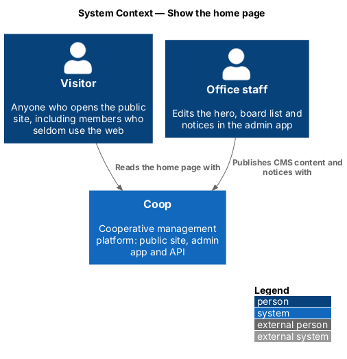
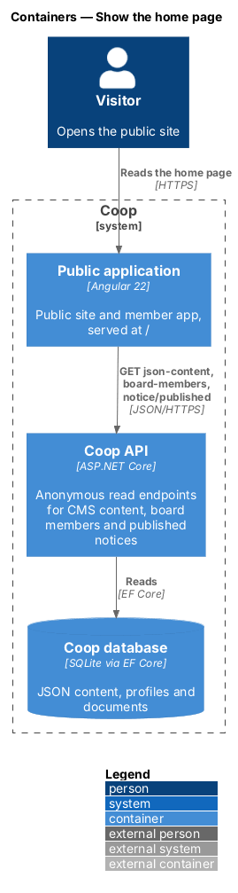
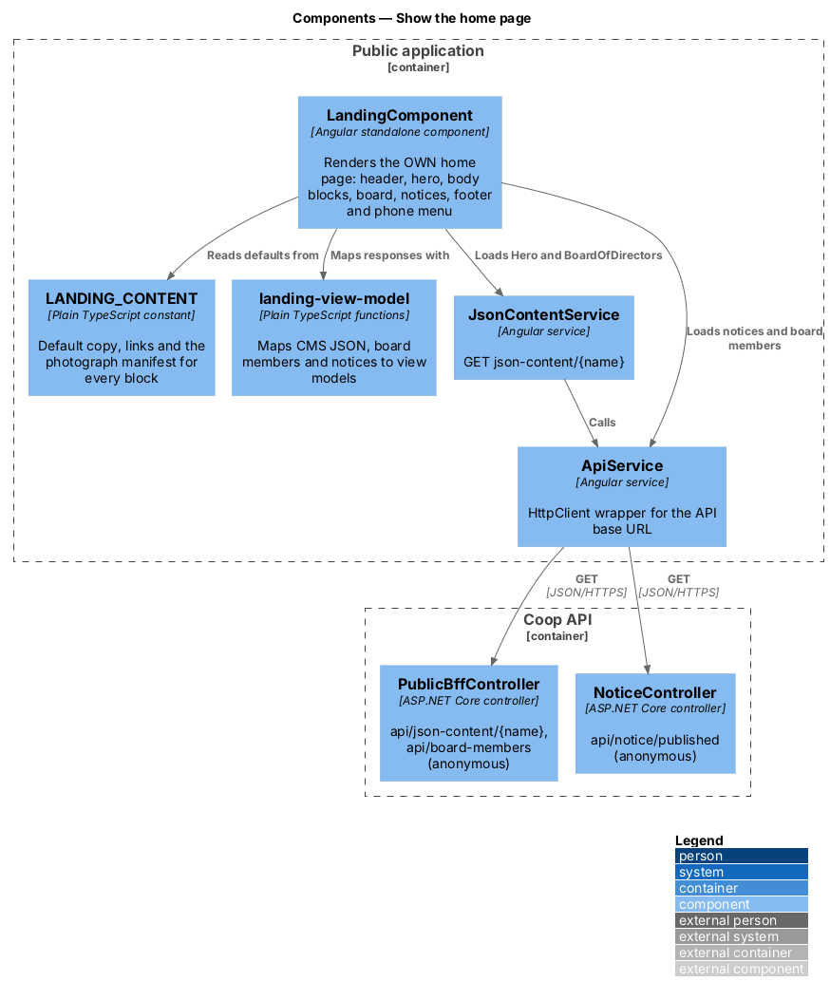
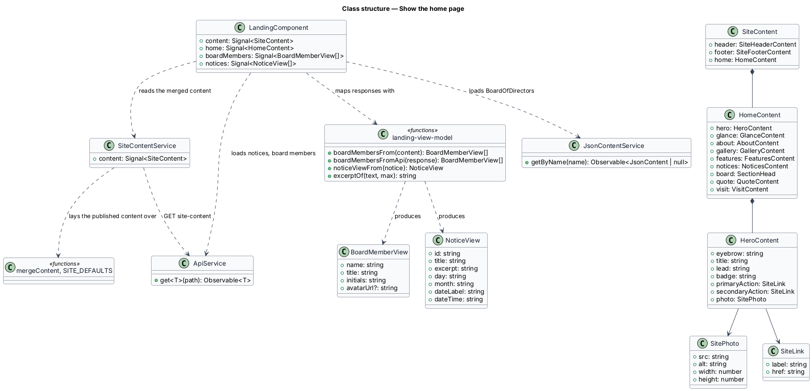
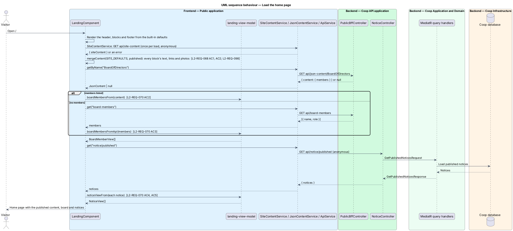
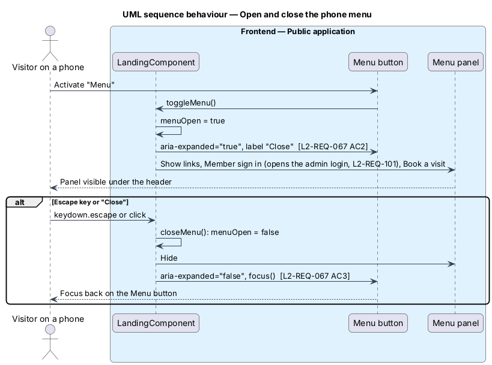

# Show the home page

## Overview

The home page is the first screen a visitor sees at `/` in the public
application. It presents Oakridge Women's Neighbourhood Housing Co-operative (OWN) to
prospective members, their families and current members in the warm,
photo-led design drawn in `docs/mocks/pages/public-landing/` (states `default`
and `menu`). The page is read without signing in.

The page belongs to the public-app subsystem of Coop. Office staff edit its
content in the admin application; the page reads that content through the
anonymous endpoints of the Coop API and never writes.

Terms used in this design:

- **block** — one horizontal section of the home page with its own heading,
  for example "At a glance" or "Meet the board"
- **CMS-driven block** — block whose text comes from a `JsonContent` record or
  from published documents, so the office changes it without a deployment
- **default copy** — text, links and photographs compiled into the page that
  show when the API returns nothing for a block
- **notice** — published `Notice` document that the office writes once and
  the home page lists under "What's on"
- **phone menu** — full-width panel under the header that replaces the
  horizontal navigation below 1024 px

Every block is CMS-driven. The text, links and photographs of the header,
footer and every home page block come from the site content the office edits
on the admin Website screen (`../../admin-app/manage-site-content/`,
`L2-REQ-094`). The board list comes from the `BoardOfDirectors` JSON content,
which the office keeps from the admin Board screen in
`../../admin-app/manage-board/`, falling back to the board member profiles,
and the notices are published notices.

## Description

The feature lives in `frontend/projects/public/src/app/pages/landing/`.

`LandingComponent` (`landing.component.ts`, `landing.component.html`,
`landing.component.scss`) is the routed, standalone page component. It renders
the shared `SiteHeaderComponent` and `SiteFooterComponent` from
`frontend/projects/public/src/app/layout/` (see
`../show-content-page/`) around the hero, body blocks, board and notices.
The header owns the phone menu and its `menuOpen` signal. Its stylesheet carries the OWN foundation from the
mock (`docs/mocks/assets/own-site.css`): the `--own-*` tokens for colour,
type, space, radius and motion, and the `own-*` block classes. The classes and
accessible state attributes match the mock so the Playwright page object and
the design reference describe the same DOM. The product shows the light
theme only; the dark tokens in the mock are not implemented.

`LandingComponent` reads the merged site content from `SiteContentService`
(`core/services/site-content.service.ts`), which requests `api/site-content`
once per load and lays it over `SITE_DEFAULTS`
(`core/site-content/site-defaults.ts`) value by value with `mergeContent`.
The content types each have their own file in `core/site-content/`
(`SiteContent`, `HomeContent`, `HeroContent`, `SitePhoto`, `SiteLink` and
one per block). Empty optional texts and empty lists leave their element or
block out; value-card colours follow position and feature rows alternate the
photograph's side. A photograph that fails to load is replaced with
`own/photo-unavailable.svg` by `showPhotoUnavailable`. `BoardMemberView`
(`board-member-view.ts`) and `NoticeView` (`notice-view.ts`) stay beside the
page.

`landing-view-model.ts` holds the pure functions that turn API responses into
view models, so the rules stay out of the template:

- `boardMembersFrom(content)` reads `members` from the `BoardOfDirectors`
  JSON content, accepting `name`, `title`, `role`, `avatarUrl` and `photoUrl` in
  either casing, and derives two-letter initials for members without a photograph.
- `boardMembersFromApi(response)` reads the `api/board-members` array or the
  `boardMembers` property of `api/boardmembers`.
- `noticeViewFrom(notice)` maps a published notice (`name` or `title`,
  `body` or `content`, `createdOn` or `createdAt`) to a `NoticeView` with the
  day and month for the date badge, the full date in `en-CA` and an excerpt.
- `excerptOf(text, max)` strips HTML tags and cuts at a word boundary,
  appending an ellipsis.

Data access reuses the existing services. `JsonContentService.getByName`
calls `GET api/json-content/{name}` on `PublicBffController` (anonymous) and
falls back to `GET api/jsoncontent/name/{name}`. `ApiService.get` calls
`GET api/notice/published` on `NoticeController` and `GET api/board-members`
on `PublicBffController`, with `GET api/boardmembers` as the fallback the
Playwright mock serves. `SiteContentService` calls `GET api/site-content` on `SiteContentController`.
Every request failure resolves to the default copy;
the page never shows an error banner (`docs/mocks/manifest.json` records this
choice for the landing page).

Behaviour of the phone menu (in `SiteHeaderComponent`): `toggleMenu()`
flips `menuOpen`; the button shows "Menu" or "Close", sets `aria-expanded`
and `aria-controls="menu"`; `closeMenu()` hides the panel and returns focus
to the button. The Escape key on the page closes an open menu. The panel is
hidden with the `hidden` attribute, as in the mock, and CSS hides the button
and panel at 1024 px and wider. The navigation lists the home page section
links followed by one link per website page (L2-REQ-082).

Acceptance coverage is the Playwright `public` project:
`e2e/tests/public/landing.spec.ts` states intent and
`e2e/pages/public/landing.page.ts` owns the selectors. The in-process mock
API in `e2e/fixtures/mock-api/` seeds the `SiteContent` and
`BoardOfDirectors` content and one published notice; tests that need an empty notices block
clear `mockApi.store.documents` before navigating.

Items marked `<TO SUPPLY>`: the Co-op's own photographs for the hero,
gallery, feature rows, board and quotation. The seeded content ships the
mock's illustrations until the office chooses its photographs on the Website
screen.

## Requirements

| L2 ID | Refines (L1) | Requirement |
|-------|--------------|-------------|
| `L2-REQ-053` | `L1-REQ-013` | The system shall provide a public-facing web app whose content and presentation are driven by CMS-managed data. |
| `L2-REQ-066` | `L1-REQ-015` | The public app header at desktop breakpoints shall display the Co-op mark, site name, horizontal navigation links to CMS pages, and a "Member sign in" button. |
| `L2-REQ-067` | `L1-REQ-015` | The public app header below LG (1024) shall collapse navigation into a labelled "Menu" button. |
| `L2-REQ-068` | `L1-REQ-016` | The home page shall open with a CMS-driven hero at XL (1440): an eyebrow line, a large title, a lead paragraph, two calls to action and a hero photograph with a badge. |
| `L2-REQ-069` | `L1-REQ-016` | The hero shall reflow to one column below LG (1024). |
| `L2-REQ-070` | `L1-REQ-016` | Below the hero, the home page shall show the body blocks of the OWN design in this order: at a glance, who we are, a look around, our building and our community, what's on, meet the board, a word from a member, and visit or apply. |
| `L2-REQ-071` | `L1-REQ-016` | The home page body blocks shall adapt responsively without horizontal scrolling. |
| `L2-REQ-078` | `L1-REQ-019` | The public app footer at desktop breakpoints shall display contact information, quick links, and a copyright notice in a multi-column layout. |
| `L2-REQ-079` | `L1-REQ-019` | The footer shall adapt responsively at mobile breakpoints. |

## Diagrams

The system context places the home page between two people: the visitor who
reads it and the office staff who publish what it shows.

The container view shows the public Angular application reading three
anonymous endpoints of the Coop API, which reads the SQLite database through
EF Core.

Inside the public application, `LandingComponent` composes the default copy,
the view-model functions and the two existing services; the API side is the
public BFF controller and the notice controller.

The class diagram shows the page component, the content constant with its
typed blocks, the two API-derived view models and the mapping functions.

Loading the page renders the defaults first, then overlays the site content,
board and notices as each anonymous request returns; a failed request leaves
the defaults in place.

On a phone the menu button opens the panel, and Escape or "Close" hides it
and returns focus to the button.

