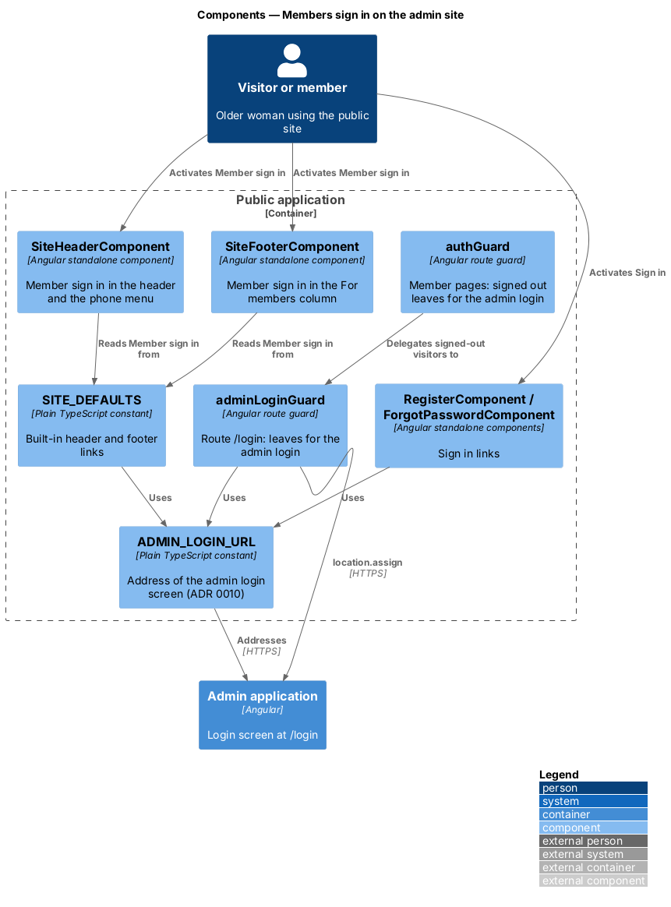
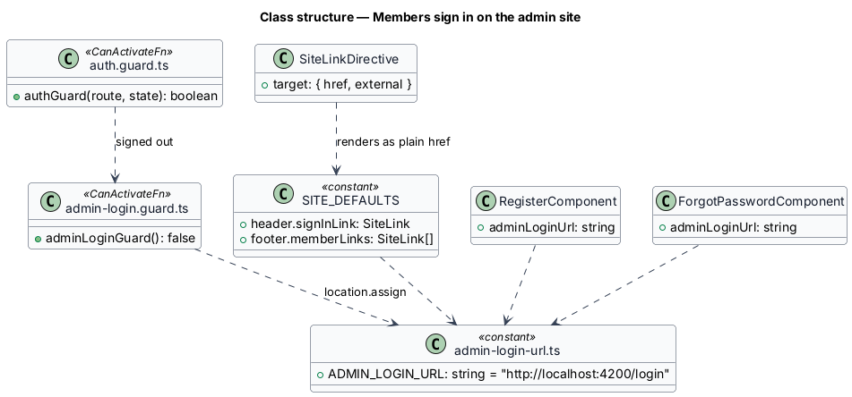
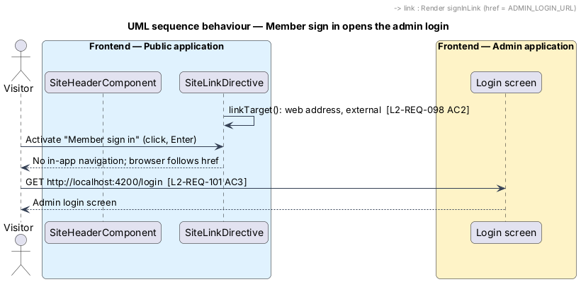
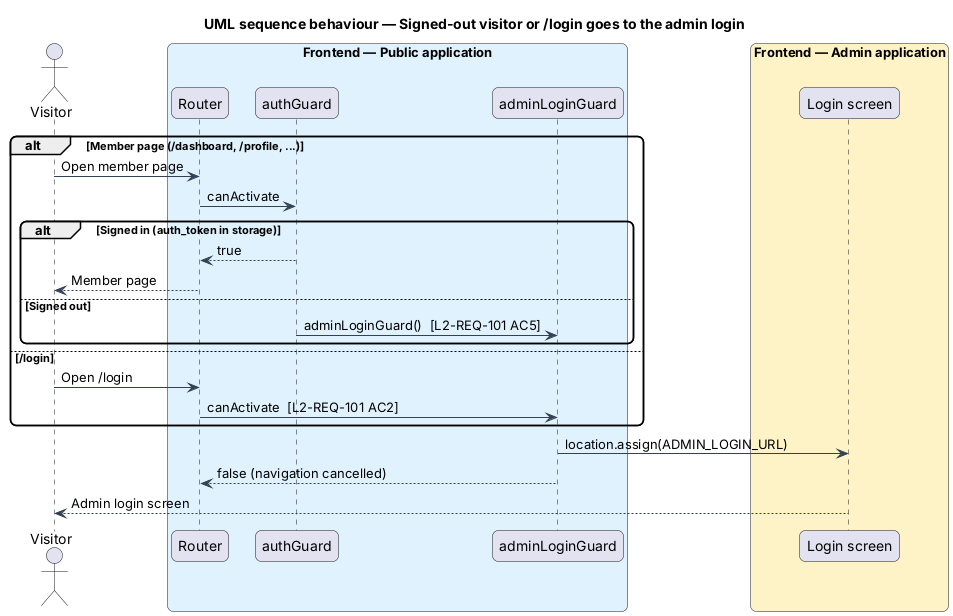

# Members sign in on the admin site

## Overview

The public site has no login screen of its own. Members sign in on the admin
site's login screen (`docs/mocks/pages/admin-login/`), and every sign-in link
and sign-in redirect on the public site takes the visitor there. The public
mocks draw the links unchanged; only their target is the admin login
(`docs/mocks/pages/public-landing/` and `public-page/`; the
`public-register/` and `public-forgot-password/` mocks were removed on 21
October 2026 with those screens).

The feature belongs to the public-app subsystem of Coop. It changes no
backend endpoint and no admin screen.

Terms used in this design:

- **admin login** — the login screen of the admin application, the `login`
  route of `frontend/projects/admin/src/app/app.routes.ts`, served at
  `http://localhost:4200/login` in development and
  `https://app.esplanade.technology/login` when deployed
- **admin login address** — `ADMIN_LOGIN_URL`, the one place in the public
  app that holds that address (ADR 0011)
- **sign-in link** — "Member sign in" in the header, the phone menu and the
  footer's "For members" column, and "Sign in" on the register and
  forgot-password screens
- **member page** — a public route behind `authGuard`: dashboard,
  maintenance, messaging, profile and onboarding

## Description

**Where the address lives.** `ADMIN_LOGIN_URL`
(`frontend/projects/public/src/app/core/services/admin-login-url.ts`) holds
`http://localhost:4200/login` in development and
`https://app.esplanade.technology/login` when deployed, beside `api.service.ts`, whose API base URL
is held the same way. No other file spells the address (ADR 0011).

**Header, menu and footer.** `SITE_DEFAULTS`
(`core/site-content/site-defaults.ts`) uses `ADMIN_LOGIN_URL` for
`header.signInLink` and for the first of `footer.memberLinks`.
`SiteHeaderComponent` and `SiteFooterComponent` render them as before,
through `[href]` and `SiteLinkDirective`. `linkTarget()` treats an
`http://` address as a web address, so the directive does not route it in
the app: the browser follows the `href` in the same tab and the link
carries `rel="noopener noreferrer"` (L2-REQ-098 AC2). The classes
`own-btn own-btn--secondary own-header__signin` and
`own-btn--block`, the labels, the 48 px size and the focus ring are
unchanged. Published site content wins over the defaults; content that still
says `/login` (the API seed does) reaches the admin login through the
`/login` redirect below.

**Register and forgot-password.** `RegisterComponent` and
`ForgotPasswordComponent` expose `adminLoginUrl = ADMIN_LOGIN_URL` and bind
it to the `href` of their "Sign in" and "Back to Sign In" links, in place of
`routerLink="/login"`. Labels and styles are unchanged.

**The `/login` redirect.** The `login` route of `app.routes.ts` no longer
loads a component. It has `canActivate: [adminLoginGuard]` and no children.
`adminLoginGuard` (`core/guards/admin-login.guard.ts`) calls
`DOCUMENT.location.assign(ADMIN_LOGIN_URL)` and returns `false`, so the
router cancels the in-app navigation while the browser leaves for the admin
login. `pages/login/` is removed.

**The auth guard.** `authGuard` returns `true` for a signed-in member, as
before. For a signed-out visitor it returns `adminLoginGuard(route, state)`,
so member pages send her to the admin login. `AuthService.logout()` still
navigates to `/login`, which now ends on the admin login.

**Dead code.** `AuthService.login()` was used only by the removed login
page and is removed. `AuthService` keeps reading `auth_token`,
`auth_user_id` and `auth_username` from local storage, so a member who has
those values is signed in.

**Tests.** Acceptance coverage is the Playwright `public` project, which
also serves the admin app at `http://localhost:4200`, so a test can follow a
sign-in link to the real admin login screen without a backend.
`e2e/tests/public/landing.spec.ts` covers the header and menu links and the
footer link, `auth.spec.ts` the register and forgot-password links, `/login`
and the member-page redirects, and `profile.spec.ts` Log Out. The public page objects
(`landing.page.ts`, `register.page.ts`, `forgot-password.page.ts`,
`profile.page.ts`) own the selectors; the admin `login.page.ts` owns the
admin login address and checks that the admin login screen is open. Member-page tests start signed in through the `authenticatedPage`
fixture, which seeds the three storage values. The mock site-content seed
(`e2e/fixtures/mock-api/site-content-seed.ts`) publishes the admin login
address for the sign-in links.

## Deferred

- Per-environment configuration of the admin login address (ADR 0011).
- Changing the API seed's sign-in links from `/login`; the redirect covers
  them.

Since 21 October 2026 the public site has no member pages, register or
forgot-password screens: members sign in and stay on the admin site, and
those public addresses open the admin login (L2-REQ-110, L2-REQ-111, ADR
0016, `docs/detailed-designs/admin-app/member-areas-by-role/`). The parts of
this design about the register, forgot-password and member pages and the
`authGuard` describe the state before that change.

## Requirements

| L2 ID | Refines (L1) | Requirement |
|-------|--------------|-------------|
| `L2-REQ-101` | `L1-REQ-018` | The public app shall have no login screen of its own. Every sign-in link and sign-in redirect on the public site shall open the admin site's login screen, configured in one place in the public app. |
| `L2-REQ-066` | `L1-REQ-015` | The public app header at desktop breakpoints shall display the Co-op mark, site name, horizontal navigation links to CMS pages, and a "Member sign in" button that opens the admin site's login screen. |
| `L2-REQ-067` | `L1-REQ-015` | The public app header below LG (1024) shall collapse navigation into a labelled "Menu" button; its panel holds a "Member sign in" button that opens the admin site's login screen. |
| `L2-REQ-077` | `L1-REQ-018` | The public app shall include a member registration screen with invitation token validation; its "Sign in" link opens the admin site's login screen. |
| `L2-REQ-078` | `L1-REQ-019` | The public app footer at desktop breakpoints shall display contact information, quick links, and a copyright notice in a multi-column layout; its "For members" sign-in link opens the admin site's login screen. |
| `L2-REQ-076` | `L1-REQ-018` | Retired: the public app no longer has a login screen. Replaced by `L2-REQ-101`. |

## Diagrams

Inside the public application, every sign-in link and both guards read the
one admin login address; the links and the `/login` guard lead to the admin
application's login screen.

The class diagram shows the constant, the two guards and the places that
read the address.

Activating "Member sign in" follows a plain link: the site-link directive
leaves the click to the browser, which opens the admin login.

Opening `/login`, or a member page while signed out, runs `adminLoginGuard`,
which sends the browser to the admin login and cancels the in-app
navigation.

